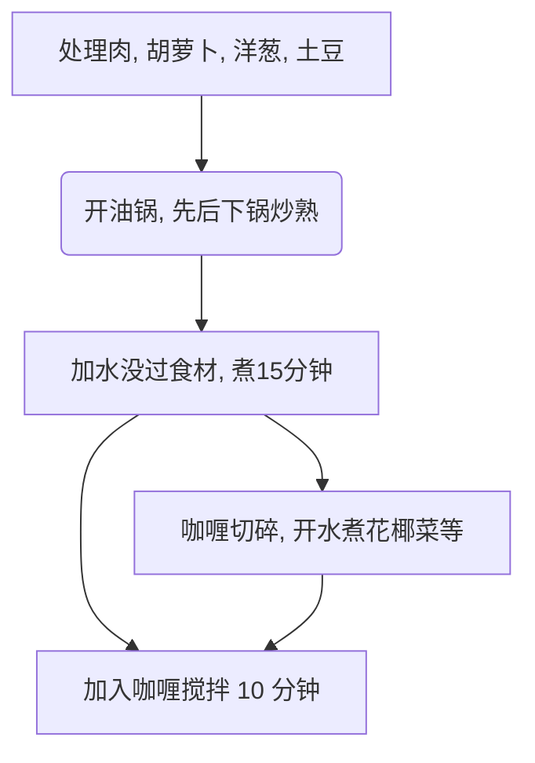
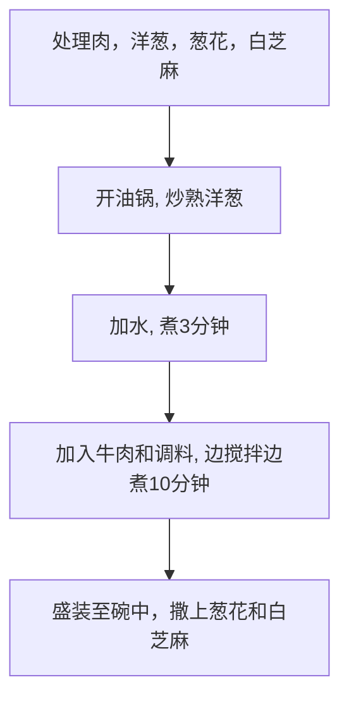

# 程序员做饭指南 · 主食（59 道）

> 本文件由 scripts/merge_library.py 自动生成；菜谱原文来自
> Anduin2017/HowToCook，内容一字未改（仅去除 HTML 编辑注释）。
> 单菜提取命令见 SKILL.md 第 3 步。

<!-- dish:意式肉酱面 -->
# 意式肉酱面的做法


意式肉酱面是一道简单快手的家常西餐，酱汁浓郁、面条筋道，适合忙碌的日常。肉末和洋葱搭配成品意面酱，能快速补充蛋白质与碳水化合物，洋葱还含有膳食纤维。做法对初学者十分友好，全程只需简单切炒，熟练后 15 分钟就能端上桌，比方便面更满足。

预估烹饪难度：★

预估卡路里：1199 大卡

## 必备原料和工具

- 意大利面
- 意大利面酱
- 肉沫
- 白洋葱（紫洋葱也可以）

## 计算

每次制作前需要确定计划做几份。一份正好够 2 个人吃。

每份：

- 意大利面 180 克（可以根据食量上下浮动）
- 肉沫 80 克（可以根据食量上下浮动）
- 洋葱大半个 （大约 150 克，通常是肉的两倍重）
- 意大利面酱 300 克（可以看情况上下浮动）
- 食用油 10-15ml

## 操作

1. 锅中加水，烧开后放入意面（等待 6 - 12 分钟）
2. 在烧水的时候可以进行下面这些步骤，但请注意煮面的时间
3. 洋葱切成小丁
4. 空锅中倒油，中火下入洋葱碎
5. 时刻搅拌，注意不要让洋葱烧糊，直到洋葱变成半透明状
6. 下入肉沫，继续搅拌（搅散），直到肉末变成棕色
7. 加入意大利面酱，稍微搅拌一下即可
8. 把煮好的意大利面沥干水分并倒入肉酱中搅拌均匀即可（或者直接把做好的肉酱倒在意面上也行）

## 附加内容

- 意大利面分为很多不同的粗细，煮面条之前请注意意面盒子上标注的时间
- 意大利面酱并不是番茄酱，平常用的番茄酱准确是叫番茄沙司，而意大利面酱虽然和番茄沙司都是调味过的番茄酱，但加的调味料不同


如果您遵循本指南的制作流程而发现有问题或可以改进的流程，请提出 Issue 或 Pull request 。
<!-- /dish -->

<!-- dish:煮泡面加蛋 -->
# 煮泡面加蛋的做法

煮泡面加蛋是一道便捷的快手主食，口感顺滑，汤味浓郁，适合随时填饱肚子。主要提供碳水化合物和蛋白质，能快速补充能量。做法极其简单，只需烧水、煮面、打入鸡蛋煮熟，新手也能轻松掌握，全程大约 10 分钟即可完成。

预估烹饪难度：★

预估卡路里：550 大卡

## 必备原料和工具

- 泡面
- 鸡蛋
- 水

## 计算

- 单人，能支撑一个成年人不饥饿状态约 3 至 4 小时。

每份：

- 泡面 1 包
- 水 550ml-1000ml，根据锅的情况。以能完整将泡面浸入其中为准。
- 鸡蛋 1 个

## 操作

1. 先将水加热至沸腾（火候不做严格要求，使用热水会更快）
2. 将取出的面饼放入锅中
3. 将泡面里附带的佐料放入锅中
4. 取出筷子轻微拨动泡面，使佐料充分溶解，面饼充分浸泡受热
5. 盖上锅盖等待约 1 分钟至锅内水再次沸腾
6. 去壳鸡蛋，加入锅中
7. 等待约 3 至 4 分钟，即可

## 附加内容

- 本指南中的鸡蛋包括但不仅限于：生鸡蛋，熟鸡蛋，卤蛋等
- 原材料泡面可在楼下便利店购买
- 可根据个人需要加入佐料，和其他食材包括但不仅限于：火腿肠，生菜，小肉丝，辣条，鱼干，虾仁，鸡腿

如果您遵循本指南的制作流程而发现有问题或可以改进的流程，请提出 Issue 或 Pull request 。
<!-- /dish -->

<!-- dish:猪油拌饭 -->
# 猪油拌饭的做法

这是一道充满南方家常气息的简单拌饭，米粒被融化的猪油包裹，透着酱油的咸鲜和葱花的清香，是许多孩子食欲不振时的安心之选。主要提供快速碳水与脂肪能量，但胆固醇较高，不宜常吃。制作毫无门槛，哪怕完全不会做饭也能轻松完成，煮好的米饭只要几分钟就能拌出一碗香喷喷的主食。

预估烹饪难度：★

预估卡路里：420 大卡

## 必备原料和工具

- 米饭（推荐用粳米）
- 猪油
- 生抽（推荐用李锦记或海天）
- 老抽
- 蚝油（可选）
- 葱花（可选）
- 猪油渣（可选）

## 计算

每次制作前需要确定计划做几份。一份够 1 个人吃。

每份：

- 米饭 200 g
- 猪油 15 g（添加蚝油时，减少到 10 g）
- 生抽 5 ml（添加蚝油时，减少到 3 ml）
- 老抽 2 ml
- 蚝油 8 g
- 葱花 0-12 g（初始建议 5 g）
- 猪油渣 5 g

## 操作

1. 碗底铺猪油
2. 加入米饭
3. 淋上酱油与蚝油
4. 撒上葱花和猪油渣
5. 搅拌均匀

## 附加内容

- 建议搭配瘦肉和蔬菜食用来均衡营养
- 高胆固醇，不建议经常食用
- 参考资料：[猪油拌饭 - 维基百科，自由的百科全书](https://zh.wikipedia.org/wiki/%E8%B1%AC%E6%B2%B9%E6%8B%8C%E9%A3%AF)

如果您遵循本指南的制作流程而发现有问题或可以改进的流程，请提出 Issue 或 Pull request 。
<!-- /dish -->

<!-- dish:电饭煲蒸米饭 -->
# 电饭煲蒸米饭的做法

一道家喻户晓的基础主食，米香纯粹、口感软糯，因水量调节可偏硬或偏润。富含碳水化合物，能快速补充能量，适合搭配各类菜肴。操作极其简单，新手也能轻松上手，从洗米到焖好大约需要四十分钟。

预估烹饪难度：★

预估卡路里：442 大卡

## 必备原料和工具

* 电饭煲
* 江南米或北方大米
* 水

## 计算

* 一般一个人可以食用 100ml-200ml 的米。

指尖量水法 （用于精准确定米水量的方法）

* 江南米，米和水放在电饭煲的容器内，食指触及米时，水量能刚好没过食指的第一个指节又第二个指节 1/4 处（即大约 2.6 厘米）。
* 北方大米，米和水放在电饭煲的容器内，食指触及米，水量能刚好没过食指的第一个指节（即大约 2 厘米处）。

使用上述条件，计算出计划使用的原材料比例。

## 操作

1. 清洗米
2. 将米和水一起加入电饭煲中。
3. 连接电饭煲电源，进入加热模式。等待大约 30 分钟。
4. 待电饭煲自动进入保温模式后。
5. 将米在电饭煲中闷 10-15 分钟。
6. 盛出米。

## 附加内容

- 技术总结
  - 不论什么容器，水的量都是可以使用“指尖量水法”煮出好米饭。
  - 水的多少是能够严重影响一碗好米饭的口感。
  - 南方一般食用江南米，北方一般食用北方大米，江南米会比较细长，而北方大米会比较短且圆。
  - 米饭不同品种的米，不同的水量会极度影响口感。
- 更多信息请参考使用的电饭煲的说明书。

如果您遵循本指南的制作流程而发现有问题或可以改进的流程，请提出 Issue 或 Pull request 。
<!-- /dish -->

<!-- dish:老干妈拌面 -->
# 老干妈拌面的做法

一道香辣开胃的家常快手面食，面条筋道裹满老干妈的豆豉辣香，酱油提鲜，简单却滋味十足。作为主食能快速补充碳水化合物和能量，辣椒素还有助促进食欲。制作毫无门槛，新手也能轻松驾驭，从烧水到出锅只需大约十 分钟。

预估烹饪难度：★

预估卡路里：502 大卡

## 必备原料和工具

* 面
* 老干妈
* 酱油

## 计算

每次制作前需要确定计划做几份。一份正好够 1 个人食用

总量：

* 水 1 升
* 面量 120 克 * 份数
* 老干妈 15ml * 份数
* 酱油 5ml * 份数

## 操作

1. 将水倒入锅中并煮沸
2. 将面均匀放入锅中
3. 在煮的过程注意搅拌，避免面粘成一坨
4. 当用筷子挑起一根面且该面能自然地从筷子上滑落时再等 30 秒关火
5. 将面夹入碗中
6. 按照上面的计量放入老干妈和酱油
7. 用筷子将碗里的面、老干妈、酱油拌均匀
8. 吃

## 附加内容

如果您遵循本指南的制作流程而发现有问题或可以改进的流程，请提出 Issue 或 Pull request 。
<!-- /dish -->

<!-- dish:螺蛳粉 -->
# 螺蛳粉的做法

螺蛳粉是广西柳州的特色小吃，汤鲜味浓，酸辣爽口，米粉软滑筋道。口味上融合了螺蛳汤的鲜美、酸笋的独特发酵风味和辣椒油的刺激，层次分明。作为主食，米粉提供充足碳水化合物，螺蛳肉包和配料带来一定蛋白质，酸笋则有助于开胃促消化。这道菜所需操作简单，只需按顺序煮熟米粉和调味即可，对新手非常友好。从烧水到出锅，最快约十分钟就能端上餐桌，适合快手解决一餐。

预估烹饪难度：★

预估卡路里：1109 大卡

## 必备原料和工具

> 出于家常菜考虑，从螺蛳，酸笋等工序开始制作螺蛳粉并不现实，因此本食谱基于袋装螺蛳粉实现。

### 原料

- 袋装螺蛳粉一包，其中应该包含：
  - 米粉
  - 螺蛳肉包（可能放在配料包中）
  - 汤料包
  - 酸笋包、花生包、豆皮包、木耳包等配料包
  - 醋包、辣椒油等调味包

### 工具

- 煮锅

- 电磁炉/灶台

- 筷子一双

## 计算

- 根据个人经验，一包袋装螺蛳粉足够一人一餐食（虽然看着很大包）
- 水 1L

## 操作

1. 锅中加水，将水烧开
2. 下米粉，煮 3-5 分钟，期间用筷子搅拌，防止米粉粘在一起
3. 下汤料包，按个人口味添加
4. 下一部分配料包，如木耳，花生，螺蛳（这部分配料需要煮一会才入味）
5. 下调味包，按个人口味添加
6. 搅拌后捞出，放入碗中
7. 下剩下的配料包，如酸笋，豆皮（这部分配料不适合被汤泡太久）
8. 享用美食

## 附加内容

- 如果想要更有嚼劲的粉，可以缩短第二步煮粉的时间
- 如果想在螺蛳粉中添加炸蛋，请参考炸蛋的教程
- 配料的选择请依照个人口味

如果您遵循本指南的制作流程而发现有问题或可以改进的流程，请提出 Issue 或 Pull request 。
<!-- /dish -->

<!-- dish:麻油拌面 -->
# 麻油拌面的做法

麻油香气浓郁，搭配老抽与胡椒粉简单调味，咸香适口，是一道省时省钱的家常拌面。面条提供充足碳水化合物，麻油含有不饱和脂肪酸与维生素 E，能为身体补充能量。制作毫无难度，厨房新手也能轻松上手，从煮水到拌好只需大约十分钟。

预估烹饪难度：★

预估卡路里：451 大卡

## 必备原料和工具

* 风干快熟面/任何牌子的快熟面（不需要调味料）
* 麻油
* 胡椒粉
* 老抽
* 盐

## 计算

每份：

* 水 1 升
* 快熟面 1 块
* 麻油 15ml
* 老抽 10 克
* 盐 30 克（可选，这 30g 盐不会被全部食用）
* 胡椒粉 10 克
* 生抽 5 克（可选）

## 操作

1. 将水倒入锅中并煮沸 （喜欢吃 q 弹面的同学，可在水里加入 30 克盐，用盐水煮出来的面会比较 q 弹）
2. 将快熟面放入锅中 3 分钟（也可参考当下品牌快熟面的烹饪时间）
3. 当面开始散了可以开始搅拌，让面受热均匀
4. 将水滤干把面倒入碗中
5. 按照上面的计量放入麻油，老抽，胡椒粉，生抽（可选）
6. 筷子搅拌均匀
7. 一道简单即省钱的懒人麻油拌面就完成啦

## 附加内容

如果您遵循本指南的制作流程而发现有问题或可以改进的流程，请提出 Issue 或 Pull request 。
<!-- /dish -->

<!-- dish:微波炉腊肠煲仔饭 -->
# 微波炉腊肠煲仔饭的做法


这是一道简单快手的粤式风味主食，米饭吸足腊肠油脂后油润咸香，搭配脆嫩青菜和胡萝卜，口感层次丰富。富含碳水化合物、蛋白质和多种维生素，营养均衡。烹饪用微波炉操作，对新手十分友好，预计全程仅需 15 分钟即可享用。

预估烹饪难度：★★

预估卡路里：1039 大卡

## 必备原料和工具

- 工具
  - 微波炉
  - 2 个大碗（推荐微波炉专用碗）
  - 1 个小碗
- 原料
  - 米 200 ml
  - 腊肠 1 根
  - 鸡蛋 1 个
  - 红萝卜 1 个
  - 盐
  - 油 15 ml
  - 生抽 10 ml
  - 香葱 1 颗

## 计算

1 人份。

## 操作

1. 将米淘洗干净后倒入 `饭碗` 内，加入 400ml 的水，**盖上盖**
2. 放入微波炉，高火，`6` 分钟，煮饭途中准备原料

  - 切好腊肠
  - 洗好青菜
  - 切好红萝卜片
  - 切好葱花
  - `青菜碗` 中放入青菜、红萝卜片，倒入 10 ml 油，放入 5 g 盐
  - `小碗` 中倒入 10 ml 生抽、5 ml 油

3. 6 分钟后，用毛巾或隔热手套取出碗，可以看见米饭已经八分熟
4. 在米饭上摆入切片的腊肠，继续高火 `2` 分钟
5. 取出腊肠饭，放入 `青菜碗`，高火 `4-5` 分钟
6. 在腊肠饭上摆好青菜，磕入鸡蛋，看个人喜好继续高火 `40-60` 秒
7. 取出腊肠饭，此时已经基本完成。
8. 将 `小碗` 放入，继续高火 `30` 秒
9. 在腊肠饭上淋上叮热的生抽，撒上葱花即可
10. 多余的青菜可以沾着酱油吃

## 附加内容

如果您遵循本指南的制作流程而发现有问题或可以改进的流程，请提出 Issue 或 Pull request 。
<!-- /dish -->

<!-- dish:汤面 -->
# 汤面的做法

汤面是一道自由搭配的家常主食，汤汁清爽，面条软滑，兼容各种荤素食材，味道可鲜可淡。它富含碳水化合物和优质蛋白质，搭配蔬菜还能补充维生素与膳食纤维，营养均衡又饱腹。做法非常简单，无需厨艺基础，新手也能轻松驾驭。从准备食材到出锅，一般约需 30 分钟。

预估烹饪难度：★★

预估卡路里：565 大卡

## 必备原料和工具

- 面食材料：可以是手工面条、龙须面、面鱼，也可以是泡面面饼、各类规格粉丝，或者是其他任何自己所喜欢的面食形式。
- 菜类材料：建议荤素搭配，选择自己喜欢的食材洗干净即可。例如：
  - 牛羊鱼虾等肉类（生熟皆可）
  - 鸡蛋鸭蛋鹅蛋鸵鸟蛋等蛋类
  - 豆块豆筋豆腐皮等豆制品类
  - 生菜菠菜油麦菜
  - 青椒番茄胡萝卜等蔬菜类。

## 计算

- 面类材料：单人一个方便面大小的量，可以在 70-230g 之间选择。
- 冷水： 加入能浸没面的量，一般在 200 - 400 ml 之间选择
- 菜类：体积大约和面类相当
  - 其中青菜体积可忽略

## 操作

1. 先将菜类材料切成边长不超过 4cm 的块状，便于煮熟
2. 如有生肉，则先放入冷水中，盖上锅盖，煮沸腾，先捞出上层血沫，再关火，捞出半熟的肉备用
3. 先大火将水加热至沸腾，后调至中火
4. 将较难煮熟的食材放入锅中（比如半熟肉类、香菇类、等最先放入锅中）。为保证煮熟，可在沸腾后计时 10 分钟，特别难熟的大块食材可追加 5 分钟。
5. 将面食放入锅中，适当搅拌确保面和汤充分接触，使液面保持轻微沸腾，煮 5 分钟。加入面后液面易产生白色泡沫，可适当抬起锅盖通气或者撤下锅盖。
6. 将易于煮熟的食材如青菜类放入锅中，适当搅拌以充分浸没，煮 2-5 分钟
7. 关火，随后加入盐、胡椒粉、香油等自己喜欢的调味料，适当搅拌即可出锅食用

## 附加内容

- 操作流程可根据自己喜好更改，多多尝试会有惊喜
- 如掌握不好加盐量，可采用少量多次添加的方法，以免过量

如果您遵循本指南的制作流程而发现有问题或可以改进的流程，请提出 Issue 或 Pull request 。
<!-- /dish -->

<!-- dish:滕州菜煎饼 -->
# 滕州菜煎饼的做法

滕州菜煎饼是山东省滕州市的传统小吃，创始于清代，由王牛臯创制。以白面煎饼包裹白菜、粉条、豆腐等时令蔬菜，搭配鸡蛋、火腿肠，调以油与香料煎烙而成。成品外酥内软、鲜香爽口，适合作为主食或早餐，从备料到出锅大约 15 分钟即可完成。

预估烹饪难度：★★

预估卡路里：800 大卡

## 必备原料和工具

- 白面煎饼（市售山东煎饼，或自制）
- 白菜
- 粉条（干）
- 豆腐
- 胡萝卜
- 韭菜（可选）
- 鸡蛋
- 火腿肠（可选）
- 食用油
- 食盐
- 味精（可选）
- 孜然粉
- 辣椒粉（可选）
- 黑胡椒粉
- 鏊子 或 平底不粘锅（直径不小于 28 cm）

## 计算

每次制作前需要确定计划做几份。一份正好够 1 个人食用。

总量：

- 白面煎饼数量 = 份数 * 2 张
- 白菜 = 份数 * 100 g
- 粉条（干重） = 份数 * 50 g
- 豆腐 = 份数 * 80 g
- 胡萝卜 = 份数 * 50 g
- 韭菜 = 份数 * 30 g（可选）
- 鸡蛋 = 份数 * 1 个
- 火腿肠 = 份数 * 40 g（可选）
- 食用油 = 份数 * 20 ml
- 食盐 = 份数 * 2 g
- 味精 = 份数 * 1 g（可选）
- 孜然粉 = 份数 * 2 g
- 辣椒粉 = 份数 * 2 g（可选）
- 黑胡椒粉 = 份数 * 1 g

## 操作

1. 粉条放入温水中浸泡 10 分钟至变软，捞出沥干，切成不超过 5 cm 的段，备用
2. 白菜洗净，切成不超过 1 cm 宽的细丝；胡萝卜去皮，切成不超过 1 cm 的细丝；豆腐切成不超过 1 cm 见方的小丁；韭菜洗净，切成不超过 1 cm 的段。全部放入拌碗
3. 在拌碗中依次加入食用油 15 ml、食盐 2 g、味精 1 g、孜然粉 2 g、黑胡椒粉 1 g、辣椒粉 2 g，用筷子搅拌均匀，使蔬菜表面均匀裹上调料，备用
4. 平底锅（或鏊子）中火预热，倒入食用油 5 ml 并转动锅体使油铺满锅面。打入鸡蛋，用锅铲将蛋清与蛋黄打散，摊成比煎饼略小的圆形薄蛋皮
5. 取 1 张煎饼平铺在蛋皮上，使蛋皮贴服于煎饼，将煎饼连蛋皮翻面（蛋皮朝上），转小火备用
6. 将拌好的蔬菜均匀铺在煎饼（蛋皮朝上）表面，边缘留约 1 cm 不铺菜，防止折叠时漏出
7. 取第 2 张煎饼覆盖在蔬菜上方，用锅铲轻轻按压使两层煎饼贴合
8. 开中小火加热 2 分钟至底部微黄，用锅铲将整张菜煎饼翻面，继续加热 2 分钟至另一面微黄、油润
9. 转最小火继续加热 1 分钟，至两面均呈金黄色、蔬菜熟透（可用筷子插入中心，确认无生蔬菜的阻力）
10. 关火，将菜煎饼两边向中间折叠成约 10 cm 宽的长方形，用锅铲或刀从中间一分为二，盛盘

## 附加内容

- 蔬菜可按喜好替换：菠菜、南瓜、水萝卜、荠菜等均可，单份蔬菜总量保持在 300-350 g
- 菜煎饼适合趁热食用；常温放置超过 30 分钟会变软，失去酥脆口感
- 若无鏊子，用直径不小于 28 cm 的平底不粘锅即可，注意火候不宜过大以免煎饼焦糊
- 白面煎饼可市购；也可用面粉 100 g 加饮用水 150 ml 调成稀面糊，在平底锅上摊制
- 参考资料：[滕州菜煎饼 - 百度百科](https://baike.baidu.com/item/滕州菜煎饼/2512643)

如果您遵循本指南的制作流程而发现有问题或可以改进的流程，请提出 Issue 或 Pull request 。
<!-- /dish -->

<!-- dish:炒方便面 -->
# 炒方便面的做法


这道炒方便面口感 Q 弹筋道，咸香入味，是一道改良自传统煮面的家常快手主食。搭配鸡蛋和火腿肠，丰富了蛋白质和能量来源。做法简单，只需注意冷水冲面保持口感，新手也能轻松完成，全程大约 15 分钟即可出锅。

预估烹饪难度：★★

预估卡路里：789 大卡

## 必备原料和工具

* 方便面
* 鸡蛋
* 火腿肠（可选）

## 计算

每次制作前需要确定计划做几份。一份正好够 1 个人食用

总量：

* 方便面用量为 1 包/人。
* 鸡蛋的用量为 1 个/人。
* 火腿肠的用量为 1 个/人。
* 食用油的用量为 10 - 18 ml / 人。

使用上述条件，计算出计划使用的原材料比例。

## 操作

### 火腿肠预处理

1. 将火腿肠撕开包装，切成宽度 1cm 的小块。

### 面的处理

1. 向煮锅中加入 1200 ml 水，实际以没过面饼为准。完全煮沸，不要在未沸腾时加面。
2. 加入方便面面饼，煮 45 秒。煮的过程中将其挑动，把面条打散。
3. 面条打散后立刻关火。不要煮熟！
4. 从锅中舀出 80ml 热面汤备用。
5. 将面汤和面分离。用凉水冲一下面条。
6. 沥干面条上的水分。不要长时间将面泡在水中。

### 酱料处理

1. 准备一个小碗，将方便面的调料包挤进去。

  * 挤进去所有菜包
  * 挤进去所有酱包
  * 挤进去 50% - 80% 的粉包。（全部粉包都挤进去会很咸）

2. 将上一步的 80ml 热面汤全部倒入小碗，搅匀，得到调料碗。

### 鸡蛋的预处理

1. 取出计算好的数量的鸡蛋，打入一个小碗。不要加盐！（鸡蛋最终会混合锅里食材的盐味）
2. 热锅 20s，加入份数 * 8ml 油。
3. 加入刚刚准备好的一碗鸡蛋。翻炒大约 20s 至鸡蛋形成固态即可。
4. 将煎鸡蛋取出暂存。不需要洗锅。但一般锅内不会残余太多油。

### 最终步骤

1. 重新热锅 20s，向锅内加入油：份数 * 10ml。
2. 加入第一步处理的火腿肠。翻炒 10 秒。
3. 加入第二步的面。翻炒 30 秒。
4. 加入第三步的调料碗。翻炒 30 秒。
5. 加入第四步的煎鸡蛋。翻炒 30 秒。
6. 关火盛盘即可。

## 附加内容

* 在北京，可以考虑在盛盘后加入芝麻酱。如果芝麻酱太浓稠，可以 1:1 兑水稀释。
* 必须使用冷水冲面条！冷水能瞬间剥离面条表面的糊化淀粉，并强制中断内部的余温加热，这是保证面条下锅炒不坨、不粘锅、保持 Q 弹的核心原理。
* 处理面条的另一种方案，同样可以让面条劲道弹牙。拉长了面条整体处理时间，可以同步准备其他辅料：
  * 洗面：将方便面面饼放入凉水中浸泡 2 分钟，使其完全吸收水分变湿润，捞出沥干（不用泡软）。
  * 上蒸：将湿面饼放入蒸锅，水开后大火蒸 8 分钟，取出抖散备用（蒸能锁住水分，保证面条弹牙）。

如果您遵循本指南的制作流程而发现有问题或可以改进的流程，请提出 Issue 或 Pull request 。
<!-- /dish -->

<!-- dish:煮锅蒸米饭 -->
# 煮锅蒸米饭的做法

这是一道朴实无华的家常主食，用普通煮锅就能做出软糯适口的米饭。白米饭主要提供碳水化合物，为身体快速补充能量。做法极为简单，新手只需全程关注火候即可轻松掌握，从下米到出锅大约需要 25 分钟。

预估烹饪难度：★★

预估卡路里：418 大卡

## 必备原料和工具

- 北方大米
- 水
- 厚底煮锅+严丝合缝的锅盖（制作过程中不会有大量蒸汽泄漏）

## 计算

- 米：100ml-200ml/人
- 水：米的体积的 2 倍

## 操作

1. 清洗大米
2. 将米和水加入煮锅
3. 大火煮至水沸腾
4. **搅拌底部防止粘黏**
5. 盖上锅盖，转**小火**加热 10-15 分钟（根据对软糯程度的喜好），中途切勿打开锅盖
6. 关火，静置 5 分钟
7. Enjoy :)


## 附加内容

[腐国人研究煮米饭，好想送他们个电饭煲！](https://www.bilibili.com/video/BV1RW411z7r9)

如果您遵循本指南的制作流程而发现有问题或可以改进的流程，请提出 Issue 或 Pull request 。
<!-- /dish -->

<!-- dish:电饭煲三文鱼炊饭 -->
# 电饭煲三文鱼炊饭的做法


这是一道融合日式炊饭做法的家常料理，米饭吸饱牛油和三文鱼的香气，口感浓郁鲜香。三文鱼提供优质蛋白和不饱和脂肪酸，搭配菌菇更添膳食纤维。操作极其简单，只需用电饭煲一键完成，从备料到出锅大约 45 分钟，非常适合新手尝试。

预估烹饪难度：★★

预估卡路里：889 大卡

## 必备原料和工具

- 有盐牛油
- 三文鱼
- 米
- 粟米（可选）
- 金菇（可选）
- 冬菇（可选）

### 工具

- 电饭煲

## 计算

- 米 50g / 人
- 三文鱼 300g / 人
- 水
- 牛油一汤匙 / 人

## 操作

1. 三文鱼去鳞，去骨
2. 金菇、冬菇切碎
3. 洗米三次
4. 把三文鱼、米、牛油放入电饭煲
5. 想口感浓厚一点，可以加多一汤匙牛油
6. 根据电饭煲的刻度放水
7. 把电饭煲調較至煲飯模式，等待大約 30 - 45 分鐘

## 附加内容

如果您遵循本指南的制作流程而发现有问题或可以改进的流程，请提出 Issue 或 Pull request 。
<!-- /dish -->

<!-- dish:葱油拌面 -->
# 葱油拌面的做法

葱油拌面是一道经典的上海家常面点，以独特的葱油香味著称，做法简单快捷。富含碳水化合物和脂肪，能快速补充能量。一般初学者只需 20 分钟即可完成，非常适合作为日常快手晚餐。

预估烹饪难度：★★

预估卡路里：355 大卡

## 必备原料和工具

- 干面条
- 小葱
- 生抽
- 老抽
- 白糖

## 计算

葱油酱汁可以一次制作多份的量，分次使用。以下提供制作葱油酱汁的基础量，以及每份面条所需的葱油酱汁量。

葱油酱汁基础量 （约够 3-4 份使用）：

- 小葱 100 g
- 食用油 100 ml
- 生抽 60 ml
- 老抽 20 ml
- 白糖 15 g

每份面条：

- 干面条 80 g （约相当于 150 g 湿面条）
- 葱油酱汁 15 ml

## 操作

### 制作葱油酱汁

1. 将 小葱 洗净，切成长段（约 5-7 cm）。葱白和葱绿可以分开。
2. 锅中加入 100 ml 食用油，中火烧热。先放入葱白段，煸炒至微黄。
3. 加入葱绿段，转小火，继续煸炒。
4. 保持小火，耐心煸炒约 **15-20 分钟**，直至葱段变得焦黄酥脆。
5. 将焦黄的葱段捞出（葱油保留在锅中）。
6. 在锅中的葱油中，加入 60 ml 生抽，20 ml 老抽，15 g 白糖。小火加热并搅拌，约 **1 分钟**，至糖溶解，酱汁混合均匀。立即关火。将制作好的葱油酱汁倒入容器中，放凉后密封保存。

### 煮面条 （按份操作）

1. 取 80 g 干面条。
2. 锅中加入 1000 ml 饮用水，大火烧开。
3. 放入 面条，根据面条包装说明，煮至熟透（通常 **3-8 分钟**，以包装说明为准）。
4. 将 煮好的 面条 捞出，沥干水分，放入碗中。

### 混合拌面 （按份操作）

1. 在装有 面条 的碗中，加入 15 ml 之前做好的 葱油酱汁。
2. 可以加入之前炸好的葱段（可选）。
3. 用 筷子 快速搅拌均匀，即可食用。

## 附加内容

- 炸葱油时，火一定要小，要有耐心，才能将葱的香味充分炸出。
- 制作好的葱油酱汁可以冷藏保存一段时间，下次吃面时直接取用。

如果您遵循本指南的制作流程而发现有问题或可以改进的流程，请提出 Issue 或 Pull request 。
<!-- /dish -->

<!-- dish:西红柿鸡蛋挂面 -->
# 西红柿鸡蛋挂面的做法

西红柿鸡蛋挂面是一道家常快手面食，酸甜咸鲜，汤汁浓郁，面条劲道，属于融入北方风味的日常主食。鸡蛋提供优质蛋白，西红柿富含番茄红素和维生素，搭配碳水主食，营养均衡。操作简单，步骤清晰，对新手友好，从备料到完成大约只需 20 分钟。

预估烹饪难度：★★

预估卡路里：654 大卡

## 必备原料和工具

- 挂面或者鲜面条也行
- 西红柿一个
- 盐
- 鸡蛋
- 葱
- 酱油、蚝油或者鸡精
- 白砂糖（中和西红柿的酸味，西红柿如果不酸就不用加）
- 青椒（非线椒）
- 香油


## 计算

每次制作前需要确定计划做几份。如下分量正好够 1 个人食用

总量：

- 挂面 1 把（根据食量来）50-100g
- 西红柿 1 个大概 200g 吧。
- 鸡蛋 1~2 个
- 盐 5g
- 蚝油 5g 或鸡精 3g
- 白砂糖 2g
- 酱油 5-8g
- 食用油的用量为 20g
- 香油 5g

## 操作

### 食材的预处理

食材预处理很重要，无论做什么菜提前进行处理，在菜肴制作过程中才不会慌乱，并且制作是个很舒心的过程，这……可能就是为什么后厨需要一个单独的打荷岗位吧

1. 小葱洗净并切成葱花
2. 西红柿切块儿，如果不太会切建议先百度一下~
3. 青椒切成菱形块
4. 生鸡蛋打入一个小碗并打散，如果鸡蛋有点腥味可以加 2g 白醋去腥


### 鸡蛋的预处理

1. 起锅烧热，倒入 15~20g 食用油，鸡蛋炒嫩滑就得多一点油，同时为后面煸炒西红柿留一些底油
2. 待油温到七成热时（手掌隔大概 10cm，能感觉到热），倒入蛋液快速划散
3. 鸡蛋滑到凝固后，一点不会有蛋液了后倒入小碗备用，此处留一些底油


> 鸡蛋没有拍照用网图来代替吧

### 制作西红柿鸡蛋臊子

1. 锅中留底油后先加入葱白、蒜末炒香
2. 加入西红柿块、青椒，待西红柿炒出一点汁水
3. 此时速速加入 5g 酱油和 2g 白砂糖
4. 翻炒十几秒后加入一碗清水（刚刚好即将没过西红柿即可）
5. 煮沸后加入炒好的鸡蛋，加入蚝油 5g 或者 2g 鸡精用于提鲜
6. 中小火收汁，期间要搅拌防止粘锅，收汁到下图后加一点葱花（剩下的葱绿部分）和香油（不加也可以），臊子制作完成


### 最后煮面条

1. 可以不用洗锅，直接加清水 500ml
2. 煮沸加入挂面，挂面煮软后加入 100ml 清水
3. 再次煮沸后，若面条飘起来了，再加入 100ml 清水
4. 煮沸后看面条两侧是否呈透明状，透明状则熟了
5. 捞面到臊子碗中，拌面即可啦~


## 附加内容

- 鸡蛋蛋液中可以加入 2g 黑胡椒味道更好
- 熬臊子过程中加入 2g 白胡椒粉提升香辛口味
- 煮面条如果一次性煮熟也可以，多次加水是为了让面条口感劲道，面条不粘黏，技巧在于煮沸就加冷水，循环往复两三次即可

如果您遵循本指南的制作流程而发现有问题或可以改进的流程，请提出 Issue 或 Pull request 。
<!-- /dish -->

<!-- dish:酱拌荞麦面 -->
# 酱拌荞麦面的做法

酱拌荞麦面酸甜可口、清凉爽滑，是一道简单快手的家常凉拌面。荞麦面富含膳食纤维和蛋白质，搭配黄瓜、胡萝卜增添清爽口感与维生素，营养均衡。只需煮面、切菜、拌入老干妈，几步搞定，对新手非常友好，一般约 20 分钟便可完成。冷藏后食用风味更佳。

预估烹饪难度：★★

预估卡路里：475 大卡

## 必备原料和工具

* 荞麦面
* 黄瓜
* 红萝卜
* 老干妈

## 计算

每份：

* 荞麦面 100 g
* 黄瓜 0.5 根
* 红萝卜 0.5 根
* 老干妈 20 ml

## 操作

1. 荞麦面下冷水煮熟，8-10 分钟 后捞出沥干备用
2. 黄瓜、萝卜 切成小条
3. 将荞麦面、黄瓜、萝卜放入盘子，放上老干妈，搅拌


## 附加内容

* 荞麦面沥干后可以放冰箱冰镇后口感更佳
* 配料可以根据个人喜好选择其他，例如虾仁、肉沫等
* 酱料可以根据个人喜欢选择其他，例如花生酱、芝麻酱等
* 荞麦面跟其他面条热量几乎一致，所以不适合作为减脂的主食

如果您遵循本指南的制作流程而发现有问题或可以改进的流程，请提出 Issue 或 Pull request 。
<!-- /dish -->

<!-- dish:酸辣蕨根粉 -->
# 酸辣蕨根粉的做法

酸辣蕨根粉口感爽滑筋道，酸辣开胃，是一道家常凉菜，也可当作主食享用。蕨根粉富含淀粉和膳食纤维，能为身体提供能量。这道菜做法格外简单，对新手非常友好，从准备到完成只需 10 分钟。

预估烹饪难度：★★

预估卡路里：318 大卡

## 必备原料和工具

* 蕨根粉
* 油泼辣子
* 酱油
* 香醋
* 小米辣（可选）
* 蒜（可选）
* 葱（可选）
* 盐
* 糖
* 一口有点深度的锅

## 计算

每份：

* 酱油 : 醋 : 油泼辣子 = 3 : 2 : 2 （酱料具体量根据蕨根粉多少决定，这个比例仅为保证口味的方向不出错）
* 如果觉得酱料较为清淡，可以加入 2 至 5 克盐
* 如果想要酱料鲜一些，可以加入 2 克糖

## 操作

### 蕨根粉的煮制

1. 锅中加入约为深度 3/5 的水，烧开
2. 水沸腾后加入蕨根粉，中小火煮 8 分钟
3. 出锅

### 酱料的调制

1. 根据配比，加入酱油、醋、油泼辣子
2. 用筷子蘸取，尝一口
3. 如果觉得此时酱油味稍浓，加入准备好的盐
4. 如果觉得此时不够鲜，加入准备好的糖
5. 充分搅拌至大部分颗粒状调料溶解

### 装盘与完成步骤

1. 取一个碗
2. 加入上一步调制的酱料
3. 将蕨根粉过冷水后放入酱料中
4. 充分搅拌
5. 将准备的葱、蒜、小米辣切碎后撒在粉上
6. 完成啦(｡･∀･)ﾉﾞ

## 附加内容

* 葱姜蒜为附加调料，加入可以增添风味，不加也并无大碍
* 糖和盐根据个人口味，需要加入的具体量不同，请酌情加入
* 建议使用碗作为最终装盘餐具，因为使用盘子会使吃粉变得困难一些
* 整体口味偏辣，如果不能吃辣请减少油泼辣子的量并且不加入小米辣

如果您遵循本指南的制作流程而发现有问题或可以改进的流程，请提出 Issue 或 Pull request 。
<!-- /dish -->

<!-- dish:醪糟小汤圆 -->
# 醪糟小汤圆的做法

醪糟小汤圆是一道香甜软糯的传统中式甜品，酒酿的微酸与糯米的绵滑交融，暖胃又舒心。它富含碳水化合物和少量 B 族维生素，能快速补充能量，也有助促进血液循环。做法毫无门槛，对新手特别友好，从烧水到出锅只需约 15 分钟，是一碗随时都能轻松完成的家常甜汤。

预估烹饪难度：★★

预估卡路里：957 大卡

## 必备原料和工具

* 小汤圆
* 醪糟
* 白糖
* 枸杞（可选）

## 计算

每次制作前需要确定计划做几份。一份正好够 1-2 个人食用

总量：

* 水 300 毫升 * 份数
* 小汤圆 250 克 * 份数
* 醪糟 50 克 * 份数
* 枸杞 5 颗 * 份数
* 白糖

## 操作

1. 将水倒入锅中并煮沸
2. 放入小汤圆煮 8 分钟
3. 放入醪糟和枸杞再煮 2 分钟
4. 盛入碗中根据个人口味加入白糖并搅拌均匀
5. 吃

## 附加内容

* 白糖的用量根据个人口味更改
* 若喜欢更浓的口感可以减少 100 毫升内的水
* 若喜欢软点的枸杞口感，可以将枸杞和小汤圆同时煮

如果您遵循本指南的制作流程而发现有问题或可以改进的流程，请提出 Issue 或 Pull request 。
<!-- /dish -->

<!-- dish:陕西油泼面 -->
# 陕西油泼面的做法

这道西北传统面食以筋道的扯面和热油泼出的香辣风味著称，是陕西家喻户晓的日常主食。面条富含碳水化合物，搭配青菜和豆芽，能快速补充能量，膳食搭配合理。整个流程简单明了，对新手十分友好，从备料到出锅大约只需 30 分钟。

预估烹饪难度：★★

预估卡路里：771 大卡

## 必备原料和工具

- 鲜面条（扯面尤佳）
- 盐
- 葱
- 蒜
- 干辣椒面（或秦椒面）
- 食用油
- 生抽
- 香醋
- 青菜（油菜或菠菜均可）
- 锅

## 计算

男生一般 4 根，女生 3 根即可，量大者可适当增加

- 盐 2g
- 葱 1 根
- 大蒜 3 瓣
- 干辣椒面 15g
- 食用油 50ml
- 生抽 10ml
- 香醋 5ml
- 青菜 50g
- 豆芽 50g（选配）

## 操作

### 备料

1. 扯面的话，用擀面杖（没有擀面杖，用手也行）上下两边轻压，两手拽住左侧和右侧两端，轻轻拉开
2. 葱切成葱花，蒜切成蒜末备用
3. 青菜洗净，豆芽洗净备用（如使用）

### 煮面与调味

1. 锅中加入足量清水，大火烧开后加入 1g 盐
2. 放入面条，用筷子轻轻搅动防止粘连，煮至面条浮起后再煮 1-2 分钟
3. 在煮面的最后 1 分钟，放入青菜和豆芽焯水
4. 将煮好的面条和青菜、豆芽捞出，沥干水分后放入碗中
5. 在面条上依次加入生抽、香醋、葱花、蒜末和干辣椒面, 也可放点芝麻

### 泼油

1. 炒锅中倒入食用油，同时放入花椒、八角、桂皮、香叶（如使用），小火炸出香味后捞出香料
2. 待油温升至七成热（微微冒烟）时，迅速均匀地泼在碗中的干辣椒面上，听到“滋啦”声即可
3. 用筷子将所有调料和面条充分拌匀即可食用

## 附加内容

- 技术总结
  - 辣椒面的选择很关键，建议使用陕西秦椒面，香而不辣; 陕西八大怪之一: 油泼辣子一道菜😂
  - 泼油的油温是成败关键，油温过低辣椒不香，油温过高容易糊
  - 喜欢吃肉的可以加入肉末做成肉臊子油泼面
  - 传统陕西油泼面讲究“一青二白三红四绿”，即面条、蒜末、辣椒、葱花的颜色搭配

### 成品


如果您遵循本指南的制作流程而发现有问题或可以改进的流程，请提出 Issue 或 Pull request 。
<!-- /dish -->

<!-- dish:鲣鱼海苔玉米饭 -->
# 鲣鱼海苔玉米饭的做法


这是一道鲜香味美的日式简餐，米饭粒粒分明，融合了鲣鱼的咸鲜、海苔的酥香与玉米的甜脆。鲣鱼富含优质蛋白和 DHA，搭配海苔的矿物质和玉米的膳食纤维，营养均衡。做法非常简单，新手也能轻松完成，实际动手仅需 5 分钟，加上煮饭总共约 40 分钟即可享用。

预估烹饪难度：★★

预估卡路里：383 大卡

## 必备原料和工具

- 必备：东北米（金龙鱼 30 元 5kg 的就行，推荐使用米家 IH 电饭煲煮，教程用的是米家小饭煲，**不推荐使用高压锅煮饭**）
- 必备：鲣鱼海苔碎（JD 和淘宝都有，可以搜索：日式拌饭料）
- 必备：玉米粒（淘宝搜索：玉米粒 即食）

## 计算

- 鲣鱼海苔碎 20g
- 玉米粒 80g/袋

## 操作

1. 盛好米饭，放入玉米粒拌好
2. 放入鲣鱼海苔碎

## 附加内容

- 使用米家小饭煲煮东北米的话，水没过米 3 毫米就行，太多水煮出来不是一粒一粒的饭

如果您遵循本指南的制作流程而发现有问题或可以改进的流程，请提出 Issue 或 Pull request 。
<!-- /dish -->

<!-- dish:麻辣减脂荞麦面 -->
# 麻辣减脂荞麦面的做法

麻辣汤底融合了火锅底料与花生酱、牛奶，口感浓郁顺滑，带有鲜明麻辣风味。搭配高纤维荞麦面与新鲜蔬菜，低卡饱腹，适合减脂期享用。做法毫无难度，无需厨艺基础，全程约 20 分钟即可端锅开吃。

预估烹饪难度：★★

预估卡路里：790 大卡

## 必备原料和工具

* 调味料：火锅底料、花生酱、全脂牛奶、生抽、辣椒油、醋、花椒油
* 原料：半干荞麦面、娃娃菜、生菜
* 洗菜盆、直径 18cm 的小锅

> 建议购买方案：
> 荞麦面：pdd买食尚烩荞麦面，一包400g，价格4.9元，可以做4份
> 火锅底料：某宝小龙坎传统清油火锅底料味道最佳，29.8元一包，可以做20份
> 花生酱：pdd莺歌花生酱 24.8元两瓶，可以做68份
> 花椒油：pdd五丰黎红花椒油400ml,32元两瓶，可以做80份
> 其他：随便，不会影响到口味

## 计算

每份：

- 半干荞麦面 100g
- 娃娃菜 8 片（共 150g）
- 生菜 6 片（共 80g）
- 火锅底料 25g
- 花生酱 15g
- 全脂牛奶 150ml
- 生抽 6ml
- 辣椒油 10ml
- 醋 20ml
- 花椒油 10ml
- 水 500ml

## 操作

1. 娃娃菜、生菜洗好，备用
2. 锅内倒入 500ml 水，开大火，将荞麦面和娃娃菜放进去，等待水沸腾
3. 水沸腾后，转小火，加入火锅底料、花生酱、牛奶、生抽、辣椒油，水开后煮 5 分钟
4. 加入生菜，再煮 2 分钟
5. 加入醋、花椒油，关火，直接端着小锅开吃。

## 附加内容

* 一定要选半干荞麦面，口感最好
* 可以随意添加其他东西，比如火锅丸、蛋饺等
* 火锅底料、花生酱、牛奶一定要加，口味三大巨头
* 如果不能吃酸，可以不加醋

如果您遵循本指南的制作流程而发现有问题或可以改进的流程，请提出 Issue 或 Pull request 。
<!-- /dish -->

<!-- dish:凉粉 -->
# 凉粉的做法


凉粉是一道源自四川的传统小吃，口感冰凉爽滑，酸辣开胃，很适合夏天消暑。主要原料是豌豆淀粉，富含碳水化合物，能为身体快速补充能量。制作过程不算复杂，但需要耐心搅煮和长时间冷藏定型，对新手来说难度适中。从煮制到完成大约需要 3-4 小时，其中大部分是等待冷藏的时间，动手操作只需大约半 小时。

预估烹饪难度：★★★

预估卡路里：539 大卡

## 必备原料和工具

- 豌豆淀粉
- 大蒜
- 小米辣
- 辣椒粉
- 酱油
- 醋
- 白糖
- 鸡精
- 盐
- 花生碎
- 香菜

## 计算

下述材料为一人份，每次制作前需要确定计划做几份。一份正好够一个人吃。

- 豌豆淀粉  100g
- 大蒜   3 瓣
- 小米辣  3 颗
- 辣椒粉  10g
- 酱油   10ml
- 醋   10ml
- 白糖  3ml
- 鸡精  3g
- 盐  3g
- 花生碎  5g
- 香菜  5g

## 操作

1. 准备食材。

    

2. 把豌豆淀粉和水各 100 克混合搅拌。

    

3. 往锅中倒入 600g 水，大火煮开后转为小火。

    

4. 倒入淀粉水，边倒边不断的搅拌，搅拌到浓稠且色泽均匀。

    

5. 找一个容器，在容器中刷一层薄薄的食用油。

    

6. 将煮好的淀粉倒入容器中冷藏 2-4 小时。

    

7. 冷藏后取出，脱模，切条。

    

8. 大蒜和小米辣剁成沫，放上 10g 辣椒粉，5g 花生碎，热油搅拌均匀。

    

9. 再加入 10ml 酱油，10ml 醋，5g 白糖，3g 鸡精，3g 盐搅拌均匀。

    

10. 将调味料倒在凉粉上，然后撒上香菜即可。

    

## 附加内容

- 参考: [制作凉粉的详细步骤](https://www.zhms.cn/recipe/mzvyy.html?source=2)

如果您遵循本指南的制作流程而发现有问题或可以改进的流程，请提出 Issue 或 Pull request 。
<!-- /dish -->

<!-- dish:印度烤饼 -->
# 印度烤饼的做法

这是一道印度风味的发酵烤饼，外表微焦酥脆，内部松软有嚼劲，是咖喱的绝佳搭档。富含碳水化合物和蛋白质，酸奶的加入也让面饼更易消化。制作稍有难度，需注意面团软硬和火候，但平底锅即可操作，提前 1 小时发酵，总耗时约 1.5 小时。

预估烹饪难度：★★★

预估卡路里：559 大卡

## 必备原料和工具

- 中筋面粉（或高筋面粉）
- 酸奶
- 酵母
- 糖
- 盐
- 酥油(Ghee)或黄油
- 温水
- 黑芝麻或白芝麻（可选）
- 香菜叶（可选）
- 大蒜（蒜蓉烤饼版本，可选）
- 平底锅（不粘锅或铸铁锅）
- 擀面杖

## 计算

每次制作前需要确定计划做几份。一份可做 6 张烤饼，够 2-3 个人食用。

每份：

- 中筋面粉 300g
- 酸奶 60ml
- 干酵母 3g
- 糖 10g
- 盐 5g
- 食用油 15ml（和面用）
- 温水 100ml（约 40°C）
- 酥油或黄油 30g（涂抹用）
- 黑芝麻 5g（可选）
- 香菜叶 10g（可选）
- 大蒜 3 瓣（约 9g），切碎（蒜蓉版本可选）

## 操作

### 和面与发酵

1. 将干酵母 3g 和糖 10g 溶解在 100ml 温水中（水温约 40°C，不可过烫）
2. 静置 **5 分钟**，直至*表面冒出细泡沫*（说明酵母已激活）
3. 在大碗中放入中筋面粉 300g 和盐 5g，混合均匀
4. 倒入酵母水、酸奶 60ml 和食用油 15ml
5. 用手揉成*光滑柔软*的面团（面团应比普通面团稍软，微微粘手是正常的）
6. 揉面 **8-10 分钟**
7. 在面团表面涂 3ml 油防止干裂
8. 用湿布或保鲜膜盖住碗口
9. 放置在温暖处发酵 **至少 1 小时**，直至*面团膨胀至约两倍大*

### 分剂与擀制

1. 将发酵好的面团取出，轻揉排气
2. 分成 6 个等大的小剂子（每个约 80g）
3. 取一个剂子，手上沾 3ml 面粉或油
4. 用擀面杖擀成长椭圆形或泪滴形面饼，厚度约 4-5mm
5. 如果制作蒜蓉烤饼：在面饼表面撒上切碎的大蒜和香菜叶，轻轻擀压使其嵌入面饼
6. 可在面饼表面撒上芝麻

### 烤制

**方法一：平底锅（推荐）**

1. 将平底锅（铸铁锅最佳）大火加热至*非常烫*（滴水立即蒸发的程度）
2. 在面饼一面刷一层薄薄的水
3. 将刷水一面朝下放入锅中
4. 烤 **1-2 分钟**，直至*底面出现金棕色斑点且面饼开始鼓泡*
5. 翻面，继续烤 **1-2 分钟**
6. 如果有煤气灶：翻面后可用夹子夹起面饼，将其直接放在明火上烤 **数秒钟**，面饼会迅速鼓起
7. 取出后立即在表面涂上酥油或黄油

**方法二：烤箱**

8. 烤箱预热至最高温度（通常 250°C）
9. 将面饼放在烤盘上
10. 烤 **3-5 分钟**，直至*表面金黄且鼓起*
11. 取出后涂上酥油或黄油

### 上菜

1. 趁热食用
2. 适合搭配任何印度咖喱，如黄油鸡、红芸豆咖喱等

## 附加内容

- 面团的柔软度是关键，太硬的面团烤出的饼会干硬。面团应该是湿润且略微粘手的状态。
- 铸铁锅比不粘锅效果更好，能产生更高的温度和更好的焦斑。
- 烤好后必须立刻涂酥油或黄油，这是印度烤饼香气和口感的关键。
- 除了原味 Naan，常见的变体还有：蒜蓉烤饼(Garlic Naan)、芝士烤饼(Cheese Naan)、黄油烤饼(Butter Naan)。
- Naan 在印度有数百年的历史，最早的记载出现在 1300 年，被认为源自波斯文化。

如果您遵循本指南的制作流程而发现有问题或可以改进的流程，请提出 Issue 或 Pull request 。
<!-- /dish -->

<!-- dish:可乐炒饭 -->
# 可乐炒饭的做法

这道菜以可乐替代糖调味，带来独特的焦香微甜风味，酱汁浓郁包裹粒粒米饭，属于创意家常炒饭。鸡蛋和火腿肠提供优质蛋白质与能量，搭配主食米饭，营养均衡管饱。操作步骤直观，适合新手尝试，一般 大约 20 分钟便可端上桌。

预估烹饪难度：★★★

预估卡路里：913 大卡

## 必备原料和工具

- 米饭
- 可乐（含糖或无糖均可）
- 鸡蛋
- 火腿肠（或午餐肉，可选）
- 油
- 生抽
- 老抽
- 蚝油
- 豆瓣酱（可选）
- 葱花
- 胡椒粉（白胡椒、黑胡椒均可）

## 计算

每次制作前需要确定计划做几份。一份正好够 1 个人吃。

每份：

- 米饭 200 g
- 可乐 160 ml
- 鸡蛋 3 个
- 火腿肠 20-100 g
- 油 25 ml
- 生抽 15 ml
- 老抽 7.5 ml（如果使用无糖可乐，追加 5 ml，如果不使用豆瓣酱，追加 5 ml）
- 豆瓣酱 7.5 ml
- 蚝油 5 ml
- 葱花 5 g
- 胡椒粉 1 g

## 操作

1. 将锅烧热后，加入 25 ml 油，放两个鸡蛋，煎至底部完全凝固
2. 翻面，煎至两面完全凝固
3. 关火，将鸡蛋取出，剪成 2-5 cm² 的小块后放回锅中（也可以直接用锅铲铲碎）
4. 重新开火，倒入可乐、生抽、老抽、豆瓣酱、蚝油，搅拌均匀
5. 加热到锅内液体剩 1/3，倒入米饭和火腿肠翻炒
6. 翻炒均匀后，改小火，锅内食物中心挖一个洞，打入 1 个鸡蛋，盖上锅盖，焖 2 分钟
7. 开盖翻炒至第三颗鸡蛋熟透，撒上葱花和胡椒粉，出锅

## 附加内容

- 含糖可乐口感更好
- 如果喜欢干一点，多炒一会儿
- 如果嫌麻烦，可以在第一步直接放 3 个鸡蛋，取消挖洞打另一个鸡蛋的步骤

如果您遵循本指南的制作流程而发现有问题或可以改进的流程，请提出 Issue 或 Pull request 。
<!-- /dish -->

<!-- dish:炒凉粉 -->
# 炒凉粉的做法


炒凉粉是一道山西、陕西地区的特色小吃，入口滑嫩，咸香微辣，带着蒜香和酱香。凉粉主要由淀粉制成，能提供丰富的碳水化合物，快速补充能量。烹饪难度适中，适合有一定基础的新手尝试，全程制作大约需要 15 分钟。

预估烹饪难度：★★★

预估卡路里：567 大卡

## 必备原料和工具

- 凉粉
- 玉米油
- 大蒜
- 香葱
- 豆瓣酱
- 生抽
- 老抽
- 食盐
- 十三香
- 中粗辣椒面
- 矿泉水

## 计算

下述材料为一人份，每次制作前需要确定计划做几份。一份正好够一个人吃。

- 凉粉 500g
- 玉米油 10ml
- 蒜末 10g
- 香葱 15g
- 豆瓣酱 15g
- 生抽 20ml
- 老抽 10ml
- 食盐 5g
- 十三香 5g
- 中粗辣椒面 15g
- 矿泉水 20ml

## 操作

1. 凉粉改刀切麻将块大小
2. 开小火，起锅烧油，锅烧微热后，下入蒜末爆香后加入豆瓣酱炒出红油
3. 将凉粉块下入锅中，翻炒 10 秒
4. 加入生抽提味，老抽上色，翻炒均匀后加入辣椒面继续翻炒均匀
5. 加入食盐、十三香继续翻炒 10 秒
6. 加入准备好的矿泉水，再次翻炒 10 秒，待汤汁浓稠后，关火出锅装盘
7. 撒上葱花即可完成

  

## 附加内容

- 选择凉粉时最好选用豌豆淀粉制作成的凉粉，条件不允许的话红薯淀粉或其他也可

如果您遵循本指南的制作流程而发现有问题或可以改进的流程，请提出 Issue 或 Pull request 。
<!-- /dish -->

<!-- dish:炒年糕 -->
# 炒年糕的做法

这是一道闽南风味的主食，年糕软糯弹牙，带着葱油的焦香，家常又饱腹。以米粉制成的年糕提供充足碳水化合物，搭配鸡蛋和青菜能补充蛋白质与维生素，营养均衡。做法简单，对新手友好，从准备到出锅大约需要 30 分钟。

预估烹饪难度：★★★

预估卡路里：960 大卡

## 必备原料和工具

- 年糕/白粿 （形状不限）
- 葱
- 调味料: 酱油，盐
- （可选）：鸡蛋，青菜

## 计算

每次制作前需要确定计划做几份。一份正好够 1 个人食用

总量：

- 年糕 250 g * 份数
- 小葱 2 根 * 份数
- 食用油 50 ml
- 酱油 15 ml
- 盐 1-2g * 份数，按口味喜好。

## 操作

1. 锅中加水烧开，煮熟年糕，碗中加水确保年糕不会粘连，捞起年糕备用。
2. 小葱切葱花（将葱白和葱叶分开），青菜切小段备用。
3. （可选） 制作炒蛋，见[西红柿炒蛋](https://github.com/Anduin2017/HowToCook/blob/master/dishes/vegetable_dish/%E8%A5%BF%E7%BA%A2%E6%9F%BF%E7%82%92%E9%B8%A1%E8%9B%8B.md)。
4. 热锅，加入 30ml 食用油。
5. 将葱白倒入锅中，直至大部分葱白变成焦黄色且发出香味，倒出葱油备用。
6. 重新热锅，加入 20ml 食用油。
7. 加入所有辅料（鸡蛋，青菜等），翻炒均匀。
8. 将年糕的水倒掉，向锅中加入年糕。
9. 加入酱油和盐，翻炒均匀。
10. 关火，加入葱油，翻炒均匀，乘盘。

## 附加内容

- 辅料的选择可以根据个人选择酌情添加，如加入瘦肉等
- 在煮年糕的时候注意搅拌，以免粘锅

如果您遵循本指南的制作流程而发现有问题或可以改进的流程，请提出 Issue 或 Pull request 。
<!-- /dish -->

<!-- dish:炒意大利面 -->
# 炒意大利面的做法


这道炒意大利面软糯爽口，搭配肥牛和酱料，酱香浓郁，是带有西式风味的家常主食。富含碳水化合物与蛋白质，能快速补充能量。做法简单，新手也能轻松掌握，全程大约需要 30 分钟。

预估烹饪难度：★★★

预估卡路里：406 大卡

## 必备原料和工具

- 意大利面
- 肥牛片
- 番茄酱 / 黑胡椒酱（选其一即可）
- 菜籽油（其他植物油也可）

## 计算

- 意大利面 50 克 / 人
- 肥牛 5 片 / 人
- 食用油 5ml / 50 克意面

## 操作

1. 加入 250 克水 / 人
2. 待水烧开，下入面条，中火煮 15 - 20 分钟（这个面通常比较硬，捞起来之前最好尝一下，中心如果有一点硬，需要继续煮）
3. 捞出面条，盛入盘中备用
4. 热锅倒入食用油，待油温中热，下入面条翻炒一分钟（如果太干，加入少量水）
5. 放入 10 克番茄酱、肥牛、加入 2g 食盐，继续翻炒一分钟
6. 起锅

## 附加内容

如果您遵循本指南的制作流程而发现有问题或可以改进的流程，请提出 Issue 或 Pull request 。
<!-- /dish -->

<!-- dish:炒馍 -->
# 炒馍的做法

炒馍是一道咸香酥脆的家常面食，属于北方风味。馒头丁炒至金黄，外脆里软，孜然与五香粉的加入让风味更加浓郁。可搭配鸡蛋提供蛋白质，搭配小葱增添清香，营养均衡。制作难度适中，新手也能很快上手，预计 大约 15 分钟即可出锅享用。

预估烹饪难度：★★★

预估卡路里：767 大卡

## 必备原料和工具

* 馒头（隔天略硬更好）
* 盐
* 油
* 孜然粉
* 五香粉
* 小葱
* 鸡蛋（可选）

## 计算

* 馒头 2 个（隔天略硬更好）
* 盐 3g
* 油 20ml（花生油或芝麻油更好）
* 孜然粉 3g
* 辣椒粉 3g
* 五香粉 3g
* 小葱 2 棵
* 鸡蛋 （可选,2 个）

使用上述条件，计算出计划使用的原材料比例。

## 操作

1. 将馒头切成小块或小片。
2. 选有鸡蛋的话将鸡蛋打进碗里，打散（可加盐和五香粉各 1g 或不加，等炒的过程中加）。
3. 鸡蛋浇在馒头上，拌匀，鸡蛋不宜过多。
4. 大火热锅，倒入食用油（不锈钢锅怕伤锅的话可以先倒油，烧至油热也可也可）
5. 将馍丁放进去翻炒，翻炒均匀。
6. 将火调小，炒至馍丁呈金黄色。
7. 放入盐，胡椒粉，五香粉。
8. 最后将葱花放入一起翻炒几下。
9. 关火出锅。

## 附加内容

- 炒的过程中要注意控制火候，以防炒糊
- 火大补救措施将火调小，可沿锅边加油润锅或洒水，注意不要全倒在一个地方，最好分散开
- 调味料可根据个人喜好放入其他香料（比如南德调味料）
- 如果喜欢吃脆的，可以将火开到最小，多翻炒一会，关火后趁锅热再放置一会再倒出，更香脆
- 辅料也可根据个人口味方位蒜末，蒜苗等，可以单独爆香在混合

如果您遵循本指南的制作流程而发现有问题或可以改进的流程，请提出 Issue 或 Pull request 。
<!-- /dish -->

<!-- dish:炸酱面 -->
# 炸酱面的做法

炸酱面是一道酱香浓郁、面条劲道的传统北京家常面食，搭配清爽菜码，咸甜适口。主要营养来自瘦肉蛋白质和蔬菜维生素，能为人体提供充足能量。做法对新手友好，预计制作时长约 30 分钟，熟练掌握后可通过备菜与炒酱并行进一步缩短时间。

预估烹饪难度：★★★

预估卡路里：1272 大卡

## 必备原料和工具

* 肉丁/肉末
* 面条（挂面或普通面条）
* 蒜
* 菜码（根据个人喜好选择，通常 4-10 种，可选择黄瓜、白菜、萝卜等）
* 豆瓣酱
* 甜面酱

## 计算

每次制作前需要确定计划做几份。一份正好够 1 个人食用

每份：

* 肉丁/肉末 150g
* 如果 *面条* 选择了*挂面*：150g  
  如果 *面条* 选择了*普通面条*：250g
* 葱 15g
* 菜码 总量 35g
* 食用油 10g
* 豆瓣酱 20g
* 甜面酱 20g

## 操作

1. 菜码切丝备用。
2. 葱切碎。油锅烧热，下葱和肉，炒至肉完全熟透（无红色）
3. 下豆瓣酱和甜面酱，继续炒至**微微粘稠**。盛出，得到*炸酱*。
4. 取大碗，加凉水备用。
5. 煮面条至断生（无白芯），盛入第 4 步装有凉水的碗中。
6. 立即控水捞出，盛入干净的碗中。
7. 取第 3 步炸酱，倒入碗中，拌匀。然后取第 1 步菜码，倒入碗中，拌匀。

## 附加内容

* 肉推荐瘦肉丁，口感更好，推荐现买现用。
* *面条*推荐使用*普通面条*。
* 面条口感关键在于劲道。勿选龙须等细面。
* 如有条件（另一个锅）且熟练后，第 2、3 步和 1、4、5、6 步可分时并行执行。
* 甜咸口个人有爱好，两种酱的配比需要自己迭代优化。

如果您遵循本指南的制作流程而发现有问题或可以改进的流程，请提出 Issue 或 Pull request 。
<!-- /dish -->

<!-- dish:热干面 -->
# 热干面的做法

热干面是武汉最具代表性的小吃之一，属于鄂菜系。碱水面条筋道爽滑，裹满浓稠的芝麻酱，搭配酸豆角、萝卜干和肉末，咸香微辣，滋味醇厚。主要提供碳水化合物和蛋白质，芝麻酱也富含钙质。制作简单快捷，新手也能轻松上手，从煮面到拌好大约只需十几分钟。

预估烹饪难度：★★★

预估卡路里：1341 大卡

## 必备原料和工具

* 热干面特有的碱水面
* 小葱
* 酸豆角
* 肉末
* 蒜水
* 肉汤汁
* 萝卜干
* 芝麻酱
* 辣椒油
* 胡椒粉
* 酱油
* 食盐
* 鸡精

## 计算

每份：

* 热干面特有的碱水面 (250g)
* 小葱 (10g)
* 酸豆角 (20g)
* 肉末 (30g)
* 蒜水 (30ml)
* 肉汤汁 (30ml)
* 萝卜干 (50g)
* 芝麻酱 (40ml)
* 辣椒油 (0-10ml)
* 胡椒粉(0-10g)
* 酱油(5ml)
* 食盐(3g)
* 鸡精(0-3g)

## 操作

1. 水煮沸，并加入碱水面，焯烫 25 秒钟捞起
2. 撒上食盐、鸡精和胡椒粉
3. 芝麻酱用 90ml 水稀释，搅匀，然后加入
4. 加入 5ml 酱油，加入 30ml 肉汤汁和蒜水
5. 加入萝卜干，肉末，酸豆角，葱花
6. 拌均匀后开吃

## 附加内容

* 辣椒油看个人口味添加

如果您遵循本指南的制作流程而发现有问题或可以改进的流程，请提出 Issue 或 Pull request 。
<!-- /dish -->

<!-- dish:红芸豆拌饭 -->
# 红芸豆拌饭的做法

这道北印度家常菜是旁遮普邦和德里地区的传统美食，番茄洋葱汤汁浓郁辛香，炖煮后红芸豆软糯入味，与热米饭拌食温暖饱腹。豆子富含蛋白质、膳食纤维和多种微量元素，营养均衡。做法简单，初学者也能轻松上手，全程制作约 40 分钟，但干豆需提前浸泡 8 小时。浓郁的家常滋味，有妈妈的味道。

预估烹饪难度：★★★

预估卡路里：1842 大卡

## 必备原料和工具

- 红芸豆(Kidney Beans / Rajma)
- 巴斯马蒂香米或普通大米
- 洋葱
- 番茄
- 生姜
- 大蒜
- 青辣椒
- 香菜
- 食用油或酥油
- 姜黄粉
- 红辣椒粉
- 香菜粉
- 孜然粉
- 印度综合香料粉(Garam Masala)
- 月桂叶
- 盐
- 高压锅（推荐）或普通汤锅

## 计算

每次制作前需要确定计划做几份。一份正好够 2-3 个人食用。

每份：

**红芸豆咖喱部分：**

- 干红芸豆 200g（提前浸泡 8 小时）
- 洋葱 2 个（约 200g），切碎
- 番茄 3 个（约 300g），切碎（或番茄酱 30ml）
- 生姜 10g，磨碎
- 大蒜 4 瓣（约 12g），磨碎
- 青辣椒 1 根，切缝
- 食用油 30ml
- 月桂叶 2 片
- 姜黄粉 3g
- 红辣椒粉 5g
- 香菜粉 5g
- 孜然粉 3g
- 印度综合香料粉 3g
- 盐 6g
- 水 600ml
- 香菜叶 15g（装饰用）

**米饭部分：**

- 大米 200g
- 水 400ml

## 操作

### 准备工作（提前 8 小时）

1. 将干红芸豆用清水浸泡至少 8 小时（过夜），浸泡后体积会膨胀约两倍

### 煮红芸豆

1. 将浸泡好的红芸豆沥干
2. **使用高压锅**：放入红芸豆和 600ml 水，盖好锅盖，大火上气后转中火，**压 15-20 分钟**，直至*豆子用手指可轻松压碎*
3. **使用普通锅**：放入红芸豆和足量水，大火煮沸后转中火，**煮 60-90 分钟**，直至豆子完全软烂
4. 煮好后保留煮豆汤水，备用

### 炒制咖喱

1. 在炒锅中倒入 30ml 食用油，中火加热
2. 放入月桂叶 2 片，炸至*散出香味*（约 10 秒）
3. 放入切碎的洋葱，翻炒至*金棕色*（约 6-8 分钟）
4. 加入磨碎的生姜和大蒜，翻炒 1 分钟
5. 加入切碎的番茄，翻炒至*番茄完全软烂出油*（约 5 分钟）
6. 加入姜黄粉 3g、红辣椒粉 5g、香菜粉 5g、孜然粉 3g、盐 6g
7. 翻炒 2 分钟，使香料与番茄融合
8. 将煮好的红芸豆连同汤水一起倒入锅中
9. 加入青辣椒，搅拌均匀
10. 大火煮沸后转小火，**炖 15-20 分钟**
11. 期间用铲子背面压碎一部分豆子，使汤汁变得*浓稠*
12. 加入印度综合香料粉 3g，搅拌均匀
13. 关火，撒上香菜叶

### 蒸米饭

1. 将大米淘洗干净
2. 放入电饭锅，加入 400ml 水
3. 正常蒸煮即可

### 上菜

1. 将米饭盛入盘中
2. 将红芸豆咖喱浇在米饭上或旁边
3. 可搭配洋葱沙拉和柠檬角

## 附加内容

- 红芸豆必须煮熟透才能食用，未熟的红芸豆含有植物血凝素(Phytohaemagglutinin)，可能导致食物中毒。
- 在印度，Rajma Chawal 被认为是最有家的味道的食物，地位类似于中国的"红烧肉配米饭"。
- 如果想要更浓郁的口感，可以加入 30ml 淡奶油。
- 剩余的红芸豆咖喱冷藏保存可达 3-4 天，味道会更好。

如果您遵循本指南的制作流程而发现有问题或可以改进的流程，请提出 Issue 或 Pull request 。
<!-- /dish -->

<!-- dish:老友猪肉粉 -->
# 老友猪肉粉的做法


老友猪肉粉酸辣鲜香，米粉爽滑，带着豆豉与酸笋特有的浓郁风味，是典型的南宁家常味。猪肉提供优质蛋白质，米粉则快速补充碳水能量。整体制作中等难度，需注意提前泡发米粉，熟练后大约四十分钟就能端上桌。

预估烹饪难度：★★★

预估卡路里：927 大卡

## 必备原料和工具

- 米粉
- 猪肉
- 酸笋
- 剁椒
- 豆豉
- 大蒜
- 料酒
- 生抽
- 白糖
- 米醋
- 盐
- 油
- 生粉
- 胡椒粉

## 计算

每份：

- 米粉（250g 记得 50 度的温水泡半小时）
- 猪肉(50g)
- 酸笋(50g)
- 剁椒（15g 辣椒剁完后, 个人需求适当放。 ）
- 豆豉(30g)
- 大蒜(10g)
- 料酒(10-20ml)
- 生抽(15ml)
- 白糖（5g 如果不喜欢糖，可以考虑不放）
- 米醋(5ml)
- 盐(5ml)
- 油(15ml)
- 生粉(15ml)
- 胡椒粉(10ml)

## 操作

1. 全部猪肉用料酒、盐、生抽、生粉、胡椒粉倒在一个碗里调味，备用
2. 热锅不放油，下全部酸笋把水份炒干，炒干的酸笋中间留点空间
3. 放入 10ml - 15ml 食用油与全部大蒜、 剁椒、 豆豉到炒干的酸笋中间，全部推到中间炒出香味
4. 放入全部调味好的猪肉，持续放入 10ml 生抽炒一分钟
5. 放入 5ml 米醋、 10ml 生抽、450ml 清水一起煮开
6. 水煮开后，放入温水泡好的米粉，继续煮 3 分钟就可以盛盘

## 附加内容

- 记得米粉必须是泡过的才好吃，没有泡过的话是很难吃的！

如果您遵循本指南的制作流程而发现有问题或可以改进的流程，请提出 Issue 或 Pull request 。
<!-- /dish -->

<!-- dish:肉蛋盖饭 -->
# 肉蛋盖饭的做法

这道菜酱香浓郁、咸甜适口，肉馅焦香、鸡蛋嫩滑，盖在热米饭上十分满足，属于家常快手料理。富含优质蛋白质和必需氨基酸，能快速补充能量。做法简单直观，新手也能轻松上手，从备料到出锅大约只需十五分钟。

预估烹饪难度：★★★

预估卡路里：1822 大卡

## 必备原料和工具

- 米饭
- 鸡蛋
- 肉馅
- 老抽
- 生抽
- 醋
- 红葱油（可选）
- 葱
- 油
- 糖

## 计算

一份为一人餐，多人餐请等比例增加，但需要考虑锅的容量。

一份：

- 米饭 240g
- 鸡蛋 4 个
- 肉馅 300g
- 老抽 10ml
- 生抽 25ml
- 醋 20ml
- 红葱油可选 10g
- 葱 10g
- 油 30ml
- 糖 15g

## 操作

1. 煮好米饭，通常使用买米赠送的量杯，一杯米 240g
2. 锅中放油 30ml
3. 放入肉馅，调中火煎至两面微焦
4. 将鸡蛋打入锅中，不要打散，盖上锅盖
5. 调一个碗汁，碗中放入计算中的对应数量的老抽，生抽，醋，糖，红葱油，搅拌均匀
6. 打开锅盖，将碗汁倒入锅中，等待三分钟
7. 关火，将肉蛋盖到米饭上
8. 安全检查，开始食用盖饭

## 附加内容

- 如果喜欢甜口可以增加 10g 糖
- 请务必保证做完饭后关掉燃气设备以免发生危险

如果您遵循本指南的制作流程而发现有问题或可以改进的流程，请提出 Issue 或 Pull request 。
<!-- /dish -->

<!-- dish:芝麻烧饼 -->
# 芝麻烧饼的做法


芝麻烧饼是北方家喻户晓的面点，外皮沾满芝麻酥香可口，内层层次分明、松软适口。面粉提供充足的碳水化合物，芝麻含有丰富的钙和不饱和脂肪酸。制作过程虽然包含揉面、做油酥等步骤，但操作并不复杂，初学者也能跟着做出来。从备料到出锅大约需要 40 分钟。

预估烹饪难度：★★★

预估卡路里：282 大卡

## 必备原料和工具

- 面粉
- 酵母粉
- 白糖
- 十三香
- 食用油
- 温水( 40℃ )

## 计算

菜谱食材为 7 张饼的量

## 操作

1. 面团：300 克面粉，3 克酵母粉，3 克白糖，180 克温水，20 克食用油，醒面 10 分钟
2. 油酥：小碗放 30 克面粉，2 克盐，4 克十三香，20 克食用油，拌匀后，静置
3. 做饼：面擀成长方形，抹上调好的油酥，从一头卷起，切成 7 个面剂子，对折，用虎口收拢即可，先沾水再沾白芝麻，擀成小圆饼
4. 烙饼：将电饼铛预热，倒入凉油（锅底铺满油），将擀好的饼放入电饼铛中，将饼的上方也刷点油，涂抹均匀盖上盖子，选大饼档,听到叮的一声出锅即可

## 附加内容

- 如果没有电饼铛，也可以用平底锅
- 芝麻如果没有也可不用，一样好吃

如果您遵循本指南的制作流程而发现有问题或可以改进的流程，请提出 Issue 或 Pull request 。
<!-- /dish -->

<!-- dish:茄子肉煎饼 -->
# 茄子肉煎饼的做法


这道家常煎饼融合了腊肉的咸香与茄子的软糯，外皮酥脆、内里绵润，是一道充满乡土风味的米粉主食。它富含碳水化合物和优质蛋白质，茄子还能提供膳食纤维和维生素，荤素搭配营养均衡。制作难度中等，需要掌握面糊稠度和煎制火候，但初学者跟着步骤操作也能成功。从备料到出锅大约需要 30 分钟。

预估烹饪难度：★★★

预估卡路里：904 大卡

## 必备原料和工具

* 米粉（指用大米研磨成的粉）
* 小麦粉
* 鸡蛋
* 煮熟的腊肉
* 茄子（买长条状的，越圆越好）
* 食用油
* 食盐

## 计算

制作 1 份，1 份正好够 2 个人吃。

每份：

* 米粉 250g
* 面粉 50g
* 鸡蛋 1 个
* 煮熟的腊肉 100g
* 茄子 1 根（约 10-15cm 长）
* 食用油 10-15ml
* 食盐 1-2g

## 操作

1. 将茄子去皮后切成片，将腊肉切成片，备用


2. 依次向盆中加入 250g 米粉（大米研磨成的粉）、50g 面粉和 1 个鸡蛋


3. 边用筷子搅拌，边加入清水（**清水用于调节粘稠度**），使米粉、面粉、鸡蛋混合成面糊,当面糊能够附着在茄片、肉片上而不掉落时停止加水，而后将所有茄片和肉片放入面糊中，用面糊充分包裹


4. 平底锅加入食用油**10-30ml**，开小火


5. 用筷子或勺子把裹了面糊的茄片、肉片放入锅中，先煎至两面金黄，再煎**3-6分钟**（**煎的过程中，食用油会变少，可再添加食用油**）


6. 撒盐，翻炒均匀，起锅装盘


## 附加内容

* 用小火煎

如果您遵循本指南的制作流程而发现有问题或可以改进的流程，请提出 Issue 或 Pull request 。
<!-- /dish -->

<!-- dish:蛋包饭 -->
# 蛋包饭的做法

以嫩滑蛋皮包裹茄汁炒饭，口感丰富，酸甜开胃，是一道经典的日式家庭料理。富含蛋白质、碳水和多种维生素，营养均衡。包裹蛋皮需要一点技巧，但整体难度适中，新手也可尝试，从准备到完成约需 25 分钟。

预估烹饪难度：★★★

预估卡路里：695 大卡

## 必备原料和工具

- 鸡蛋（建议使用土鸡蛋，口感更香）
- 洋葱
- 胡萝卜
- 玉米粒
- 青豆（可选）
- 火腿肠或鸡胸肉
- 米饭
- 番茄酱
- 食用油（建议使用植物油）
- 牛奶（可选，让蛋皮更嫩）

## 计算

每次制作前需要确定计划做几份。一份适合 1 人食用。

每份：

- 鸡蛋 2 个
- 洋葱 30g
- 胡萝卜 30g
- 火腿肠或鸡胸肉 50g
- 玉米粒和青豆总共 30g
- 米饭 200g
- 番茄酱 20ml
- 食用油 15ml
- 牛奶 10ml（与鸡蛋混合）

## 操作

1. 洋葱、胡萝卜、火腿肠或鸡胸肉切成小丁，备用
2. 热锅，锅中倒入 10ml 食用油，等待 10 秒加热
3. 先放入洋葱丁翻炒 1 分钟，出香味后加入胡萝卜、玉米粒、青豆继续翻炒 2 分钟
4. 加入火腿肠或鸡胸肉丁，炒至变色
5. 加入米饭炒散后，加入番茄酱 20ml，翻炒均匀，炒饭完成，盛出备用
6. 鸡蛋打散，加入 10ml 牛奶搅匀
7. 锅中放入 5ml 食用油，倒入蛋液，轻晃锅底让蛋液均匀铺满锅面
8. 用小火加热，待蛋液表面半熟状态时，将炒饭放入蛋液中央
9. 用铲子将蛋皮折叠包住米饭，形成椭圆形状
10. 用锅铲轻轻推至盘中，整理外形，可在表面挤上少量番茄酱装饰

## 附加内容

- 炒饭用隔夜饭不易粘锅，口感更好。
- 打蛋时加入牛奶可以让蛋皮更加嫩滑。
- 操作蛋皮时火力需小，避免底部焦糊。
- 如果不擅长包裹造型，也可以直接将炒饭铺盘后盖上蛋皮。

如果您遵循本指南的制作流程而发现有问题或可以改进的流程，请提出 Issue 或 Pull request 。
<!-- /dish -->

<!-- dish:蛋炒饭 -->
# 蛋炒饭的做法

一道家常蛋炒饭，金黄的蛋丝裹着粒粒分明的米饭，搭配火腿、胡萝卜和黄瓜，口感丰富，咸香适口。鸡蛋提供优质蛋白，胡萝卜增添维生素，碳水化合物带来充足能量。制作步骤稍多，但新手按流程操作也能成功，全程大约需要 25 分钟。

预估烹饪难度：★★★

预估卡路里：853 大卡

## 必备原料和工具

* 冷饭
* 鸡蛋
* 火腿
* 黄瓜
* 胡萝卜
* 油
* 盐
* 胡椒粉
* 生抽
* 香葱
* 灯影牛肉丝/午餐肉/腊肠/卤肉...等熟肉（备选）

准备时，米饭可以参考[米饭的做法](./米饭/电饭煲蒸米饭.md)。

## 计算

每次制作前需要确定计划做几份。一份正好够 1-2 个人食用

总量：

* 冷饭（份数*500ml）
* 鸡蛋 （份数*1.5 // 1 向下取整）
* 火腿（份数*2 个）
* 黄瓜（可选，份数*30g）
* 胡萝卜（可选，份数*30g）
* 油（份数*12ml）
* 盐（份数\*4g - 份数*6g）
* 胡椒粉（份数*8g）
* 香葱（份数*1 颗）
* 生抽（份数*10ml）

使用上述条件，计算出计划使用的原材料比例。

## 操作

1. 米饭提前用铲子铲成小块
2. 火腿肠、胡萝卜、黄瓜等根据需求切片或者块状
3. 如果家里有熟肉 准备好味道更佳
4. 将蛋白，蛋黄分开，分别打入一个大碗里，各自搅匀。注意，不要在这一步加盐。
5. 大火热锅，待锅里冒烟放入食用油，放入蛋白，待主体凝固后盛出备用。
6. 如果油够，则直接放入蛋黄，如果油不够则放入食用油并等其升温到大火热锅
7. 待主体凝固后，将火调至中小火，倒入火腿肠、熟肉，胡萝卜、黄瓜等备料、翻炒 10 秒钟（到爆香）
8. 重新倒入蛋白，翻炒 5s 钟，迅速倒入米饭大火翻炒，为的就是每一粒饭都裹上鸡蛋。
9. 翻炒过程中将米饭的块状捣碎、这一步过程会比较长、待米饭全部捣碎再翻炒均匀即可
10. 调至小火、加盐、胡椒粉、生抽
11. 进一步翻炒均匀，能看到一些米饭在锅里有“跳起来”的时候其实就已经差不多了
12. 最后倒入香葱再翻炒 10s
13. 关火、盛入碗中

## 附加内容

* 技术总结
  - 使用隔夜的冷饭炒饭最佳，没有冷饭的同学也可以现煮（可以使用冰箱立马给米饭降温），不过要做到“粒粒分明”的口感就需要炒更久。
  - 炒饭要做到“粒粒分明”其实就是要将饭炒干。为什么要用隔夜的冷饭是因为隔夜已经流失了一定的水分。

如果您遵循本指南的制作流程而发现有问题或可以改进的流程，请提出 Issue 或 Pull request 。
<!-- /dish -->

<!-- dish:豆角焖面 -->
# 豆角焖面的做法

豆角焖面是一道北方家常面食，面条吸饱汤汁，口感软韧咸香，带着豆角的清爽和肉片的油润。五花肉提供蛋白质和脂肪，豆角富含膳食纤维和维生素，荤素搭配均衡。整体操作不难，但需要留意火候和加汤时机，适合有一定下厨经验的朋友尝试，一般约 30 分钟就能端上桌。

预估烹饪难度：★★★

预估卡路里：1386 大卡

## 必备原料和工具

* 鲜面条（韭叶 or 二细<解释见最下方 关于面条粗细区别一栏）
* 肉（最好为五花肉）
* 盐
* 豆角
* 鸡精
* 耗油
* 味精
* 十三香
* 生抽
* 老抽
* 葱
* 蒜头
* 姜
* 热水
* 菜刀

## 计算

下面的量是仅仅 1 够一个人一餐的主食的量！请针对实际调整用料的量！

* 鲜面条 300g。
* 肉 100g。
* 豆角 150g。
* 盐的用量为：2g。
* 食用油的用量为 10 - 18 ml。
* 鸡精的用量为：2g。
* 生抽的用量为：10ml。
* 耗油的用量为：5g。
* 十三香的用量为：1g。
* 老抽的用量为：5ml。
* 味精的用量为：1g。
* 热水的用量为：150ml。
* 葱 10g。
* 姜 5g。
* 蒜 10g。

使用上述条件，计算出计划使用的原材料比例。

## 操作

### 准备动作

1. 将豆角切成 5cm - 6cm 的小段。
2. 将葱切成 1cm - 2cm 小段。
3. 将姜切成 1mm x 1mm x 3cm 的长条
4. 将蒜放在砧板上拍碎，切成 1mm 的粒度。
5. 将五花肉切成 2mm 厚度的肉片。

6. 首先将锅烧热，烧去锅内全部水汽，手放过内距离锅底 10cm 处，感觉明显有些许烤手。
7. 加入上述定量的食用油，手持锅柄，离灶 5cm 处，摇晃锅，使食用油充分挂满锅的三分之二（自下而上）。

> ps：不粘锅请忽略上述操作，静待3-5秒油热即可。

8. 放入全部的姜和全部的葱段，翻炒爆香 5 秒（注意！此时有油飞溅的危险，建议带上手套或做好防护措施）。
9. 放入全部的肉片，放入以后不着急饭锅，静置 5 秒后，再翻炒，使所有的肉都裹满食用油。
10. 不断翻炒肉片，待到全部肉片都已经变色，沿锅边均匀淋如准备好的生抽，翻炒均匀。
11. 依次加入准备好的盐、老抽、耗油、十三香、鸡精以及全部准备好的豆角，翻炒 2 分钟。
12. 加入准备好的热水。
13. 水开使用勺子舀出锅内 2 分之一菜汤（注意！不要将菜舀出）。
14. 将所有面条平铺在菜的上方。
15. 盖上锅盖，中火焖 5 分钟。
16. 打开锅盖，将舀出的菜汤使用勺子，以每次一勺的量，均匀撒在面条上。
17. 盖上锅盖，中火焖 3 分钟。
18. 打开锅盖，将所有的蒜、味精均匀撒入。

> ps：此时锅内可能还有水，如果想吃湿一点的请关火，否则不用关火。

19. 使用筷子不断翻炒，将菜与肉均匀搅拌。
20. 关火

## 附加内容

### 面条的粗细区别

* 毛细（顾名思义，就像头发，其实就有点像细粉丝那样细）
* 细（这个比毛细粗点，跟香头一样）
* 二细（有点像一般的炒面条那样粗）
* 三细（比二细稍微粗点，吃起来像吃粗粉条，不过面如果拉的比较劲道的话，这个嚼起来感觉很有味）
* 韭叶（这鸡就像韭菜叶子一样宽）
* 大宽（就像吃麻辣烫的那个宽粉一样）

如果您遵循本指南的制作流程而发现有问题或可以改进的流程，请提出 Issue 或 Pull request 。
<!-- /dish -->

<!-- dish:韩式拌饭 -->
# 韩式拌饭的做法


韩式拌饭是一道色彩缤纷、口感丰富的韩国家常料理，甜辣酱汁包裹着米饭、蔬菜、牛肉和溏心蛋，拌匀后一口满足。多种蔬菜提供维生素和膳食纤维，牛肉和鸡蛋补充优质蛋白，营养均衡。制作简单但备菜步骤稍多，新手也能从容完成，从准备到上桌大约需要 45 分钟。

预估烹饪难度：★★★

预估卡路里：1080 大卡

## 必备原料和工具

- 米饭
- 鸡蛋
- 火锅牛肉卷
- 豆芽
- 蘑菇
- 胡萝卜
- 西葫芦
- 韩式辣酱
- 雪碧
- 芝麻
- 芝麻油

## 计算

每份：

- 米饭 1 碗 (400g)
- 鸡蛋 1 颗
- 火锅牛肉卷 6 卷 60g
- 豆芽 1 把 80g
- 蘑菇 50g
- 胡萝卜 1/4 根
- 西葫芦 50g
- 韩式辣酱 25ml
- 雪碧  2 瓶盖, 20ml
- 芝麻 10g
- 芝麻油 20ml
- 生抽 15ml

## 操作

1. 蔬菜清洗 切丝 放锅中翻炒 食材变软 便可称出
2. 煮水 等沸腾时 焯牛肉卷 只需煮熟 大概三分钟即可捞出
3. 煎[溏心蛋](../../breakfast/溏心蛋.md)
4. 将[米饭](../../staple/米饭/电饭煲蒸米饭.md)放在一个碗里 然后倒扣在大碗
5. 将准备好的蔬菜和肉卷依次绕圈放在米饭上面 将煎蛋放中间
6. 备酱汁

  - 10ml 韩式辣酱（甜辣口）+ 5ml 生抽 + 两瓶盖雪碧（减肥的话 可以放无糖雪碧）+ 10g 芝麻 + 5ml 芝麻油
  - 搅拌上述酱汁，可以再加生抽和盐

7. 将备好的酱汁倒在摆好盘的碗中

## 附加内容

- 这是道非常简单的菜 过程会比较繁琐 但当将菜肉米饭酱汁搅拌起来吃会很满足
- 如果对外观有一定要求 可以用砂锅代替普通碗

如果您遵循本指南的制作流程而发现有问题或可以改进的流程，请提出 Issue 或 Pull request 。
<!-- /dish -->

<!-- dish:韭菜盒子 -->
# 韭菜盒子的做法

韭菜盒子是一道传统中式面点，外皮金黄酥脆，内馅鲜香多汁。韭菜搭配虾仁和鸡蛋，富含维生素与优质蛋白质。做法简单，对新手也很友好，从和面到出锅大约需要 2.5 小时。

预估烹饪难度：★★★

预估卡路里：794 大卡

## 必备原料和工具

- 韭菜
- 虾仁
- 鸡蛋
- 香油
- 盐
- 面粉

## 计算

每次制作前需要确定计划做几份。一份正好够 2 个人吃。

每份：

- 韭菜 500g
- 虾仁 100g
- 鸡蛋 3 枚
- 香油 10ml
- 盐 5g
- 面粉 250g

## 操作

1. 将面粉放入大碗中，加入水，搅拌成光滑的面团，静置 30 分钟。
2. 韭菜洗净切碎，加入打散的鸡蛋、5g 盐，搅拌均匀。
3. 将面团分成小剂子，擀成薄圆饼，包入韭菜、虾仁、鸡蛋液。
4. 热锅，加入食用油，放入包好的韭菜盒子，煎至两面金黄，约 3-4 分钟。
5. 盛盘，稍凉后即可享用。

## 附加内容

- 制作时可根据个人口味添加豆腐干等配料。
- 注意煎制时火候，避免外焦内生。

如果您遵循本指南的制作流程而发现有问题或可以改进的流程，请提出 Issue 或 Pull request 。
<!-- /dish -->

<!-- dish:中式馅饼 -->
# 中式馅饼的做法

这道饼外皮微脆内里松软，馅料咸香，属于家常面食。富含碳水化合物和蛋白质，搭配胡萝卜和鸡蛋更添营养。制作难度中等，新手需掌握火候，但步骤明确易上手。从备料到完成大约需要 1 小时。

预估烹饪难度：★★★★

预估卡路里：1265 大卡

## 必备原料和工具

* 面粉（非自发粉）
* 肉沫
* 油
* 盐
* 糖
* 生粉
* 酱油
* 风味调料（如鸡粉、孜然、椒盐，可选）
* 蒜头
* 大葱
* 鸡蛋（可选）
* 胡萝卜（可选）
* 平底锅
* 炒锅（可以使用同一个平底锅替代）

## 计算

每一份含：

* 面粉 200g
* 肉沫 50g
* 油 30ml
* 盐 3g
* 糖 5g
* 生粉 10g
* 酱油 5g
* 风味调料 3g
* 蒜头 2 瓣
* 大葱 1/4 根（靠叶部分）
* 鸡蛋 （可选，1 个）

使用上述条件，计算出计划使用的原材料比例。

## 操作

### 准备原料

1. 取肉沫（解冻），加入 1/2 所有上述调料（油、盐、糖、酱油、风味调料）和全部的生粉，搅拌均匀，腌制 30 分钟。
2. 将面粉加入碗中，加入鸡蛋，加入剩下 1/2 所有上述调料，加入相当于面粉 1/2 的水（使得面粉相对粘稠但可以流动），搅拌均匀。
3. 蒜头切为蒜末。
4. 大葱切段。
5. 胡萝卜切末（作为馅料用，所以要求尽量细碎，可用乱刀）

### 烹饪

1. 热锅冷油，宽油起锅。
2. 待油烧热后，放入蒜末爆香。
3. 加入腌制的肉沫，翻炒，直至断生。
4. 将胡萝卜末加入肉沫中一同翻炒，直至油被染为金黄色（这是为了萃取胡萝卜的风味）。
5. 关火。冷却 2 分钟。
6. 将炒好的肉沫倒入生面糊中，搅匀。
7. 重新开火，平底锅铺底油。
8. 调至小火，将面糊倒入锅中均匀铺满。保证厚度不要过高。可以端起锅，让面糊流过锅底来完成这一操作。
9. 在饼的表面尚为液态时，撒上大葱段。
10. 保持小火，直到底面凝固。
11. 将饼翻面，继续小火煎烤，直至另一侧凝固。
12. 之后，每一面再额外煎 20 秒。
13. 关火出锅。

## 附加内容

- 将肉沫和胡萝卜末加入面糊后，应该尽量搅匀，保证味道扩散到饼内各处。
- 肉沫和胡萝卜末即馅料可以使用各类熟馅料替代。

如果您遵循本指南的制作流程而发现有问题或可以改进的流程，请提出 Issue 或 Pull request 。
<!-- /dish -->

<!-- dish:咸肉菜饭 -->
# 咸肉菜饭的做法

这是一道充满上海弄堂风情的家常主食，咸肉的醇香与青菜的清甜在猪油的点化下融进每一粒米饭，既有锅巴焦脆，又保留菜梗爽嫩，层次分明。青菜富含维生素和膳食纤维，咸肉提供蛋白质与能量，荤素搭配均衡。做法并不复杂，但需要掌握分次下菜叶的小技巧，对新手而言稍有挑战。从头备料到出锅，大约需要 1 小时。

预估烹饪难度：★★★★

预估卡路里：847 大卡

## 必备原料和工具

- 大米
- 青菜（推荐矮脚青菜，又称上海青）
- 咸肉（淡咸肉）
- 冬笋（可选）
- 猪油
- 料酒（可选）
- 白糖（可选）
- 白胡椒粉（可选）

## 计算

每次制作前需要确定计划做几份。一份够 3 个人吃。

每份：

- 大米 300 g
- 水 310 ml（偏硬 300 ml，偏软 325 ml，如果加入冬笋，额外加入 20 ml）
- 青菜 400 g
- 咸肉 150 g
- 冬笋 100 g
- 猪油 15 g
- 料酒 15 ml
- 白糖 0-3 g
- 白胡椒粉 1 g

## 操作

1. 如果加入冬笋，切薄片后冷水下锅煮 10 分钟去涩味
2. 咸肉切 1 cm 小丁
3. 咸肉和冬笋冷锅下 10 g 猪油、料酒、白糖，中小火煸炒到透明冒泡
4. 青菜切碎，菜梗和菜叶分开放，菜梗切成 0.5 cm 边长的正方形小块，菜叶切成长 2-3 cm，宽 1-1.5 cm 的长方形小块
5. 菜梗下锅炒到翡翠色
6. 米淘净后倒进电饭煲，加水
7. 把炒好的咸肉和菜梗铺在米上
8. 正常煮饭模式启动，最后 10 分钟开盖快速铺入菜叶
9. 煮好后焖 5 分钟，再淋 5 g 猪油、白胡椒粉疯狂翻拌均匀

## 附加内容

- 炒好的咸肉和菜梗铺在饭上，煮饭时千万不要搅匀
- 尽量不要买“家乡鲜肉”，可以预期会很咸。如果不是淡咸肉可以混入新鲜五花肉丁，或减少咸肉的用量，或将瘦肉部分切下泡入 5% 糖水 20 分钟。
- 参考资料：[咸肉菜饭 - 维基百科](https://wuu.wikipedia.org/wiki/%E5%92%B8%E8%82%89%E8%8F%9C%E9%A5%AD)

如果您遵循本指南的制作流程而发现有问题或可以改进的流程，请提出 Issue 或 Pull request 。
<!-- /dish -->

<!-- dish:扬州炒饭 -->
# 扬州炒饭的做法

这是一道配料丰富的升级版炒饭，米饭粒粒分明，鸡蛋嫩滑，搭配虾仁、午餐肉和蔬菜丁，口感层次鲜明，属于淮扬菜系中的经典主食。富含优质蛋白、碳水化合物和多种维生素，营养均衡。步骤虽多但操作直观，对初级烹饪者也较为友好，只需耐心备料。预计制作时长约 1 小时。

预估烹饪难度：★★★★

预估卡路里：1769 大卡

## 必备原料和工具

- 冷饭（干一点的为佳）
- 鸡蛋
- 冷冻去皮基围虾
- 午餐肉罐头
- 青豆
- 胡萝卜
- 玉米粒（可选）
- 葱
- 油
- 盐

## 计算

每次制作前需要确定计划做几份。一份正好够 1-2 个人吃。

每份：

- 冷饭 500g
- 鸡蛋 2-3 个
- 冷冻去头去皮基围虾 10-15 只
- 午餐肉罐头 150g（推荐上海梅林的火腿午餐肉罐头，340g 每罐，一次用半罐）
- 青豆 30g
- 胡萝卜 30g
- 玉米粒 30g
- 葱 1 根
- 油 30-40ml
- 盐 12-15g

## 操作

1. 胡萝卜切丁 0.2cm*0.2cm*0.2cm，备用
2. 午餐肉切丁 0.2cm*0.2cm*0.2cm，备用
3. 葱分别取葱白和葱绿，各切成 0.25-0.5cm 的小段，分开备用
4. 在碗中打入鸡蛋液，均匀搅拌，备用
5. 将胡萝卜，青豆，玉米粒煮熟捞出，备用（水别倒）
6. 将虾煮熟，捞出备用（水可以倒了）
7. 热锅热油，可以参考[学习炒与煎](../../../tips/learn/学习炒与煎.md)中的热锅双油

  - 第二次倒油需使用 20-30ml 油，等到第二次凉油热了以后，缓慢倒入鸡蛋（控制碗到油直接的流注直径大约在 0.5cm）不要搅拌

8. 鸡蛋凝固后立刻捞出，备用
9. 将午餐肉，青豆，胡萝卜，玉米粒，虾倒入锅中翻炒 1-2 分钟，装盘备用
10. 水冲一下锅，将杂物冲干净，保证锅内干净（可以有油但是不能有杂质）
11. 热锅热油(10ml)，将葱白放入爆香
12. 调至小火（如果油温过高可以关火 1-2 分钟），放入米饭，用铲子快速砸击米饭并翻炒，保证米饭均匀沾到油且粒粒分明
13. 倒入鸡蛋，继续砸击，使鸡蛋碎开并与米饭充分混合
14. 转大火，倒入其他所有备用配料，快速翻炒 1-2 分钟
15. 撒入盐，并翻炒至充分混合
16. 撒入葱绿，翻炒 1 分钟
17. 关火，装盘

## 附加内容

- 如做完后胳膊酸痛为正常现象，需加强上肢锻炼
- 超市有青豆，胡萝卜，玉米粒的混合冷冻包装，可以使用这个省去切丁的烦恼，推荐 Pams Mixed Veges 很便宜，或者类似的都可以用（如下图）


如果您遵循本指南的制作流程而发现有问题或可以改进的流程，请提出 Issue 或 Pull request 。
<!-- /dish -->

<!-- dish:披萨饼皮 -->
# 披萨饼皮的做法


披萨饼皮采用低温隔夜发酵，成品饼底柔软又略带嚼劲，属于家常西式面点。主要提供碳水化合物和少量优质脂肪。制作流程简单，但需要耐心等待面团发酵，对新手也算友好。从准备到烘烤完成，算上隔夜冷藏时间大约需要 10-14 小时，适合提前一天备好。

预估烹饪难度：★★★★

预估卡路里：537 大卡

## 必备原料和工具

**原料**

- 中筋面粉
- 水（温水）
- 安琪干酵母粉
- 食用盐
- 橄榄油
- 白砂糖

**工具**

- 烤箱
- 烘焙油纸
- 披萨石（有更好，没有普通烤盘也可以）
- 擀面杖（非必需）

## 计算

一个 8 ~ 9 寸的披萨差不多需要 125g 面粉，差不多是一个人的量（成年男性将将够吃的样子）

原材料的混合比例

```text
面粉 : 水 : 橄榄油 : 酵母粉 : 盐  : 糖
100 : 70 : 7     : 1     : 0.6 : 0.6
```

示例

如果要一次做 4 个饼皮，需要:

- 面粉 125g x 4= 500g，
- 水 70 x 5 = 350g，
- 橄榄油 7 x 5 =35g，
- 酵母粉 1 x 5 = 5g，
- 盐 0.6 x 5 = 3g，
- 糖 0.6 x 5 = 3g

## 操作

1. 用准备好的温水把酵母粉化开，稍微搅拌小就好，备用
2. 取准备好的面粉，依次添加盐、橄榄油、白砂糖
3. 准备混合水和面粉，边加水边搅拌直至水全部加完
4. 搅拌至看不到干米粉为止
5. 用差不多三倍大面团的容器装好，密封，冰箱冷藏（4 度） **等待 8~12 小时，一般晚上做第二天就可以用**
6. 观察面团醒发完毕 **差不多是原始大小大约两倍算醒发完毕**
7. 取醒发好的面团，均匀分成四份，分别用保鲜膜盖好，备用
8. 案板撒稍微多一点的干面粉，准备开始揉面
9. 因为是比较湿的面团，所以粘上干面粉后才没那么粘手，不用揉太多次，面团表面稍微光滑一点就可以了
10. 用手拉扯，或者擀面杖擀平，也不一定非得擀圆，只要厚度均匀，烤箱放得进去就好
11. 铺好油纸，放上饼皮，依照个人口味，把准备好的食材放上去，撒上芝士碎
12. 水果烤箱上 180 度，下 220 度，16 分钟即可
13. 肉蔬菜烤箱上 200 度，下 230 度，18 分钟即可
14. 挤上沙拉酱或者其他自己喜欢的酱即可享用~

## 附加内容

- 一定要注意水的比例
- 烤箱品质层次不齐，第一次做注意观察火候对披萨的影响
- 一般不特别标注是低筋或高筋面粉，基本都是中筋面粉
- 容易出水的水果不能作为食材，比如西瓜、橘子等

如果您遵循本指南的制作流程而发现有问题或可以改进的流程，请提出 Issue 或 Pull request 。
<!-- /dish -->

<!-- dish:日式咖喱饭 -->
# 日式咖喱饭的做法

日式咖喱饭是一道浓郁醇厚的家常和风料理，以咖喱块调味，搭配土豆、胡萝卜、洋葱和肉类，口感顺滑绵密、辛香微甜。它富含蛋白质、碳水与多种维生素，能为身体提供充足能量。做法整体不算复杂，但需要掌握火候与搅拌技巧，适合稍有下厨经验的朋友尝试。从备料到出锅约需 1 小时，冷藏后风味更佳。

预估烹饪难度：★★★★

预估卡路里：730 大卡

## 必备原料和工具

### 主食材

- 咖喱块（推荐品牌好侍）
- 土豆
- 胡萝卜
- 洋葱
- 肉（猪肉、鸡肉、牛肉均可）
- 蒜头

### 副食材

额外用作点缀的食材，可选

- 花椰菜（清水煮开）
- 培根（即食）
- 煎蛋或[太阳蛋](../../breakfast/太阳蛋.md)

## 计算

食材用量与咖喱成正比，计算部分以 **半盒好侍咖喱块(115g)** 为例。半盒约六碗份，做好的咖喱在冰箱冷藏后风味更佳，不用担心一个人吃不完。

- 洋葱 2 个
- 土豆 2 个
- 胡萝卜 1 根
- 蒜头 2~3 瓣
- 肉 2 斤

## 操作

### 1. 食材准备

1. 胡萝卜去头尾，去皮，滚刀切
2. 洋葱剥去外层去芯，切成月牙状
3. 土豆去皮、切大块
4. 肉切块状
5. 剥蒜拍平切碎
6. 咖喱块切碎，增加接触面积加速溶解

### 2. 烧煮过程

1. 热油锅放入蒜和肉，**快速翻炒**至肉*表面变白*
2. 加入胡萝卜，**快速翻炒**至均匀受热
3. 加入洋葱，**快速翻炒**至洋葱*变透明状*
4. 加入土豆，保持翻炒至土豆*变软*（可以用筷子确认）
5. 加水没过所有食材，沸腾后**等待 15 分钟**
6. 关火，加咖喱并搅拌
7. 等待咖喱融化后再开火，缓慢**搅拌 10 分钟**，防止糊锅
8. 在外观*呈粘稠状态*关火结束制作

### 3.冷藏后加热

冷藏的咖喱每次取出需要吃的份量，加热后盖在[米饭](../米饭/电饭煲蒸米饭.md)上。

1. 微波炉：单人份高火 2-3 分钟
2. 锅：需额外加 50ml 水，加热时保持搅拌

## 附加内容

### 备注说明

- 步骤 1-6 可以在 2-5 的等待过程进行，在这个过程也可以用清水锅煮些蔬菜，或做个煎蛋。
- 2-5 到 2-6 之间，需要注意观察沸腾的水位线，如发现低于 2/3 的食材应加热水至没过食材。

### 流程图解



### 成品


### 参考资料

- [世界美食教程的微博视频](http://t.cn/EJ77yFy)

---
如果您遵循本指南的制作流程而发现有问题或可以改进的流程，请提出 Issue 或 Pull request 。
<!-- /dish -->

<!-- dish:日式肥牛丼饭 -->
# 日式肥牛丼饭的做法

一道经典的日式家常盖饭，肥牛片与白洋葱在咸甜酱汁中炖煮入味，肉质软嫩，洋葱甜润，汁香浓郁。牛肉提供优质蛋白和血红素铁，洋葱富含膳食纤维与多种抗氧化物。制作不算复杂，新手只要跟着步骤操作也能轻松完成，炒煮过程约需 30 分钟。

预估烹饪难度：★★★★

预估卡路里：774 大卡

## 必备原料和工具

### 主食材

- 洋葱（务必选用外皮为白黄色的洋葱，不要用紫色的洋葱）
- 肥牛（火锅肥牛即可，也可选用原切肥牛片）
- 葱（也可选用切好的葱段）
- 白芝麻
- 味淋（一种常用日式调料，可在各大电商平台购买，也可用料酒代替）

### 副食材

额外用作点缀的食材，可选

- [温泉蛋](../../breakfast/温泉蛋/温泉蛋.md)
- 出汁（使用柴鱼干和昆布熬制的汤汁，可以用于提鲜）

## 计算

食材用量与米饭成正比，计算部分以 **一杯米(160ml)** 为例。约为二人食用分量，吃不完可以放冰箱冷藏，但可能会没那么好吃

- 洋葱 1 个
- 肥牛 250 克
- 葱 1~2 根
- 白芝麻 5 克

## 操作

### 1. 食材准备

1. 洋葱剥去外层去芯，切成月牙状
2. 葱洗净切成 0.5cm 的小段
3. 热锅直接放入白芝麻，**前后晃动锅体**使芝麻均匀受热至*略呈金黄色*
4. 肥牛焯水 1 分钟后捞出
5. 将 40g `味淋`（或 30g `料酒`），30g `酱油`，20g `耗油`，5g `糖`，5g `老抽`（可选，用于调色），在碗中搅拌混合成`调料`（该步骤可直接将碗放在电子秤上进行）

### 2. 烧煮过程

1. 热油锅放入洋葱，**快速翻炒**至洋葱*变透明状*
2. 关小火，加入 250g 水（或出汁），开回大火加热**等待 3 分钟**
3. 加入牛肉和`调料`
4. **不断翻动**所有食材 **10 分钟**，防止食材粘锅
5. 关火
6. 盛装肥牛丼至[米饭](../米饭/电饭煲蒸米饭.md)上（注意要把汁水淋一些在饭上）
7. 撒上葱花和白芝麻，制作完成。

### 3.冷藏后加热

冷藏的牛丼每次取出需要吃的份量，加热后盖在[米饭](../米饭/电饭煲蒸米饭.md)上。

1. 微波炉：单人份高火 2-3 分钟
2. 锅：需额外加 50ml 水，加热时需**不断翻动**

## 附加内容

```shell
struct Staple{float 咸度;};
struct Staple 牛丼
牛丼.咸度 = 尝一口汤汁;
while(牛丼.咸度 < 预期) 加入(1 g)酱油; 牛丼.咸度 = 尝一口汤汁;
```

### 备注说明

- 如果用的是比较不错的牛肉，可以选择不焯水，能够更加保留牛肉的风味，因为加入了味淋所以不会很腥，无需担心牛肉不熟，加热 10 分钟肯定熟了
- 如果有条件，选择加入 15g`清酒`

### 流程图解



### 成品


### 参考资料

- [河水洋洋实验室 【牛丼｜肥牛饭】吉野家牛肉饭的正宗做法](https://www.bilibili.com/video/BV1rK4y1d7Fk)
- [夏叔厨房 60秒搞定神仙配方，好吃又下饭的肥牛饭！](https://www.bilibili.com/video/BV1xu4y1676X)

---
如果您遵循本指南的制作流程而发现有问题或可以改进的流程，请提出 Issue 或 Pull request 。
<!-- /dish -->

<!-- dish:河南蒸面条 -->
# 河南蒸面条的做法


河南蒸面条是源自河南的家常小吃，面条先蒸后炒再蒸，油润入味，口感劲道爽滑。五花肉和蒜薹提供丰富的蛋白质和膳食纤维，搭配主食带来均衡营养。制作步骤稍多一些，但对新手而言只要按顺序操作就能成功。从备料到出锅，总共约需 40 分钟。

预估烹饪难度：★★★★

预估卡路里：3066 大卡

## 必备原料和工具

- 挂面 （推荐圆的）
- 五花肉
- 蒜薹
- 葱 + 姜 + 蒜 + 料酒
- 盐 + 鸡精 + 十三香
- 生抽 + 老抽 + 蚝油
- 麻油
- 油 + 锅 + 菜刀 + 铲子
- 蒸篦子
- 额外的盆

## 计算

下面的量是仅仅 1 够一个人一餐的主食的量！请针对实际调整用料的量！

每份：

- 挂面 300g
- 五花肉 350g
- 蒜薹 150g
- 食用油 10-15ml
- 生抽 15ml
- 老抽 10ml
- 蚝油 5ml
- 盐 2g
- 鸡精 2g
- 十三香 1g
- 葱 10g
- 姜 5g
- 蒜 10g
- 料酒 5ml
- 麻油 5ml

## 操作

### 第一次蒸

1. 起锅加 7 成水，水开，上蒸篦子
2. 将挂面，均匀铺开放置，淋 5ml 油并抹匀，蒸 15 分钟
3. 将挂面和蒸篦子取出，放置一边，并倒掉锅中的水

### 切菜

1. 五花肉，切成 2mm 厚度的肉片
2. 蒜薹，切成 3cm 段
3. 葱，切成 0.2cm 薄片
4. 姜，切成 1mm x 1mm x 3cm 的细丝
5. 蒜，放在砧板上拍碎，切成 1mm 的粒度

### 炒制

1. 起锅，烧干水分，加 3ml 食用油
2. 手持锅柄，摇晃锅，使食用油充分挂满锅的 2/3
3. 中火，加入肉片，翻炒 1 分钟
4. 加入葱姜蒜，料酒，继续翻炒 1 分钟
5. 将蒜薹段，放入锅中，翻炒 1 分钟
6. 开始调味，加入老抽、生抽、蚝油、盐、鸡精、十三香，翻炒 1 分钟
7. 加入 500ML 水，没过蔬菜，炖煮 1 分钟
8. 将蒸好的挂面放入，不断搅拌 3 分钟，待挂面全部均匀上色，关火
9. 将搅拌好的挂面和菜，全部倒入额外的盆中

### 第二次蒸

1. 起锅，加冷水 7 成，放上蒸篦子，将拌好的面条和菜，均匀的铺在上面
2. 水开后，大火烧 15 分钟，出锅
3. 淋上 10g 的麻油，即可食用

## 附加内容

挂面的粗细与口感：

- 细的、圆的 （超市大部分都是这种，口感更加劲道）
- 宽的、扁的 （口感比较软）

如果您遵循本指南的制作流程而发现有问题或可以改进的流程，请提出 Issue 或 Pull request 。
<!-- /dish -->

<!-- dish:火腿饭团 -->
# 火腿饭团的做法


一道简单快手的日式风味饭团，咸香火腿搭配沙拉酱与海苔，口感丰富饱腹。富含碳水化合物、蛋白质和维生素，能快速补充能量。制作难度极低，新手也能轻松上手，从煮饭到完成大约只需 1 小时。

预估烹饪难度：★★★★

预估卡路里：665 大卡

## 必备原料和工具

- 火腿
- 米饭
- 水
- 冷冻青豆（可选）
- 冷冻玉米粒（可选）
- 海苔碎（可选）
- 喜欢的沙拉酱（推荐日式 mayo！）

## 计算

每次制作前需要确定计划做几份。一份正好够 2 个人吃。

每份：

- 火腿(100g)
- 米饭(125g)
- 水(90ml)
- 冷冻青豆(30g)
- 冷冻玉米粒(30g)
- 海苔碎(10g)
- 喜欢的沙拉酱(20g)
- 食用油 10-15ml

## 操作

1. 将米饭和水放到电饭锅里，点击米饭模式，等待完成
2. 冷冻玉米粒和青豆放到锅里，加水没过所有食材，沸腾后静待 2 分钟后，捞出。
3. 火腿切成 1cm 的方块
4. 与此同时，加入 10ml 食用油，加入火腿翻炒至火腿上色
5. 将米饭，火腿，海苔碎，青豆，玉米粒，沙拉酱放入碗中，混合均匀即可
6. 装盘（如果有的话）

## 附加内容

- 沙拉酱的程度可以根据个人口味酌情删减。
- 可以尝试混合沙拉酱。
- 参考资料：小红书 - 干饭选手又困了

如果您遵循本指南的制作流程而发现有问题或可以改进的流程，请提出 Issue 或 Pull request 。
<!-- /dish -->

<!-- dish:炒河粉 -->
# 炒河粉的做法

炒河粉是一道流行于广东地区的经典小吃，讲究镬气十足、干香爽滑，河粉软韧透亮，搭配肉丝、豆芽和黄瓜丝，口感层次丰富。主要提供碳水化合物和蛋白质，蔬菜的加入也补充了维生素与膳食纤维。按本菜谱操作难度适中，即便新手只要备齐材料也能尝试，整个制作过程约需 30 分钟即可端上餐桌。

预估烹饪难度：★★★★

预估卡路里：822 大卡

## 必备原料和工具

* 炒河粉、猪肉/牛肉
* 炒料：盐、味精、老抽、生抽、孜然粉（或直接用河粉料）
* 其他调味料：胡椒粉
* 黄瓜、面筋块、绿豆芽、鸡蛋、蒜瓣、小葱、淀粉
* 盆、盘子

> 建议购买方案：在某宝、某买菜等平台上购买袋装鲜河粉，一般是1斤起售，冷藏保质期可达到两周，而且送河粉炒料！

## 计算

* 河粉用量为 250 g/人，如果需要更大食量，可再加 100g/人 向下取整。
* 黄瓜丝 30g/人、面筋块 30g/人、绿豆芽 30g/人、打碎的鸡蛋 1 个/人。
* 拍碎的蒜瓣 2 个/人、小葱 1 根/人
* 河粉料可按 20g/人添加，若自行准备炒料可 10g 盐+2g 味精+3g 孜然粉。
* 淀粉可准备每 100g 肉+5g 淀粉比例准备。
* 老抽/生抽，分别为每 250g 河粉 10ml/15ml。

## 操作

### 准备工作

1. 小葱切碎（葱白和葱叶分开）、蒜瓣拍碎，丢案板上备用。
2. 打碎鸡蛋，捞一点蛋清到一只碗中，剩下的丢入另一只碗中备用。
3. 将绿豆芽放入锅中，大火煮 60 秒。豆芽捞出，过凉水，放入盘中备用。
4. 黄瓜切丝放入盘中备用，可和豆芽丢一起。
5. 处理面筋，单独丢一个盘中。
6. 肉切细条状，加入淀粉与刚刚碗中的鸡蛋清、胡椒粉，顺时针拌匀。
7. 注：超市购买来的凉皮表面一般会有食用油，可以使用自来水清洗。面筋同样。
8. 注：清洗面筋之后，请用手将面筋中的大量水分挤出（不需过于用力）。

### 热锅炒肉

1. 加入食用油，锅热倒出。
2. 倒入处理好的肉，翻炒均匀至变色，倒入碗中备用。

### 炒制河粉

1. 趁锅热，加入 20g 食用油（高血压人群可降低用量），倒入葱白、蒜爆炒出香。
2. 加入河粉，淋入老抽提色，翻炒均匀后再加入河粉炒料，继续翻炒。
3. 河粉即将透明时，放入炒制好的肉丝与面筋，并加入生抽提鲜，简单翻炒两次。
4. 加入豆芽与黄瓜丝，翻炒至河粉完全透明。
5. 关火！

### 最终步骤

1. 撒入葱叶点缀，把锅端起。
2. 倒入盘中，开始干饭。

## 附加内容

个人口味根据地区、天气、时间均有不同，调料的具体使用量请据个人情况而定，喜欢辣椒的可以自行添加。

如果您遵循本指南的制作流程而发现有问题或可以改进的流程，请提出 Issue 或 Pull request 。
<!-- /dish -->

<!-- dish:烙饼 -->
# 烙饼的做法

这道家常烙饼层次分明，外皮酥脆内里柔软，带着油酥的焦香，是北方餐桌上常见的主食。主要提供碳水化合物和能量，适合搭配菜肴一起食用。制作需要一点手法，尤其卷酥和擀饼环节，但跟着步骤操作并不难，新手也能掌握。从和面到烙好，大约需要 1 个小时。

预估烹饪难度：★★★★

预估卡路里：1185 大卡

## 必备原料和工具

* 油
* 面粉
* 电饼铛

## 计算

注意：该主食不提供更少或更多的版本，这里选取了最适合新手的量：

* 面粉 = 400g
* 热水 = 130ml（80 度）
* 冷水 = 130ml

## 操作

1. 将 400g 面粉倒入盆中，一半用凉水和面，一半用热水和面，搅拌成面絮，用手揉成团。用保鲜膜封起来，醒面 40 分钟
2. 离醒面完成时间还有 10 分钟时，请查看[小技巧](../../condiment/油酥.md)中的油酥做法（热油酥效果更好）
3. 醒好的面不用揉，稍微摁一下，用一横刀一竖刀将其分成四份。
4. 搓圆，擀开，擀成与电饼铛大小差不多的饼，取 1/4 的油酥，将饼表面涂抹均匀
5. 沿饼的半径切开，从外圈将其卷成圆锥形，然后将圆锥尾部捏好，防止油酥外漏。
6. 按压面饼圆锥尖的地方，将其压扁，然后再次擀成与电饼铛大小差不多的面饼（厚度约为 3mm）
7. 将电饼铛预热，涂上凉油（热锅凉油），将擀好的饼放入电饼铛中，将饼的上方也刷点油，涂抹均匀（锁住水分），盖上盖子
8. 大火烙一分钟，打开盖子，将饼翻个面再烙一分钟
9. 重复以上动作，完成饼的烙制


## 附加内容

如果您遵循本指南的制作流程而发现有问题或可以改进的流程，请提出 Issue 或 Pull request 。
<!-- /dish -->

<!-- dish:照烧鸡腿饭 -->
# 照烧鸡腿饭的做法

照烧鸡腿饭是一道甜咸适口的下饭菜，鸡腿煎得焦香后融入浓郁酱汁，口感嫩滑入味。鸡腿肉富含优质蛋白，搭配西兰花和胡萝卜能补充膳食纤维与维生素。制作稍需一点去骨技巧，但整体不复杂，新手跟着步骤也能成功。从备料到出锅，大约 30 分钟就能端上餐桌。

预估烹饪难度：★★★★

预估卡路里：1670 大卡

## 必备原料和工具

- 鸡腿
- 料酒
- 生抽
- 蜂蜜（可选）
- 黑椒碎
- 黑椒粉
- 盐
- 西兰花（没有就用不辣的青椒代替）
- 胡萝卜
- 老抽
- 大蒜
- 生姜
- 食用油
- 清水
- 米饭

## 计算

每次制作前需要确定计划做几份。一份够 1-2 个人吃。

每份：

- 鸡腿 500 g（约 3 只）
- 料酒 15 ml
- 生抽 30 ml
- 蜂蜜 15 ml（没有时使用白糖 20 g + 玉米淀粉 5 g + 0.5 ml 柠檬汁或醋代替）
- 黑椒碎 5 g
- 黑椒粉 5 g
- 盐 2.5 g
- 西兰花 50 g
- 胡萝卜 50 g
- 老抽 12 ml
- 大蒜 10 g（拍碎，不用切末）
- 生姜 10 g
- 食用油 15-25 ml
- 清水 30 ml
- 米饭 300-400 g

## 操作

1. 取一只鸡腿，鸡皮朝下放在砧板上
2. 用刀尖沿着鸡腿骨头的轮廓轻轻划开，从一端到另一端
3. 用手指或刀背慢慢推开鸡肉，让骨头暴露出来。如果遇到筋膜，用刀尖切断
4. 当鸡肉完全分离后，握住骨头一端，轻轻扭转并拔出
5. 重复上述步骤将所有鸡腿去骨
6. 去骨鸡腿加入黑胡椒粉、黑胡椒碎、盐、姜片腌制 5 分钟
7. 碗里加入料酒、生抽、蜂蜜、老抽清水拌匀
8. 蔬菜焯水 1-2 分钟煮熟捞起
9. 热锅放油 15 ml 放入拍碎的大蒜爆香
10. 放入鸡腿中小火煎至两面金黄，如果感觉锅中太干，补 5-10 ml 油
11. 加入调好的酱汁，盖好盖子中小火（在燃气灶上使用小火）焖 5-10 分钟熟透，酱汁浓稠起泡即可
12. 切件，和蔬菜一起摆在饭面，淋入煎鸡腿的酱汁就可以慢慢享用啦

## 附加内容

- 如果使用白砂糖、淀粉组合代替一定让白砂糖和淀粉完全溶解再下锅，否则容易糊锅
- 焖煮时每隔 3-5 分钟翻搅一下，避免局部过热
- 如果酱汁冒大泡、颜色变深褐，或边缘出现细密焦糖结晶，立即关火

- 参考资料：[【照烧鸡腿饭的做法步骤图，照烧鸡腿饭怎么做好吃】小晓姐姐_下厨房](https://www.xiachufang.com/recipe/104126605/)

如果您遵循本指南的制作流程而发现有问题或可以改进的流程，请提出 Issue 或 Pull request 。
<!-- /dish -->

<!-- dish:空气炸锅照烧鸡饭 -->
# 空气炸锅照烧鸡饭的做法


这道日式照烧风味的鸡肉饭，甜咸酱汁浓郁，表层烘烤得略微焦脆，内里软嫩多汁，搭配米饭非常下饭。鸡肉和鸡蛋提供丰富的优质蛋白，不过酱油和糖的用量较多，更适合偶尔改善口味。做法简单，只需混合原料交给空气炸锅，新手也能轻松搞定，从准备到出锅大约需要 1 小时。

预估烹饪难度：★★★★

预估卡路里：1854 大卡

## 必备原料和工具

- 丽滋饼干(Ritz crackers)
- 酱油
- 糖（白沙糖）

## 计算

每次制作前需要确定计划做几份。一份正好够 1 个人吃。

每份：

- 鸡肉 900g
- 酱油 100-125ml
- 糖 60-65g
- 白醋 30-35ml
- 丽滋饼干（咸味曲奇可替代） 16 个(48g)
- 鸡蛋 2 个

## 操作

1. 将酱油、糖和醋混合在一起,搅匀料汁备用
2. 另一个碗中加入鸡肉、鸡蛋、1/2 料汁和压碎的丽滋饼干。搅拌均匀
3. 空气炸锅用箔纸碗铺底，加入肉饼混合物，将剩余的料汁均匀的倒在上面
4. **350°F(177°C)** 炸**40 分钟**。最好在米饭上食用
5. 在外观*呈金黄酥脆*后出锅，切块盛盘

## 附加内容

- 米饭的做法参考[电饭煲蒸米饭](https://cook.aiursoft.com/dishes/staple/%E7%B1%B3%E9%A5%AD/%E7%94%B5%E9%A5%AD%E7%85%B2%E8%92%B8%E7%B1%B3%E9%A5%AD/)或[煮锅蒸米饭](https://cook.aiursoft.com/dishes/staple/%E7%B1%B3%E9%A5%AD/%E7%85%AE%E9%94%85%E8%92%B8%E7%B1%B3%E9%A5%AD/)
- 操作时，需要注意温度以免烫伤。
- 参考资料：[库克美食教程:Air fryer Teriyaki Chicken Meatloaf](https://cookpad.com/eng/recipes/16276348)

如果您遵循本指南的制作流程而发现有问题或可以改进的流程，请提出 Issue 或 Pull request 。
<!-- /dish -->

<!-- dish:蒸卤面 -->
# 蒸卤面的做法

这是一道豫南地区经典的家常面食，荤素搭配，面条吸足汤汁，口感软韧，咸香入味。五花肉提供优质蛋白质和脂肪，芹菜富含膳食纤维。做法简单易学，新手也能从容上手，整体制作约需一小时。

预估烹饪难度：★★★★

预估卡路里：1563 大卡

## 必备原料和工具

- 猪五花肉
- 芹菜
- 鲜面条（要求必须是**最细**的，如果附近菜市场没有，请参考制作[焖面](https://note.youdao.com/)）
- 葱，姜，蒜
- 食用油（花生油最佳）
- 生抽，老抽，料酒，盐，五香粉
- 蒸锅，需带笼屉
- 炒锅

下列原料供有一定烹饪基础或者学有余力的同学选配

- 花椒
- 干红椒
- 青椒

## 计算

每次制作前需要确定计划做几份。一份正好够 2 个人吃。

- 芹菜 两根中等大小的芹菜
- 五花肉 350g
- 面条 500g
- 大葱 10cm
- 大蒜 5 瓣
- 姜片 20g
- 青椒 2 个
- 干红椒 3 个
- 花椒 20 粒
- 盐 10g
- 五香粉 5g
- 生抽 15ml
- 老抽 10ml

## 操作

### 备料

1. 猪肉去皮，切成 `2 cm * 6 cm * 0.5 cm` 薄片备用
2. 芹菜去叶，去掉根部 2cm，然后从中对半切开，切成 2cm 段备用
3. 大蒜去皮切粒备用，葱切 0.2cm 薄片备用，姜切细丝备用

### 预制

1. 炒锅烧热至冒烟后，倒入 3ml 食用油滑锅后倒出底油
2. 重新加入食用油，加入肉片，葱姜蒜，干红椒，炒 1 分钟，注意不停匀速翻炒
3. 加入料酒，生抽，老抽，再翻炒 1 分钟
4. 续入 500ml 热水。盖上锅盖炖煮 3 分钟
5. 将芹菜，青椒倒入锅中，加入盐，五香粉调味，盖上锅盖继续炖煮 3 分钟 后关火
6. 蒸锅加入 1000ml 水，烧开上汽后，将面条摊平在笼屉上放入锅中，蒸 15 分钟
7. 面条蒸熟后取出，用筷子和无情铁手扒拉散开在案板上，室温冷却

### 再加工

1. 将面条放入菜锅中搅拌，搅拌方式为一手持筷，一手持锅铲将菜翻至面条上面，以面条以全部均匀上色为搅拌完成标准
2. 将搅拌后的面条再次放在整屉上，再次蒸 10 分钟 关火

## 附加内容

- 技术总结
  - 切割猪肉时，可以让菜市场摊贩帮忙，根据经验，请求时机把握在已切割后未付款之前成功率最高
  - 首次做饭时可以提前备好料防止手忙脚乱，后续熟练后可以并发执行
  - 两次蒸面条时，都要尽量的弄散开，可以避免蒸好后团在一起。面条太长时可以拽断，方便后续搅拌与盛取
  - 取出蒸好的面条时尽量动作轻一些，避免蒸屉翻到面条触水
  - 佐餐时啤酒更配呦！

如果您遵循本指南的制作流程而发现有问题或可以改进的流程，请提出 Issue 或 Pull request 。
<!-- /dish -->

<!-- dish:鲜肉烧卖 -->
# 鲜肉烧卖的做法

这是一道江南风味的精致点心，皮薄如纸，馅料饱满多汁，咬开时肉香、笋鲜与皮冻融化后的汤汁交融，咸中带甜，口感软嫩弹牙。猪肉和虾仁提供优质蛋白质，冬笋与香菇增添膳食纤维和微量元素，低脂版本进一步减少了饱和脂肪。虽然包制手法需要一点耐心，但整体步骤清晰，新手多加练习也能掌握，从拌馅到出锅大约需要一小时。

预估烹饪难度：★★★★

预估卡路里：1485 大卡

## 必备原料和工具

- 烧卖皮
- 猪肉末（肥瘦 3:7，如果想做低脂版本，用猪里脊肉或猪前腿肉）
- 生姜末
- 葱末（只用绿色部分）
- 生抽
- 料酒
- 盐
- 糖（可选）
- 白胡椒粉（可选）
- 芝麻油
- 高汤或浓汤宝
- 冬笋（可选）
- 皮冻（可选但推荐）
- 香菇（或干香菇泡发，可选）
- 虾仁（可选）
- 猪油（或鸡油）（低脂版本）
- 复配食品增稠剂（κ-卡拉胶 45%、瓜尔胶 35%、氯化钾 20%）（或玉米淀粉）（低脂版本）
- 蒸笼垫（推荐顺序为刷油竹垫、草垫、粽叶、带孔硅油纸，传统上用草垫，现在更多用带孔硅油纸）

## 计算

每次制作前需要确定计划做几份。一份够 2-3 个人吃。

每份：

- 烧卖皮 240-465 g（约 24-31 张，建议用每张 10g 的烧卖皮 30 张）
- 猪肉末 300 g（低脂版本用猪里脊或猪前腿肉 280 g）
- 生姜末 5-10 g
- 葱末 10-20 g
- 生抽 15 mL
- 料酒 10 mL
- 盐 3-5 g（如果使用浓汤宝，减少 3 g）
- 糖 2-3 g
- 白胡椒粉 2 g
- 芝麻油 5 mL
- 高汤 30 mL
- 浓汤宝 6 g（建议家乐牌，约 1/8 块）
- 冬笋 50 g
- 皮冻 100 g
- 香菇 75 g（或干香菇 30 g 泡发）
- 虾仁 100-200 g（约 20-25 个）
- 复配食品增稠剂 1.2 g（或玉米淀粉 2 g）
- 猪油（或鸡油）15 g

## 操作

1. （低脂版本）取 10 mL 冷水，加入复配食品增稠剂，调成糊糊
2. （低脂版本）加入 25 mL 开水，搅拌至半透明凝胶
3. （低脂版本）冷却后混入 280 g 纯瘦肉糜 + 15 g 融化猪油（或鸡油）
4. 将猪肉末与生姜末、葱末混合，加入酱油、料酒、盐、糖、白胡椒粉，顺一个方向搅拌上劲
5. 如果使用浓汤宝，取浓汤宝块加入 15 mL 热水混合，搅拌至乳浊液完全分散，再加入 15 mL 常温水
6. 慢慢加入水或高汤，继续搅拌，直到馅料吸收水分，变得粘稠，如果觉得肉馅太稠，补 5 mL 水继续搅拌
7. 加入可选配料（冬笋、皮冻、香菇），最后淋上芝麻油，拌匀。冷藏 30 分钟，让味道融合
8. 取一张烧卖皮，放上约 20-25 g 馅料（别太贪心，否则包不住）
9. 用虎口轻轻收拢皮子边缘，形成“花瓶”状，顶部留开口
10. 用手指轻轻压实底部，确保站立稳定
11. 如果要加虾仁，在顶部加一颗虾仁
12. 重复包烧卖的步骤，直到包好
13. 放在蒸笼里，间隔开，避免粘连
14. 大火蒸 8-10 分钟即可

## 附加内容

- 烧卖中的脂肪主要来自肥肉，低脂版本中的肥肉被移除后为保证口感需要使用少量动物油来补偿
- 如果没有烧卖皮，可用大馄饨皮，或者饺子皮擀薄
- 皮的直径在 8-10 cm 之间，每张皮重约 10-15g，皮和馅的比例控制在 1:2 - 1:2.5
- 绞肉机建议用中档，这样肉末不会太细（像糊糊）也不会太粗（像碎块），保持适中纹理，让馅料口感 Q 弹
- 使用姜末 5 g，葱末 10 g 不容易掩盖鲜肉的味道；姜末 10 g，葱末 20 g 有点像饺子馅
- 包烧卖的时候在虎口抹点油，收口不会粘手
- 蒸的时候记得水开了再上笼，这样皮子不会塌掉
- 做多了可 -18 ℃ 冷冻保存，冷冻保存的需要蒸 12-15 分钟
- 蘸上玫瑰米醋更好吃，也可以根据口味配上桐乡辣酱、油泼辣子、生抽、姜丝
- 参考资料：[【鲜肉烧麦的做法步骤图，鲜肉烧麦怎么做好吃】小什么l_下厨房](https://www.xiachufang.com/recipe/106527847/)

如果您遵循本指南的制作流程而发现有问题或可以改进的流程，请提出 Issue 或 Pull request 。
<!-- /dish -->

<!-- dish:鹰嘴豆炸饼 -->
# 鹰嘴豆炸饼的做法

鹰嘴豆咖喱配油炸面饼是北印度经典街头小吃，松软的炸饼搭配香料浓郁的鹰嘴豆，口感层次丰富，酸辣咸香。鹰嘴豆富含植物蛋白和膳食纤维，饱腹又营养。制作步骤稍多，但跟着流程走并不难，适合有一定基础的家常烹饪。约 50 分钟即可完成（鹰嘴豆需提前浸泡 8 小时）。

预估烹饪难度：★★★★

预估卡路里：1098 大卡

## 必备原料和工具

- 鹰嘴豆（干）
- 中筋面粉
- 酸奶
- 洋葱
- 番茄
- 生姜
- 大蒜
- 青辣椒
- 香菜
- 红茶包（用于鹰嘴豆上色）
- 食用油
- 姜黄粉
- 红辣椒粉
- 香菜粉
- 孜然粉
- 印度综合香料粉(Garam Masala)
- 石榴粉(Amchur/Anardana)— 可用柠檬汁替代
- 盐
- 小苏打
- 深锅（炸饼用）

## 计算

每次制作前需要确定计划做几份。一份正好够 2-3 个人食用。

每份：

**鹰嘴豆咖喱(Chole)部分：**

- 干鹰嘴豆 200g（提前浸泡 8 小时）
- 洋葱 2 个（约 200g），切碎
- 番茄 3 个（约 300g），切碎
- 生姜 10g，磨碎
- 大蒜 4 瓣（约 12g），磨碎
- 青辣椒 2 根，切缝
- 食用油 30ml
- 红茶包 1 个
- 姜黄粉 3g
- 红辣椒粉 5g
- 香菜粉 8g
- 孜然粉 5g
- 印度综合香料粉 5g
- 石榴粉 3g（或柠檬汁 15ml）
- 盐 6g
- 水 500ml

**炸饼(Bhature)部分：**

- 中筋面粉 250g
- 酸奶 60ml
- 食用油 15ml（和面用）
- 小苏打 2g
- 盐 3g
- 温水 约 60ml
- 食用油 500ml（炸饼用）

## 操作

### 准备工作（提前 8 小时）

1. 将干鹰嘴豆用清水浸泡过夜（至少 8 小时），浸泡后体积会膨胀至约两倍

### 煮鹰嘴豆

1. 将浸泡好的鹰嘴豆沥干水分
2. 放入锅中，加入 500ml 水和 1 个红茶包（用于上色）
3. 大火煮沸后转中火，**煮 25-30 分钟**，直至*鹰嘴豆用手指可以轻松压碎*
4. 取出红茶包，保留煮豆的汤水，备用

### 炒制咖喱酱

1. 在炒锅中倒入 30ml 食用油，中火加热
2. 放入切碎的洋葱，翻炒至*金棕色*（约 6-8 分钟）
3. 加入磨碎的生姜和大蒜，翻炒 1 分钟
4. 加入切碎的番茄，翻炒至*番茄完全软烂出油*（约 5 分钟）
5. 加入姜黄粉 3g、红辣椒粉 5g、香菜粉 8g、孜然粉 5g、盐 6g
6. 翻炒 2 分钟，使香料充分释放香味
7. 将煮好的鹰嘴豆连同汤水一起倒入锅中
8. 加入青辣椒，搅拌均匀
9. 大火煮沸后转小火，**炖 15-20 分钟**，期间可用铲子背面压碎一些鹰嘴豆使汤汁变稠
10. 加入印度综合香料粉 5g 和石榴粉 3g（或柠檬汁 15ml）
11. 搅拌均匀后关火，备用

### 制作炸饼面团

1. 在大碗中混合中筋面粉 250g、小苏打 2g、盐 3g
2. 加入酸奶 60ml 和食用油 15ml
3. 逐渐加入温水，边加边揉，揉成*光滑柔软*的面团（面团应比普通面团稍软）
4. 用湿布盖住面团，静置 **30 分钟**

### 炸制面饼

1. 将面团分成 8 个等大的小剂子
2. 取一个剂子，手上沾少量油，擀成直径约 15cm、厚度约 3mm 的圆形面饼
3. 在深锅中倒入 500ml 食用油，中大火加热至油温约 180°C
4. 将面饼轻轻滑入热油中，用漏勺轻轻按压面饼使其*膨胀鼓起*
5. **炸 1-2 分钟**，翻面炸至*两面金黄*
6. 捞出，用厨房纸吸去多余油分

### 上菜

1. 将鹰嘴豆咖喱重新加热
2. 炸饼趁热上桌，搭配鹰嘴豆咖喱食用
3. 可搭配切片洋葱、青辣椒和柠檬角

## 附加内容

- 鹰嘴豆提前浸泡是必须步骤，不泡的话煮不软。如果时间紧迫，可以用高压锅将未泡的鹰嘴豆压 20 分钟。
- 红茶包的作用是给鹰嘴豆上色，使其呈现深棕色。这是印度餐厅的秘诀。
- 炸饼面团中的酸奶和小苏打是其松软蓬松的关键。面团不宜太硬。
- 这道菜在印度是国民级的早午餐，从路边摊到高档餐厅都有供应。在中国的印度餐厅中通常被称为"鹰嘴豆咖喱配炸饼"。

如果您遵循本指南的制作流程而发现有问题或可以改进的流程，请提出 Issue 或 Pull request 。
<!-- /dish -->

<!-- dish:利提巧卡 -->
# 利提巧卡的做法

利提巧卡是印度比哈尔邦的传统主食，由烤得金黄的麦球和烟熏风味的蔬菜泥组成，口感外脆内软，香气浓郁。烤鹰嘴豆粉馅料富含植物蛋白和膳食纤维，搭配茄子、番茄、土豆等蔬菜，营养丰富。制作需要和面、包馅、烤制以及处理蔬菜，步骤较多，对新手有一定挑战，全程大约需要 60 分钟完成。

预估烹饪难度：★★★★★

预估卡路里：1019 大卡

## 必备原料和工具

- 全麦面粉(Atta)
- 烤鹰嘴豆粉(Sattu)— 可用炒熟的鹰嘴豆磨粉替代
- 茄子
- 番茄
- 土豆
- 洋葱
- 大蒜
- 生姜
- 青辣椒
- 柠檬
- 香菜
- 芥末油(Mustard Oil)— 可用其他食用油替代
- 孜然籽
- 印度黑盐(Kala Namak)— 可用普通盐替代
- 红辣椒粉
- 芝麻
- 酥油(Ghee)
- 盐
- 烤箱或明火

## 计算

每次制作前需要确定计划做几份。一份正好够 2 个人食用。

每份：

**利提（面球）部分：**

- 全麦面粉 200g
- 烤鹰嘴豆粉 120g
- 洋葱 1 个（约 80g），切极细碎
- 青辣椒 2 根，切极细碎
- 生姜 5g，磨碎
- 芥末油 15ml
- 柠檬汁 10ml
- 香菜叶 10g，切碎
- 孜然籽 3g
- 芝麻 5g
- 红辣椒粉 3g
- 印度黑盐 3g
- 盐 3g
- 温水 约 100ml（用于和面）
- 酥油 30g（烤好后涂抹用）

**巧卡（蔬菜泥）部分：**

- 茄子 1 个（约 250g）
- 番茄 2 个（约 180g）
- 土豆 2 个（约 240g）
- 大蒜 4 瓣（约 12g）
- 青辣椒 1 根
- 芥末油 15ml
- 盐 4g
- 香菜叶 10g

## 操作

### 制作利提馅料

1. 在碗中混合烤鹰嘴豆粉 120g、切碎的洋葱、青辣椒、生姜
2. 加入孜然籽 3g、芝麻 5g、红辣椒粉 3g、印度黑盐 3g、盐 3g
3. 加入芥末油 15ml、柠檬汁 10ml、切碎的香菜叶
4. 充分混合均匀，馅料应呈松散但可捏合的状态，备用

### 制作利提面团

1. 将全麦面粉 200g 放入大碗中
2. 逐渐加入温水，边加边揉，揉成*光滑柔软*的面团
3. 面团静置 **15 分钟**
4. 将面团分成 8 个等大的小剂子
5. 每个剂子用手压成一个直径约 8cm 的圆形面片（中间稍厚）
6. 在面片中央放入约 15g 馅料
7. 将面片四周收拢包住馅料，封口处捏紧，搓成圆球

### 烤制利提

1. 烤箱预热至 200°C
2. 将利提放在烤盘上，烤 **25-30 分钟**，期间翻面一次，直至*表面金棕色且有裂纹*
3. 如果使用明火：将利提直接放在炭火或煤气灶小火上烤，不断翻转，直至*均匀焦黄*
4. 烤好后趁热将每个利提表面涂上酥油，使其*浸润吸收*

### 制作巧卡

1. 将茄子、番茄、土豆放在明火上直接烤，或放入 200°C 烤箱烤 **20-25 分钟**，直至*外皮焦黑、内部完全软烂*
2. 烤好后去皮，将茄子、番茄、土豆分别用叉子或手捣碎
3. 将捣碎的蔬菜混合在一起
4. 加入切碎的大蒜、青辣椒、盐 4g、芥末油 15ml
5. 充分搅拌混合均匀
6. 撒上香菜叶装饰

### 上菜

1. 将利提摆盘，旁边放上巧卡蔬菜泥
2. 趁热食用，用手掰开利提蘸巧卡

## 附加内容

- 烤鹰嘴豆粉(Sattu)是比哈尔邦的特色食材，营养价值极高，富含蛋白质和纤维。在中国可能较难购买，可以自制：将鹰嘴豆(Chana)干炒至深棕色后磨成粉。
- 传统的利提用牛粪饼火(Cow dung cake fire)烤制，赋予独特的烟熏风味。家用烤箱或明火可以替代。
- 芥末油是这道菜的灵魂，不建议替换。如果买不到芥末油，可以使用菜籽油作为次选。
- 利提巧卡是印度最古老的食物之一，据传已有数千年历史，是古代士兵的行军食粮。

如果您遵循本指南的制作流程而发现有问题或可以改进的流程，请提出 Issue 或 Pull request 。
<!-- /dish -->

<!-- dish:印度焖饭 -->
# 印度焖饭的做法

印度焖饭是源自莫卧儿帝国时期的皇家料理，米粒细长、香料气息浓郁，鸡肉嫩滑、米饭粒粒分明，层次丰富。富含蛋白质和多种香料精华，能提振食欲。制作步骤较繁琐，对新手不太友好，全程约需 90 分钟（鸡肉需提前腌制 1 小时）。

预估烹饪难度：★★★★★

预估卡路里：730 大卡

## 必备原料和工具

- 巴斯马蒂长粒香米(Basmati Rice)
- 鸡腿肉（去骨，可用羊肉替代）
- 酸奶
- 洋葱
- 番茄
- 生姜
- 大蒜
- 青辣椒
- 香菜
- 薄荷叶
- 藏红花(Saffron)— 可用食用黄色素替代
- 牛奶
- 酥油(Ghee)
- 食用油
- 姜黄粉
- 红辣椒粉
- 印度综合香料粉(Garam Masala)
- 全香料：月桂叶、肉桂棒、小豆蔻、丁香、八角
- 盐
- 厚底锅（带盖，密封用）
- 面团（封锅口用）

## 计算

每次制作前需要确定计划做几份。一份正好够 3-4 个人食用。

每份：

**腌肉部分：**

- 鸡腿肉 500g（去骨，切大块）
- 酸奶 100ml
- 生姜 15g，磨碎
- 大蒜 6 瓣（约 18g），磨碎
- 红辣椒粉 5g
- 姜黄粉 3g
- 印度综合香料粉 5g
- 盐 5g
- 柠檬汁 15ml

**米饭部分：**

- 巴斯马蒂香米 300g（提前浸泡 30 分钟）
- 水 2000ml（煮米用）
- 月桂叶 2 片
- 小豆蔻 3 颗
- 丁香 4 颗
- 肉桂棒 1 根（约 5cm）
- 八角 1 颗
- 盐 10g

**组装部分：**

- 洋葱 3 个（约 300g），切薄片
- 食用油 50ml（炸洋葱用）
- 酥油 30g
- 藏红花 0.5g + 温牛奶 30ml（浸泡用）
- 薄荷叶 20g
- 香菜叶 20g
- 青辣椒 3 根，切缝

## 操作

### 腌制鸡肉（提前 1 小时）

1. 在大碗中混合酸奶、磨碎的生姜和大蒜、红辣椒粉、姜黄粉、印度综合香料粉、盐、柠檬汁
2. 放入鸡肉块，均匀裹上腌料
3. 盖保鲜膜，冷藏腌制**至少 1 小时**（过夜更佳）

### 准备藏红花牛奶和炸洋葱

1. 将藏红花 0.5g 放入 30ml 温牛奶中浸泡 **15 分钟**，备用
2. 在锅中倒入 50ml 食用油，中火加热
3. 放入洋葱薄片，翻炒至*深金棕色且酥脆*（约 12-15 分钟，需耐心）
4. 捞出炸洋葱，用厨房纸吸油，备用

### 煮半熟米饭

1. 将浸泡好的巴斯马蒂香米沥干
2. 在大锅中烧开 2000ml 水
3. 加入月桂叶、小豆蔻、丁香、肉桂棒、八角和盐 10g
4. 放入米饭，大火煮 **5-6 分钟**，直至*米粒约七成熟*（外部软、芯部仍有硬度）
5. 立即沥干，丢弃全香料，备用

### 组装与焖制

1. 在厚底锅底部涂抹酥油 15g
2. 第一层：将腌制好的鸡肉均匀铺在锅底
3. 第二层：铺上一半的半熟米饭
4. 撒上一半的炸洋葱、薄荷叶、香菜叶、青辣椒
5. 第三层：铺上剩余的米饭
6. 撒上剩余的炸洋葱、薄荷叶、香菜叶
7. 将藏红花牛奶均匀淋在最上层米饭表面
8. 放上剩余的酥油 15g（切小块散放）
9. **密封锅盖**：用面粉加水和成面团条，沿锅口边缘封住缝隙（传统方法），或用锡纸包裹锅口再盖锅盖
10. 先用大火加热 **3 分钟**，直至锅内开始冒蒸汽
11. 然后转最小火，**焖 25-30 分钟**
12. 关火后**不要开盖**，再焖 **5 分钟**
13. 开盖，用大铲子从底部轻轻翻拌，使各层混合均匀
14. 盛盘，搭配酸奶(Raita)食用

## 附加内容

- 巴斯马蒂香米是制作 Biryani 的必备原料，普通大米无法替代其独特的长粒香气。中国各大电商平台均有售。
- 密封焖制(Dum)是这道菜的精髓，蒸汽不能泄漏，否则米饭会干燥。
- 米饭只能煮到七成熟，因为焖制过程中会继续吸水变熟。煮过头会导致最终成品米饭糊烂。
- 印度焖饭(Biryani)的两大流派：海得拉巴(Hyderabadi)式用生肉铺底焖制，勒克瑙(Lucknowi)式先将肉煮熟再与米饭组装。本食谱采用的是最常见的混合做法。
- 此菜在印度是婚礼和节日的必备菜品，被誉为"印度的国菜"。

如果您遵循本指南的制作流程而发现有问题或可以改进的流程，请提出 Issue 或 Pull request 。
<!-- /dish -->

<!-- dish:基础牛奶面包 -->
# 基础牛奶面包的做法


这款基础牛奶面包通过酵头预发酵简化了传统面包的制作，成品奶香浓郁，质地松软。富含碳水化合物和蛋白质，能为身体提供能量。难度适中，适合烘焙新手尝试，全程大约需要 200 分钟。

预估烹饪难度：★★★★★

预估卡路里：2048 大卡

## 必备原料和工具

### 所需原料

- 高筋或中筋面粉 *（尽量使用高筋面粉，但**避免使用低筋面粉**。所有无特殊说明的“万能面粉”均为中筋面粉）*
- 鸡蛋 *（不过分要求大小及重量）*
- 糖 *（如有糖浆是最好的。）*
- 干酵母
- 盐
- 牛奶或淡奶油或炼乳或奶粉 *（最好使用**奶粉**，奶香味十足，但**不要使用任何复方奶粉**，如成人奶粉或婴儿奶粉，因为化学性质不稳定。同时可以两种奶制品混合使用。尽量**避免选用额外含糖**的原料，因为实际含糖量会多于本食谱建议加糖量）*
- 黄油或玉米油 *（如果**选用的奶制品含脂量极高可以不加**。黄油尽量选用动脂无盐的。豆油可能会有豆腥味，尽量不要使用。）*
- 谷朊粉（可选）
- 香草精（可选）

### 所必要的工具

- 烤箱 *（**不要使用不带控温的烤箱**）*
- 量杯
- 布
- 擀面杖
- 硅油纸或模具

### 可选材料、工具及材料、工具的介绍

>
>
>烘焙是独立的美食制作门类，因此与日常烹饪的工具有很大差别。下面介绍了常用的工具。
>
>- ①量杯：量取原料。量杯一般会以 cup 为度量单位。量取时不要晃动，防止量取的原料偏少。
>- ②刮刀：又名硅胶铲，用于搅拌和刮净附着在容器边缘的面糊等。
>- ③布：覆盖在面团表面防止在制作过程中损失过多的水分。在制作过程中根据实际情况选择使用潮湿的或干燥的布。建议使用蒸笼的屉布（不是一次性屉布），也可以使用保鲜膜。
>- ④烤箱：烘烤食材。烤箱分为小型的经济型烤箱和大型的专业烤箱。经济型烤箱因密闭性差，因此可能受热不均，这时可以降低温度延长烘焙时间。烤箱必须先预热。后面的章节会展开细说。
>- ⑤刮板：刮去面板上的面和将面团切成适当的大小。也可以用干净的刀代替。
>- ⑥擀面杖：压制面团。
>- ⑦喷壶：使面团或容器表面均匀覆盖上水或油，用于烤制脆皮和防粘。
>- ⑧筛子：使面粉均匀铺开或过滤面粉结块和杂质。
>- ⑨面板或硅胶垫：在其上方进行和面操作，防止污染面团和其地方。
>- ⑩刷子：用于给面团刷蛋液，使成品更加光鲜、亮丽、有光泽。
>- 11.硅油纸：防止烤制时与其物品粘连，使烤制的成品难以脱模。硅油纸是耐高温的，没有安全问题。部分硅油纸是区分正反面的，使用时要注意。
>- 12.模具：帮助面包烘烤时塑形。对于面包烤制的模具无过多要求，但对于蛋糕烤制的模具必须是阳极氧化铝的材质且最好喷油面混合物帮助蛋糕爬升。
>- 谷朊粉：这是从小麦中提取出来的蛋白质，在吸水后会形成网格状结构。在日常中应用广泛，如面筋等。
>- 香草精：香草精是从香草高度提纯的天然食用香精。常用来制作香草味食品外还会用作中和蛋腥味等异味。

## 计算

**注意：虽然给出了原料的具体用量，但室内温度、室内湿度甚至是空气中酵母菌的含量都会影响制作过程。本食谱会在制作过程中尽可能地给予调整建议。**

cup 是常用的烘焙计量单位，因为可以在体积与重量之间轻松进行换算。 1 cup = 250 ml ，一般的， 1 cup 面粉 = 120 g 。更多的换算见附加内容。

在此，用量较大的用 cup ，较小的用 g 。

每份：

- **酵头**
  - 面粉 1 cup （盛一杯后用勺子挂掉多余的部分，不要晃动）
  - 30 ℃ 温水（以不烫手为宜） 1 cup
  - 酵母 2 g
  - 盐 2 g
- **面团**
  - 面粉 2½ cup
  - 鸡蛋 1 个
  - 糖或糖浆 ⅛ cup
  - 奶制品 混合后共 ¼ cup （奶粉需要和水混合。）
  - 黄油或玉米油 ⅛ cup
  - 谷朊粉 ¼ ~ ½ cup （可选）
  - 香草精 3 g （可选）

## 操作

### 酵头的制作

酵头是预发酵的产物，通过预发酵，不仅可以提升成功率，而且更长的发酵时间会让面包的风味更好。如果有条件，酵头应该发酵 4 天以达到最佳风味。但对新手来说， 30 分钟的发酵的酵头所呈现的成品就已经很可观了。接下来制作酵头。


1. 首先，将酵母和 ***30℃ 的温水*** 用刮刀或厨具混合均匀，静置 5 分钟。之后与面粉混合，搅拌均匀。此时的酵头应该是**特别粘稠**的面糊。


2. 用布盖上面糊，将面糊放置到**温暖的地方**进行发酵，时长为 45 ~ 60 分钟。


3. 最终的面糊应该是表面有很多气泡的且体积明显增大。

**发酵失败了？看看这里：**

>1. 确定酵母没有过期
>2. 确定水温合适
>3. 延长发酵时间，可以放在冷藏室内过夜
>4. 可能温度不够，这时可以将烤箱预热至 60℃ ，停止加热后放到烤箱内进行发酵
>5. 可以再加入等量的酵母搅拌均匀再次发酵并延长发酵时间
>6. 可以尝试加入 3g 糖再次发酵

**如何制作“永久的”酵头？**

>有了酵头，随时开烤面包就不是梦！“永久的”酵头可以按下面的方法制作：
>
>1. 按上述方法制作好酵头后，放到阴凉的地方（甚至是冷藏室！）每1-3天在上面撒上薄薄的一层面粉（只要看不见面糊的厚度就可以！）再次搅拌，然后继续盖上布发酵。如果发酵过快体积过大，可以扔掉一部分。
>2. 等到开始制作面包时，只需留下发酵前体积的酵头继续发酵，剩下的用于面包的制作。
>3. 久而久之，酵头就会产生独特的香味，这种香味对于面包来说是最好的“原料”！

### 面团的制作

有了酵头，那就成功一半了！


1.将剩下的原料全部与酵头用刮刀混合、搅拌。在搅拌时一定要刮壁，使其充分混合。在形成面团且没有干粉时，用干净的干燥的一只手按压面团，另一只手扶住容器，使其形成一个大的面团，然后倒在面板或硅胶垫上操作

>此时地面团应该已经成型并且比较软。如果无法成型且很黏，那么说明面粉较少，可以加入 ¼ cup 面粉再次充分搅拌，直至成型。如果的面团成型了或者有很多的干粉，那么说明揉制时间不够。这时可以增加揉制时间。
>
>按压面团时，用拳头推开面团，然后对折再次推开，如此往复，将容器壁的面粉全部揉进面团里。

2.用手掌下部推开面团，然后对折再次推开，直至表面没有干粉结块。这时的面团还不是很光滑。

>如果在此过程中使用面板，可能会有少部分的粘连，这时可以用刮板或者刀将其铲下。
>
>如果的面团成型但却比较硬，那么说明水分过少。这时可以在表面用湿润的手或者喷壶在表面均匀覆盖上水并盖上湿布静置发酵 20 分钟，如此往复。


3.使用喷壶将至少是当前面团三倍大的容器内喷上一层植物油（也可用手涂抹均匀），将面团放入并盖上布，发酵 1 小时。

>如发酵发生问题，请参阅酵头制作下对于发酵失败的解决方法。
>
>发酵后的面团表面应当是有粘性的。如果没有，可在表面用湿润的手或者喷壶在表面均匀覆盖上水并再次发酵 20 分钟。

4.此时面团应该有原来的两倍大。在面板或硅胶垫上撒上薄薄的一层面粉（可以看见面板或硅胶垫的厚度即可），然后将面团拿出，用手压瘪面团排气。
5.之后使用擀面杖，擀成 1 cm 的厚片。并紧实、不留空隙地从一边卷起来。
6.然后旋转 90° ，重复步骤 4、步骤 5 。
7.将面包整形，放到垫了硅油纸的烤盘或者涂抹油脂的模具内。注意接缝处朝下。

>可以在烤盘上用喷均匀喷洒一层油或用黄油涂抹薄薄一层再放上硅油纸。这样硅油纸就不会随意移动了。

8.在托盘或模具内，发酵 30 ~ 45 分钟 。

>如发酵发生问题，请参阅酵头制作下对于发酵失败的解决方法。

9.于此同时，预热烤箱。

>烤箱的预热：将烤箱调到最高温度下空烤至少 20 分钟。

10.在面包上用剪子或者刀划开几条缝作为面包的花纹。
11.用刷子刷上蛋液。（可选）


11.放入烤箱，上下火 180℃ 烤制 30 分钟，然后调 165 ℃ 再烤 10 分钟。

>不同的烤箱的温度不一样。在烤制过程中，观察面包，如果 30 分钟后没有明显的变色，那么温度过低。这时提高 5 ~ 10 ℃ 或多烘烤 5 ~ 10 分钟
>在烤制结束后，品尝面包，如果面包表面发苦（注意，只要不苦都不算烘焙过度），那么温度过高，尝试降低 5 ~ 10 ℃ 或减少 5 ~ 10 分钟的烤制时间;
>如果外部已经呈焦糖色但里面却没有熟，那么降低 5 ~ 15 ℃ 并延长 10 ~ 20 分钟的烤制时间。
>
>如果面包表面很硬或者开裂很严重，可以用锡纸覆盖面包并在最后十分钟拿开锡纸或者倒扣另一个烤盘并安在最上方的位置，然后在最后 10 分钟拿开锡纸或烤盘。

12.放凉后装入食品袋内，可保存一个星期。冷冻可保存一个月。

>当装在食品袋内密闭一晚上后，面包会内部和表面会进一步回软。所以最好的品尝时机是第二天早上。

## 附加内容

1. 常见原料的换算（仅供参考）

| 体积 /cup |原料  |质量 /g   |
|:---------:|:----:|:-------:|
|1          |黄油  |227      |
|1          |面粉  |120      |
|1          |细砂糖|180 ~ 200|
|1          |粗砂糖|200 ~ 220|
|1          |糖粉  |130      |
|1          |碎干果|114      |
|1          |葡萄干|170      |
|1          |蜂蜜  |340      |

2. 如何保存多余的面包

  可以把面包切片进行冷冻，在下次使用时可以放置到常温处等待回温，亦或是直接加热。但**千万不要放到冷藏区！** 在冷藏区面包的水分会迅速流失。

3. 推荐食用方式


a. 取一大块面包，上下一分为二。放入锅中小火加热（一般不需要加油，但如果希望脆皮可在面包表面涂抹黄油后再煎烤） 1 ~ 2 分钟。
b. 锅中用喷壶喷 3 ~ 4 泵油，大火烧至锅中微微冒烟，转最小火。
c. 然后下入一枚鸡蛋，盖盖子。等待 2 ~ 3 分钟。然后翻面再加热 2 ~ 3 分钟。
（这是流心蛋的做法，如需要全熟蛋，可在翻面前加入最多 1 ml 的水，转中小火，直至把水烧干。这样就得到了一个全熟蛋）
d. 将面包双面涂上喜欢的任何酱料，将鸡蛋夹在中间。

------------------------------------------
如果您遵循本指南的制作流程而发现有问题或可以改进的流程，请提出 Issue 或 Pull request 。
<!-- /dish -->

<!-- dish:手工水饺 -->
# 手工水饺的做法

手工水饺是一道中式经典主食，皮薄馅大、鲜美多汁，饱腹又可以根据个人口味随意调味。猪肉馅提供优质蛋白质和脂肪，搭配韭菜还能补充维生素与膳食纤维。这道菜品对新手来说难度较高，需要掌握和面、擀皮、调馅和煮饺的火候，预计制作时间约 3 小时。

预估烹饪难度：★★★★★

预估卡路里：1313 大卡

## 必备原料和工具

- 擀面杖
- 面粉
- 冷水
- 直径 30cm 以上的盆
- 芝麻香油

## 计算

-单人，约 20 只

每份：

- 面粉 200g
- 冷水 150ml
- 芝麻香油 2-3ml
- 瘦肉末 250g
- 肥肉末 20g #不喜可不加
- 姜 3g
- 葱 15g
- 盐 3g
- 蚝油 2ml
- 香油 2ml
- 生抽 2ml
- 鸡蛋 1 个

## 操作

### 制作饺子皮

1. 盆中加入所有面粉
2. 加入芝麻香油
3. 面粉中央挖小洞
4. 分 4-5 次加入水，并搅和，当出现碎末状的稍微干燥面团时
5. 取消加水，用手将面团压实
6. 面团压实至可把盆周围的面粉纳入即可，此步骤为面光盆光
7. 将面团置于桌上，盆倒扣于桌上，环境温度为 25 度，使面团醒发约 45 分钟
8. 醒发完成后，将面团搓成条状，合成一团，再次搓成条，重复 3 次
9. 擀成条状，切成 20 份均匀大小面团，并搓成直径约 3-3.5cm 的球状
10. 压扁面团，在手上，桌上，擀面杖上，及面团上撒上面粉，此步骤防止面团发粘
11. 用擀面杖将面团擀平，约 8cm 直径，厚约 2mm，中间略微比四周厚 1mm

### 拌馅

1. 猪肉去皮，保留部分肥肉,切成小块
2. 菜刀（建议两把）将猪肉剁成肉沫，放入碗中
3. 葱、姜切成末，放入肉碗中搅拌均匀
4. 韭菜洗净，切短至 3mm 以下长度
5. 韭菜和肉沫混合，加入蚝油、生抽、香油各 2ml，加入一个鸡蛋的蛋清，用手混合搅拌均匀
6. 放置 30 分钟即可开始包饺子

### 包饺子

1. 左手上放面皮，放饺子馅一面尽量不要粘到面粉，防止无法合拢
2. 右手用筷子夹约面皮 1/2 直径的馅
3. 沿饺子皮圆周进行合拢，捏实，个人吃无需捏花，饺子皮不漏即可

### 煮饺子

1. 使用可放下 20 只饺子的锅，或分批量煮
2. 烧水，水约 3/4 锅的高度
3. 大火烧开水后放入饺子，调至中火
4. 第一次放入饺子，且水冒泡后，锅边加入 50ml 冷水（重复此步骤两次）
5. 第三次水开后加入冷水 50ml，水开后调至小火等 60s 即可出锅

## 附加内容

- 煮水饺不需要盖锅盖，加三次水就是为了不让饺子一直处于沸腾状态导致表皮破损变成面片。

这道菜存在一些补充做法，包括但不限于：

额外添加下列材料：

* 黑醋 10ml
* 姜 一小块 50 克
* 香油 2 滴
* 大蒜/蒜泥 3 瓣/人

* 考虑搭配黑醋食用。建议用量：10-20ml。
* 考虑姜切丝，在小碗加入 20ml 的黑醋与姜丝搅拌当蘸料，味道更丰富。
* 考虑搭配黑醋时加入 1~3 滴香油，搅拌当蘸料。
* 考虑搭配黑醋时加入砸好的蒜泥，搅拌当蘸料。（口腔内会残留蒜味，若饭后需要与他人面对面谈话建议放弃或清洁口腔）

如果您遵循本指南的制作流程而发现有问题或可以改进的流程，请提出 Issue 或 Pull request 。
<!-- /dish -->

