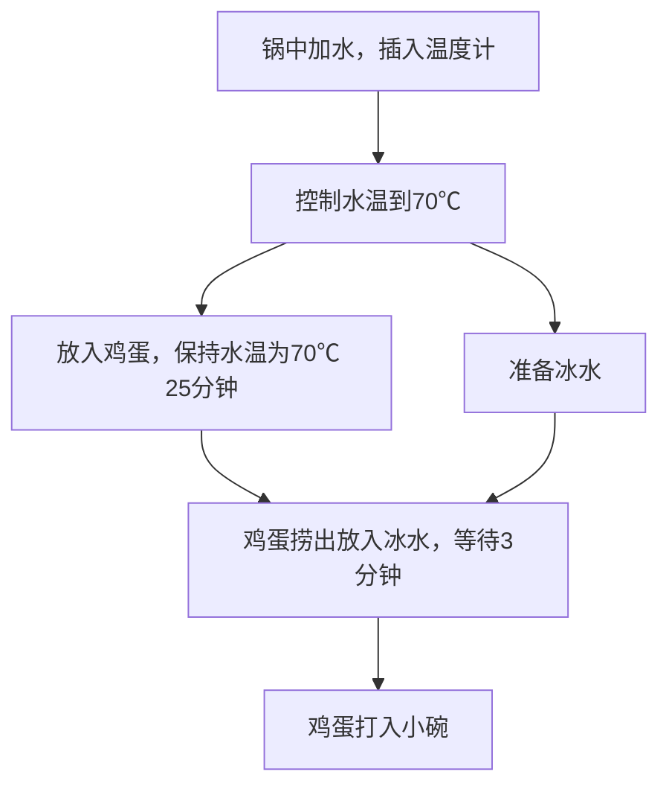

# 程序员做饭指南 · 早餐（25 道）

> 本文件由 scripts/merge_library.py 自动生成；菜谱原文来自
> Anduin2017/HowToCook，内容一字未改（仅去除 HTML 编辑注释）。
> 单菜提取命令见 SKILL.md 第 3 步。

<!-- dish:吐司果酱 -->
# 吐司果酱的做法

这是一道极简快手早餐，烤至微脆的吐司夹入甜香果酱，外脆内软，方便随身携带，属于典型的便捷西式简餐。主要提供碳水化合物和糖分，能快速补充晨间能量。操作几乎零门槛，非常适合不擅烹饪的忙碌新手。从准备到完成只需大约 2 分钟，无需开火，也几乎不用清洗厨具。

预估烹饪难度：★

预估卡路里：223 大卡

## 必备原料和工具

- 新鲜吐司
- 果酱
- 面包机

## 计算

- 吐司两片
- 果酱足够涂满一面吐司的量

## 操作

1. 将吐司放入面包机
2. 设置好档位，时间到了会自动弹出
3. 两分钟后吐司加热完成弹出
4. 先取出一片吐司，涂满果酱再盖上另一片吐司即可
5. 用餐巾纸包一下可以边走边吃也可以吃完再出门

两分钟快速搞定，操作很简单，味道十分美味，十分适合程序员。耗时短，不会产生额外垃圾，也不需要清洗工具什么的。

## 附加内容

面包机一般不会超过一百块，吐司去楼下超市或美团买菜送上门，一般一包十块钱八片，保质期比较短，很干净卫生。

如果您遵循本指南的制作流程而发现有问题或可以改进的流程，请提出 Issue 或 Pull request 。
<!-- /dish -->

<!-- dish:微波炉荷包蛋 -->
# 微波炉荷包蛋的做法

微波炉荷包蛋是一道便捷的家常快手菜，蛋白嫩滑、蛋黄软糯，带有芝麻油的清香。鸡蛋富含优质蛋白质和卵磷脂。做法极其简单，新手也能轻松掌握，从准备到出锅仅需约 2 分钟。

预估烹饪难度：★

预估卡路里：169 大卡

## 必备原料和工具

- 鸡蛋
- 芝麻油
- 盐

## 计算

每次制作前需要确定计划做几份。一份正好够 1 个人早饭佐餐。

每份：

- 鸡蛋 2 个
- 饮用水 35ml
- 芝麻油 3ml
- 盐 0.8g

## 操作

1. 将鸡蛋打入小碗中，用筷子在所有鸡蛋黄上扎 2 个洞，避免加热弄脏微波炉
2. 然后向碗内倒入常温饮用水
3. 再向碗内倒入食用盐
4. 最后加入芝麻油
5. 将放好材料的碗放入微波炉中，高火加热 80 秒
6. 到达设定时间后，使用抹布垫着手取出成品

## 附加内容

- 微波炉加热前，如果想进一步避免蛋黄和蛋白溅射，可以在碗上盖个盖子避免弄脏微波炉

如果您遵循本指南的制作流程而发现有问题或可以改进的流程，请提出 Issue 或 Pull request 。
<!-- /dish -->

<!-- dish:微波炉蒸蛋 -->
# 微波炉蒸蛋的做法

一道用微波炉快速制作的嫩滑蒸蛋，口感细腻如布丁，属于家常快手菜。富含优质蛋白，易于消化吸收，很适合作为早餐或轻食。制作非常简单，新手也能轻松上手，全程约 10 分钟即可完成。

预估烹饪难度：★

预估卡路里：151 大卡

## 必备原料和工具

- 鸡蛋
- 温水或高汤
- 食盐
- 生抽（可选）
- 香油
- 耐热碗
- 保鲜膜或微波炉专用盖

## 计算

- 鸡蛋 2 个（约 100g 蛋液）
- 温水或高汤 100-120ml（蛋液体积的 1.0-1.2 倍）
- 食盐 1g
- 生抽 2ml（可选）
- 香油 几滴（出锅用）

使用上述条件，计算出计划使用的原材料比例。

## 操作

1. 将鸡蛋打散，加入温水/高汤、盐、生抽，轻轻搅匀，尽量不要起泡。
2. 将蛋液过筛倒入耐热碗中，表面若有气泡可用牙签轻戳。
3. 覆盖保鲜膜并扎 8-10 个小孔，或使用微波炉专用盖（留缝隙）。
4. 放入微波炉中加热：

  - 700W：1 分 30 秒 → 视情况再加热 20-30 秒至表面刚凝。
  - 600W：约 1 分 40 秒–2 分 10 秒。
  - 800W：约 1 分 10 秒–1 分 40 秒。

5. 加热完成后取出静置 1 分钟，让余温使中心完全熟化。
6. 淋上香油，撒葱花即可食用。

> 不同功率和容器会影响时间，建议第一次尝试时少量多次加热，找到适合自己设备的最佳时长。

## 附加内容

- 水温应在 40–50℃ ，不宜过热。
- 蛋液与水比例控制在 1:1 至 1:1.2 之间口感最佳。
- 覆盖保鲜膜并扎孔能防止表面爆开或出现蜂窝。
- 过筛可显著提升细腻度。
- 若表面鼓泡或出水，说明加热过头，下次缩短时间即可。

如果您遵循本指南的制作流程而发现有问题或可以改进的流程，请提出 Issue 或 Pull request 。
<!-- /dish -->

<!-- dish:微波炉蛋糕 -->
# 微波炉蛋糕的做法

微波炉版的快手蛋糕，口感松软香甜，是一道零基础也能轻松上手的家庭甜点。以鸡蛋、面粉为基础，搭配黄油提供能量和浓郁香气，糖分快速补充体力，加入坚果或水果还能增加膳食纤维和维生素。仅需准备少数材料，借助微波炉高火一分钟即可完成，从备料到品尝最快仅需 2 分钟，新手约 20 分钟即可搞定。

预估烹饪难度：★

预估卡路里：308 大卡

## 必备原料和工具

- 微波炉
- 能放进微波炉的容器
- 黄油
- 面粉
- 泡打粉（不加吃着像饼）
- 鸡蛋

## 计算

- 鸡蛋🥚 1 个
- 面粉🍚 15g
- 泡打粉🍚 2.5g
- 白（红）糖🍬 10g
- 盐🧂 1g

（口味可选）

- 咖啡粉☕
- 巧克力🍫
- 麦片🍿
- 牛奶🥛
- 坚果🥜
- 饼干屑🍪
- 香蕉🍌
- 非黑暗料理🍆

## 操作

1. 加入以下食材，注意不要超过容器的 3/4

  - 挖半个鸡蛋大的黄油放进容器, 在微波炉**加热 15 秒**至融化
  - 将**巧克力/香蕉** 融化/搅碎成 **颗粒/糊状**
  - 打入一个鸡蛋并打散搅和
  - 15g 白（红）糖（甜党可以多加些） （见附 4）
  - 加入 1g 盐 (**如果后续的口味食材含盐需自己斟酌**)
  - 加入 2.5g 泡打粉
  - 加入 15g 面粉（筋度没太大影响）
  - **加入任何喜欢的口味食材!**（坚果与饼干等干食材不是现在放）
  - 搅和至看不见干粉的稠酸奶状
  - 加入可选的干燥食材（不包括冲泡粉）在顶端

2. 夸赞一下自己🥰
3. 微波炉（高火）加热 **1分钟** （至蓬松蛋糕形态）
4. 取出杯子（烫手啊啊啊啊↑）并拍朋友圈就可以吃了

## 附加内容

- 在夸赞自己之前的操作可以重复多遍做出更大的蛋糕
- 泡打粉用来让蛋糕更蓬松 大多不含铝 几块钱一包 可以买了在家备着
- 在 **加入任何喜欢的口味食材！** 这一步骤中 若加入**液体**（如牛奶） 请务必确保下一步可以搅和成**稠酸奶状** 建议少量多次加入以防止水分过量而导致成品湿瘪
- **食材不要超过容器的3/4!!**

如果您遵循本指南的制作流程而发现有问题或可以改进的流程，请提出 Issue 或 Pull request 。
<!-- /dish -->

<!-- dish:牛奶燕麦 -->
# 牛奶燕麦的做法

一份高蛋白、高纤维的便捷营养早餐，将牛奶的滑润、燕麦的谷香与煎蛋的嫩脆巧妙结合，入口温热柔和、易于消化，饱腹感强。制作过程简单直接，对新手极为友好，全程约三分钟即可完成，搭配蔬果更添清爽。

预估烹饪难度：★

预估卡路里：421 大卡

## 必备原料和工具

- 牛奶（巴氏奶口感更好）
- 燕麦
- 鸡蛋

## 计算

- 🥛 牛奶 280ml/per
- 🍳 鸡蛋 1 个/per
- 🍚 燕麦 40g/per

使用上述条件，计算出计划使用的原材料比例。

## 操作

### 燕麦烹饪常规方法

1. 将牛奶倒入早餐杯（冷的即可）
2. 准备好 200ml 水，如果是直饮水直接加入燕麦，否则请烧开后加入燕麦
3. 水沸后 2 分钟，燕麦煮好
4. 煮好的燕麦捞出倒入牛奶中（尽量不要将煮燕麦的水也倒入牛奶，影响口感）

### 燕麦烹饪快速方法

1. 将燕麦替换为快煮燕麦
2. 将牛奶倒入装有快煮燕麦的容器中并搅拌
3. 将混合物放入微波炉中
4. 中等火力微波 4 分钟

### 煎蛋烹饪方法

1. 热锅，锅内放一层底油，油热后煎鸡蛋，每面煎 20s，考虑调底味（3g 椒盐，可选）
2. 关火，装盘

烹饪基本 3 分钟 搞定，做完菜品都是常温，极易入口，一般每次 2 分钟吃完。

> 🥑 水果蔬菜，苏打饼干搭配食用更佳

## 附加内容

- 由于不同微波炉火力不同，故微波炉火力无法精确表明
- 不建议混合物超过容器容量 50%，否则加热过程中内容物极有可能溢出
- 不建议使用玻璃杯进行烹饪，理由同上

如果您遵循本指南的制作流程而发现有问题或可以改进的流程，请提出 Issue 或 Pull request 。
<!-- /dish -->

<!-- dish:空气炸锅面包片 -->
# 空气炸锅面包片的做法

空气炸锅面包片是一道极简快手的主食，外脆内软，麦香纯粹，特别适合减脂期食用。它富含膳食纤维和植物蛋白，能提供较长时间的饱腹感。做法毫无门槛，只需将面包片放入空气炸锅即可，对新手极其友好，从准备到完成仅需大约五分钟。

预估烹饪难度：★

预估卡路里：254 大卡

## 必备原料和工具

- 面包片
- 空气炸锅

## 计算

每份：

- 面包片（两片）

## 操作

1. 取出两片面包片（建议使用粗粮面包片）
2. 将面包片**垂直**放入空气炸锅
3. 200°C 烘烤 5 分钟
4. 取出即可使用

## 附加内容

营养成分表（数据基于全麦面包片）

- 热量 254 千卡
- 蛋白质 12.3 克
- 脂肪 3.5 克
- 碳水化合物 43.1 克
- 膳食纤维 6.0 克

如果您遵循本指南的制作流程而发现有问题或可以改进的流程，请提出 Issue 或 Pull request 。
<!-- /dish -->

<!-- dish:金枪鱼酱三明治 -->
# 金枪鱼酱三明治的做法

这道西式早餐三明治以水浸金枪鱼拌入蛋黄酱和俄式酸黄瓜汁，咸鲜微酸，口感绵密，配上烤脆的吐司格外饱腹。富含优质蛋白和 Omega-3 等营养，能快速补充能量。制作非常简单，只需混合酱料、用轻食机加热，新手也能在 5 分钟里轻松搞定。

预估烹饪难度：★

预估卡路里：569 大卡

## 必备原料和工具

- 水浸金枪鱼罐头（不建议用油浸，会很腻）
- 方形吐司片
- 蛋黄酱
- 俄式酸黄瓜汁
- 芝士片（可选）
- 火腿片（可选）
- 轻食机

## 计算

- 水浸金枪鱼 65g
- 方形吐司片 2 片
- 蛋黄酱 50 mL
- 俄式酸黄瓜汁 10-15mL（可根据个人口味调整）

## 操作

1. 将金枪鱼、蛋黄酱、俄式酸黄瓜汁倒入碗中，用勺子搅拌，保证将金枪鱼块搅碎，酱整体呈糊状，并备用
2. 将 1 片吐司放在轻食机上
3. 将做好的金枪鱼酱涂抹到吐司上，建议 10-15ml
4. 将另一片方形吐司片覆盖在上面，并按压轻食机，开机
5. 待轻食机自动停止加热，即可装盘使用

## 附加内容

- 金枪鱼酱可以在前一天晚上在冰箱冷藏
- 金枪鱼酱建议冷藏时间不超过一周，切需要使用保鲜膜盖住
- 注意在按压操作之前不要将轻食机电源接通，以免引发安全问题

如果您遵循本指南的制作流程而发现有问题或可以改进的流程，请提出 Issue 或 Pull request 。
<!-- /dish -->

<!-- dish:韩国麻药鸡蛋 -->
# 韩国麻药鸡蛋的做法

一道甜辣浓郁的韩式溏心蛋小菜，酱汁挂满蛋白，入口嫩滑，回味微辛。鸡蛋提供优质蛋白与卵磷脂，营养饱腹。做法极为简单，新手也能轻松上手，从煮蛋到冷藏入味大约需要一个半小时。

预估烹饪难度：★

预估卡路里：669 大卡

## 必备原料和工具

- 鸡蛋
- 韩式酱油（或生抽）
- 日式味淋
- 白糖
- 芝麻油
- 青葱
- 辣椒（小米辣或青红椒）

## 计算

每次制作前需要确定计划做几份。以下为一份酱汁的量，足以腌制 5 - 8 个鸡蛋。

每份：

- 鸡蛋 5 - 8 个
- 酱油（或生抽） 4 汤匙
- 清水 4 汤匙
- 味淋 2 汤匙
- 白糖 2 汤匙
- 芝麻油 5ml
- 青葱 15g（切葱花）
- 辣椒 15g（切圈）

## 操作

1. 烧一锅开水，水沸腾后放入鸡蛋，**煮 7 分钟**（得到完美的溏心蛋状态）。
2. 煮鸡蛋的期间调制酱汁：将 4 汤匙酱油、4 汤匙清水、2 汤匙味淋、2 汤匙白糖倒入小锅中。
3. 加热酱汁至沸腾，煮开以挥发掉味淋中的酒精味，随后关火放凉备用。
4. 将切好的辣椒圈加入放凉的酱汁中。
5. 将煮好的鸡蛋捞出，放入冰水中冷却后剥去蛋壳。
6. 将剥好的鸡蛋放入调好的酱汁中，表面淋上 5ml 芝麻油并撒上葱花。
7. 放入冰箱**冷藏等待 1 - 2 小时**，让鸡蛋充分入味。

## 附加内容

- 酱汁的比例可以根据个人口味微调。如果喜欢更甜，可以增加糖的用量。
- 剩余的酱汁非常美味，可以直接用来拌饭。

如果您遵循本指南的制作流程而发现有问题或可以改进的流程，请提出 Issue 或 Pull request 。
<!-- /dish -->

<!-- dish:太阳蛋 -->
# 太阳蛋的做法

太阳蛋是一道用微波炉快速制成的家常早餐。口感嫩滑，蛋清凝固、蛋黄微溏，属于典型的快手菜。鸡蛋富含优质蛋白和多种维生素，易于消化吸收。做法非常简单，对新手友好。使用可控火候微波炉只需 3 分钟就能完成，不可控火候的也仅需几分钟反复加热。

预估烹饪难度：★★

预估卡路里：113 大卡

## 必备原料和工具

- 鸡蛋
- 盐
- 油
- 分可控火候微波炉或不可控火候微波炉（定义和分辨方式请见附加内容）
- 筷子或牙签

## 计算

- 鸡蛋的用量为 1 个。
- 盐的用量为 1 g 每个鸡蛋。
- 油的用量为 5 mL 每个鸡蛋。

使用上述条件，计算出计划使用的原材料比例。

## 操作

### 可控火候微波炉

1. 准备一个小碗，倒入在上一步计算好的油，撒盐，搅拌均匀。倾斜碗使油沾在碗表面。
2. 取出一个鸡蛋，打入小碗。
3. 蛋黄表面戳孔。牙签戳 5 个或筷子戳 1 个。
4. 放入微波炉，中火 3 分钟。

### 不可控火候微波炉

1. 准备一个小碗，倒入在上一步计算好的油，撒盐，搅拌均匀。倾斜碗使油沾在碗表面。
2. 取出一个鸡蛋，打入小碗。
3. 蛋黄表面戳孔。牙签戳 5 个或筷子戳 1 个。
4. 放入微波炉，1 分钟。
5. while（太阳蛋 否 大面积成固体状） 用微波炉打(30s);

## 附加内容

while（太阳蛋的熟度 不符合 个人口味） 用微波炉打（1 分钟）;

- 不可控火候微波炉：
  - 定义： 即无法控制火候仅能控制时长的微波炉。
  - 辨别方法： 若在微波炉操作面板上无法找到小火，中火， 大火等字样即为不可控火候微波炉
- 可控火候微波炉：
  - 定义：即能控制火候又能控制时长的微波炉，
  - 辨别方法： 若在微波炉操作面板上能找到小火，中火，大火等字样即为可控火候微波炉

如果您遵循本指南的制作流程而发现有问题或可以改进的流程，请提出 Issue 或 Pull request 。
<!-- /dish -->

<!-- dish:完美水煮蛋 -->
# 完美水煮蛋的做法

这是一道通过科学家研发的循环水煮法制成的鸡蛋，蛋黄绵密细腻，蛋白均匀凝固，口感层次分明。它保留了更多营养素，多酚含量比传统煮法高 23%，蛋白质丰富。制作难度较高，需精准控温并反复转移，预计制作时长约 35 分钟。

预估烹饪难度：★★

预估卡路里：86 大卡

## 必备原料和工具

- 新鲜鸡蛋（推荐 AA 级）
- 100°C 沸水锅（直径≥ 15cm）
- 30°C 温水锅（直径≥ 15cm）
- 定时器
- 漏勺

## 计算

每份：

- 鸡蛋 1 个（约 60g ）
- 100°C 沸水 1500ml
- 30°C 温水 1500ml

## 操作

1. 准备两锅水： A 锅维持 100°C 沸水， B 锅维持 30°C 温水
2. 用漏勺将鸡蛋放入 A 锅，启动定时器
3. 精准**每 2 分钟**将鸡蛋转移至另一锅水
4. 重复转移操作共 16 次（总时长 32 分钟）
5. 最后一次转移后，在 B 锅静置 30 秒
6. 立即放入冰水（ 0 摄氏度）终止加热（维持 30 秒）
7. 剥壳时从钝端气室处开始，沿纵轴剥离蛋膜

## 附加内容

- 关键参数：
  - 蛋黄中心温度：67±1°C
  - 蛋白分层温度：
    - 外层：100°C→87°C
    - 中层：87°C→55°C
    - 内层：55°C→30°C
- 营养优势：多酚含量比传统煮法高 23%

如果您遵循本指南的制作流程而发现有问题或可以改进的流程，请提出 Issue 或 Pull request 。
<!-- /dish -->

<!-- dish:手抓饼 -->
# 手抓饼的做法

手抓饼外酥里软，层次分明，是深受喜爱的家常面点。饼皮用半烫面制作，柔韧有嚼劲，搭配鸡蛋和蔬菜，营养均衡。做法对新手很友好，从和面到出锅大约只需 40 分钟，非常适合忙碌的早晨。

预估烹饪难度：★★

预估卡路里：1050 大卡

---

## 必备原料和工具

- 普通面粉  
- 开水  
- 冷水  
- 食用油  
- 盐  
- 鸡蛋  
- 生菜  
- 火腿  
- 芝士片

---

## 计算

每次制作前需要确定计划做几份。一份正好够 1~2 人食用。

总量（按每份）：

- 面粉 200 克  
- 开水 100 毫升  
- 冷水 50 毫升  
- 食用油 15 毫升  
- 盐 3 克  
- 鸡蛋 1 个  
- 生菜 30 克  
- 火腿 30 克  
- 芝士片 1 片

---

## 操作

1. 面粉放入碗中，加入开水搅拌成絮状，再加入冷水揉成光滑面团，覆盖湿布静置 20 分钟。  
2. 面团分成每份约 100 克，搓圆，擀成薄片。  
3. 表面均匀涂抹食用油，撒上盐，卷成蜗牛状，松弛 10 分钟。  
4. 面团再次擀成薄饼，厚度均匀。  
5. 热锅中倒入油，小火煎至两面金黄起泡。  
6. 煎好的饼依次铺入煎蛋、生菜、火腿、芝士片等配料，卷起即可。

---

## 附加内容

- 使用开水与冷水混合和面，有助于提升饼皮柔韧度。  
- 面团醒发时间不宜少于 20 分钟，否则不易擀薄。  
- 可根据个人口味增减配料，建议配料总重控制在 100 克以内。  
- 剩余生饼皮可冷藏保存 24 小时，使用时回温擀平即可。

---

如果您遵循本指南的制作流程而发现有问题或可以改进的流程，请提出 Issue 或 Pull request 。
<!-- /dish -->

<!-- dish:桂圆红枣粥 -->
# 桂圆红枣粥的做法

一道甜香软糯的中式传统粥品。以糯米、红枣和桂圆同煮，自带甘甜，暖身暖胃。有补血安神、健脑益智、补养心脾的食养效果。做法非常友好，新手也能轻松掌握，从准备到粥香满屋大约需要 70 分钟。

预估烹饪难度：★★

预估卡路里：617 大卡

## 必备原料和工具

- 糯米（或大米）
- 红枣
- 桂圆

## 计算

每份：

- 糯米 100g
- 红枣 15 颗
- 桂圆 15 颗

## 操作

1. 将桂圆肉扒出，用清水洗两次，放入碗中浸泡 10 分钟
2. 红枣用清水洗两次，放入碗中浸泡 10 分钟
3. 糯米放入电饭锅中，清水淘米两次后，加入 2000ml 水
4. 将桂圆和红枣加入电饭锅
5. 打开电饭锅煮饭模式，1 小时后粥成

## 附加内容

对粥的稀稠程度有不同喜好的朋友可以酌情增加或减少水的用量，煮出来的粥是甜的，可以通过控制加入桂圆的数量控制甜度

如果您遵循本指南的制作流程而发现有问题或可以改进的流程，请提出 Issue 或 Pull request 。
<!-- /dish -->

<!-- dish:水煮玉米 -->
# 水煮玉米的做法

水煮玉米是一道家常快手菜，口感清甜软糯。新鲜玉米带皮煮制，保留原香，加入盐和糖更能提味。它富含膳食纤维、维生素与碳水化合物，能为身体提供饱足感。做法极其简单，新手也能轻松上手，从准备到上桌只需大约 15 分钟。

预估烹饪难度：★★

预估卡路里：108 大卡

## 必备原料和工具

- 新鲜玉米
- 放得下玉米的锅
- 水
- 盐
- 糖（可选）

## 计算

- 一个带皮玉米
- 淹过玉米约半节指头的水
- 煮玉米的时候，开始和淡盐水，差不多 2 克盐加 50ml 的水
- 根据口味选择加或者不加糖（可选）

## 操作

1. 将新鲜玉米剥去外皮，剩部分玉米皮入锅
2. 加入淹过玉米约半节指头的水，加盐和糖
3. 水煮开之后转至小火，加盖继续煮 15-20 分钟，玉米煮久点没事。
4. 煮熟后沥干水分，冷却后食用。

## 附加内容

如果您遵循本指南的制作流程而发现有问题或可以改进的流程，请提出 Issue 或 Pull request 。
<!-- /dish -->

<!-- dish:煎饺 -->
# 煎饺的做法

煎饺是一道底部金黄酥脆、内馅鲜嫩多汁的家常面点，常见于北方餐桌。搭配速冻水饺制作，富含碳水化合物和蛋白质，简单快手。预估难度二星，对新手非常友好，总共约需 15 分钟就能端上桌。

预估烹饪难度：★★

预估卡路里：769 大卡

## 必备原料和工具

- 饺子（速冻水饺）
- 芝麻、葱花（切段）或其他配料

## 计算

每份：

- 饺子一包 （根据个人食量选择， 约 10 - 15 个）

## 操作

1. 取出平底锅（不沾平底锅最佳）
2. 加入 10ml - 15 ml 食用油
3. 开火，放入饺子（尽量平均铺开，不宜堆叠）
4. 立刻加入清水，水线没过饺子平均高度的 1/2
5. 盖上锅盖（此时炉灶应该处于大火）
6. 等待 8 - 10 分钟
7. 当锅中水分仅剩 2mm 时， 转中火开始煎制
8. 当水分全部蒸发后，摇晃平底锅使饺子受热均匀
9. 放入黑芝麻和葱花再焖 10s
10. 1 - 2 分钟夹出一个饺子观察底部，若出现金黄色脆皮立即取出

## 附加内容

- 操作时，需时刻观察锅内情况，切记不可分神玩手机。

如果您遵循本指南的制作流程而发现有问题或可以改进的流程，请提出 Issue 或 Pull request 。
<!-- /dish -->

<!-- dish:燕麦鸡蛋饼 -->
# 燕麦鸡蛋饼的做法

燕麦鸡蛋饼是一道快手营养早餐，口感软嫩，带有燕麦的谷物香气与蛋奶的醇厚，属于家常简约风格。富含蛋白质、碳水化合物和膳食纤维，能为身体提供充足能量，尤其适合健身人士和工作日早晨。做法简单，对新手友好，从备料到出锅通常只需十几分钟。

预估烹饪难度：★★

预估卡路里：535 大卡

## 必备原料和工具

- 鸡蛋
- 燕麦
- 牛奶 50-100g，能够将燕麦搅拌粘稠即可
- 可根据口味选择增加 50g 蔬菜，如菠菜。

## 计算

- 鸡蛋两个，亦可选择两个蛋清，一个蛋黄。
- 纯干燕麦片 50g （大约等同一个鸡蛋的量）
- 牛奶一盒 约 250ml
- 蔬菜碎叶一把

## 操作

1. 将牛奶与干燕麦混合搅拌均匀至黏稠状。
2. 将鸡蛋搅拌均匀至颜色单一程度。
3. 将鸡蛋液倒入燕麦牛奶中继续搅拌至黏稠、均匀。
4. 平底锅中加入一层黄油并覆盖均匀。
5. 下入搅拌好的食材，并摊开至饼状。
6. 小火加热两到三分钟。如想要加入蔬菜，可以在加热过程中加入碎菜叶。
7. 翻面继续加热两分钟。
8. 出锅，搭配剩下的牛奶作为早餐。

## 附加内容

- 如果口味偏咸口，可以在搅拌鸡蛋液时加入盐，胡椒等调料。
- 煎饼时使用小火，避免燕麦部分煎糊。

### 营养成分

一份上述早餐的预估营养价值（三大营养素）如下，供热爱健身人群参考*。

- 碳水化合物：39g
- 蛋白质：30g
- 脂肪：19g
- 总热量：450kcal

*： 牛奶按照常见的 250ml 计算

如果您遵循本指南的制作流程而发现有问题或可以改进的流程，请提出 Issue 或 Pull request 。
<!-- /dish -->

<!-- dish:美式炒蛋 -->
# 美式炒蛋的做法

这是一道松软鲜嫩的美式家常蛋料理，加入牛奶后蛋花细密、口感绵润，富含优质蛋白和钙质。做法简单，对新手友好，从准备到出锅大约只需 20 分钟。

预估烹饪难度：★★

预估卡路里：258 大卡

## 必备原料和工具

- 鸡蛋
- 全脂牛奶/奶油
- 黄油
- 盐

## 计算

每份：

- 鸡蛋 3 个
- 全脂牛奶/奶油 10g
- 黄油 5 克
- 盐 1 克

## 操作

1. 鸡蛋打入大碗中，加盐搅打至起泡，静置 15 分钟
2. 黄油切小块入锅，倒入蛋液，开小火不断搅拌
3. 黄油一融化，就快速翻动蛋液，将其打碎成细密状，在蛋液大体凝固前关火
4. 加入牛奶搅拌 15 秒，至炒蛋湿润绵密，装盘

## 附加内容

- 想吃的更丰富可以在最后一步那里加上炒好的番茄丁，洋葱丁，培根丁，切好的芝士小丁，等等。(总之不会再出水的东东）
- 使用平底锅（不粘锅）。
- 考虑到很多人是一人食就炒一两个鸡蛋，口径比较小的锅或许更方便在锅中均匀搅拌。

如果您遵循本指南的制作流程而发现有问题或可以改进的流程，请提出 Issue 或 Pull request 。
<!-- /dish -->

<!-- dish:蒸水蛋 -->
# 蒸水蛋的做法

这是一道以滑嫩如布丁的口感和清雅鲜美的风味见长的家常菜，南北通吃，北方常亲切地称其为“鸡蛋糕儿”。鸡蛋富含优质蛋白和卵磷脂，是日常补充营养的便捷之选。做法只需掌握蛋水比例和小火慢蒸的诀窍，对新手非常友好，从准备到出锅通常 大约 15 分钟就能完成。

预估烹饪难度：★★

预估卡路里：143 大卡

## 必备原料和工具

- 新鲜鸡蛋
- 热水
- 锡纸或保鲜膜

## 计算

- 鸡蛋两只
- 盐 2g
- 热水 260ml

## 操作

1. 鸡蛋打入碗中，打散
2. 取其他容器，倒入 1.5 倍（半个蛋壳为 0.5 倍水）于蛋液的温水（温度 20~30），将盐倒入水中化开
3. 将盐水倒入鸡蛋液中，顺时针或逆时针单方向搅拌均匀，气泡之类的可以用舀出丢弃，过筛则口感更加。
4. 使用锡纸包裹盛蛋液的碗（或用盘子盖住），置入提前带盖并加入大约 3cm 深度水的锅中
5. 中火烧至水开，转最小的火继续蒸 4 分钟

## 附加内容

- 一般出锅稍晾即可食用，保留鸡蛋原香的终极口感
- 也可加入蒸鱼豉油，葱花香油作为佐料。

如果您遵循本指南的制作流程而发现有问题或可以改进的流程，请提出 Issue 或 Pull request 。
<!-- /dish -->

<!-- dish:蒸花卷 -->
# 蒸花卷的做法

这是一道北方传统面食，松软可口，带着淡淡麦香。使用冷冻花卷蒸制，能快速补充碳水化合物和膳食纤维。做法极其简单，烹饪新手也能轻松掌握，全程仅需半小时，是理想的快手早餐。

预估烹饪难度：★★

预估卡路里：400 大卡

## 必备原料和工具

- 冷冻花卷
- 圆碟子
- 蒸架
- 水 400ml

## 计算

- 冷冻花卷 5 个（女生分量 3 个即可）（可以在超市、各种买菜平台购买）
- 圆碟子，直径 28cm
- 蒸架，直径 20cm
- 水 400ml

## 操作

1. 从花卷的包装袋中取出 5 个花卷
2. 把花卷平铺在碟子上，尽量不用重叠
3. 往锅里倒入 400ml 水，把蒸架放里面，把装花卷的碟子放在蒸架上，盖上锅盖。
4. 开大火加热，直至水沸腾。
5. 转中火加热 15 分钟
6. 开盖用手感受花卷的表面温度，如果不够热，就继续盖上盖子加热，否则就可以关火出锅。
7. 碟子取出放凉至 50 度即可食用

## 附加内容

- 操作时，需要注意观察锅里的水不能少于 50ml。

如果您遵循本指南的制作流程而发现有问题或可以改进的流程，请提出 Issue 或 Pull request 。
<!-- /dish -->

<!-- dish:蛋煎糍粑 -->
# 蛋煎糍粑的做法

一道简单快手的小吃，外皮微酥，内里软糯，裹着蛋香与甜味，是南方家常风味。糍粑提供丰富碳水，鸡蛋补充蛋白质，热量较高但很顶饱。制作过程极其简单，新手也能轻松驾驭，全程仅需大约十 分钟。

预估烹饪难度：★★

预估卡路里：379 大卡

## 必备原料和工具

- 鸡蛋
- 糍粑
- 白糖或红糖

## 计算

每份：

- 糍粑 两块
- 红糖 10g （建议 8g - 15g 之间）
- 鸡蛋 1 个
- 食用油 10-15ml
- 食用盐 2g

## 操作

1. 把糍粑切成长方形小块，便于后面煎
2. 碗里打入一个鸡蛋并把鸡蛋搅碎，加入 2g 食用盐
3. 将切好的小糍粑依此放入搅碎的鸡蛋里面，涂抹完糍粑双面为止
4. 锅里倒入植物油 10ml ，把涂抹好的糍粑小块放进去小火慢慢煎软。
5. 将剩下的鸡蛋液慢慢倒在糍粑表面
6. 用筷子或者勺子为糍粑翻面，来回煎至金黄色后开吃

## 附加内容

- 放糍粑进去时候注意把糍粑间隔开来，防止粘在一起
- 鸡蛋的量根据糍粑的量而定
- 糖的量根据个人喜好

- [蛋煎糍粑教程](https://www.dachu.co/recipe/378826)

如果您遵循本指南的制作流程而发现有问题或可以改进的流程，请提出 Issue 或 Pull request 。
<!-- /dish -->

<!-- dish:鸡蛋三明治 -->
# 鸡蛋三明治的做法

这是一道简单快手的西式简餐，吐司夹着绵密的鸡蛋酱和咸香培根，口感软嫩又带着焦香。鸡蛋富含优质蛋白，搭配培根和黄油能快速补充能量。操作非常友好，厨房新手也能轻松驾驭，全程只需 大约 10 分钟即可完成。

预估烹饪难度：★★

预估卡路里：560 大卡

## 必备原料和工具

- 鸡蛋
- 吐司
- 培根
- 黄油
- 蛋黄酱
- 盐
- 黑胡椒

## 计算

- 鸡蛋 1 个
- 吐司 2 片
- 培根 2 片
- 黄油 10 g
- 蛋黄酱 20g
- 盐 1g
- 黑胡椒 2g

## 操作

1. 吐司切去四边，备用
2. 鸡蛋煮熟，捣碎
3. 混合鸡蛋、蛋黄酱、盐、黑胡椒
4. 锅中加入黄油，煎熟培根
5. 组装吐司，在两片吐司间加入制作好的鸡蛋酱及培根
6. 四边形吐司切成三角形装盘

## 附加内容

- 也可加入芝士、酸黄瓜等食材

如果您遵循本指南的制作流程而发现有问题或可以改进的流程，请提出 Issue 或 Pull request 。
<!-- /dish -->

<!-- dish:意式香肠北非蛋 -->
# 意式香肠北非蛋的做法

意式香肠北非蛋是一道浓郁鲜香的地中海风味料理，溏心蛋卧在酸甜的番茄肉酱里，搭配脆面包蘸食，口感丰富。主要食材提供优质蛋白质，番茄、甜椒和洋葱带来维生素与膳食纤维。制作不难，只需注意焖蛋火候，全程约 30 分钟即可上桌。

预估烹饪难度：★★★

预估卡路里：668 大卡

## 必备原料和工具

- 意式猪肉香肠（去肠衣）、辣香肠 (Chorizo) 或切块的午餐肉
- 百味来 (Barilla) 拿坡里意面酱 (Napoletana Sauce)
- 鸡蛋
- 甜椒（青椒或红椒皆可）
- 洋葱
- 橄榄油
- 帕马森干酪（可选）
- 新鲜欧芹（可选）
- 干辣椒碎（可选）
- 面包（推荐酸面团面包 Sourdough、恰巴塔 Ciabatta 或厚切吐司）
- 宽口平底锅（带锅盖）

## 计算

每次制作前需要确定计划做几份。一份正好够 2 个人吃。

每份：

- 肉类（香肠/午餐肉）：100g - 150g
- 百味来拿坡里意面酱：1 罐（400g，提供基本的番茄、洋葱和香草风味）
- 鸡蛋：3 - 4 个
- 甜椒：半个（切细丝）
- 洋葱：半个（切小丁）
- 橄榄油：10ml - 15ml（用于炒菜）

## 操作

1. 将意式猪肉香肠去肠衣备用；洋葱切小丁；甜椒切细丝。
2. 在宽口平底锅中倒入 10ml - 15ml 橄榄油，中火加热。
3. 放入处理好的香肠或午餐肉，翻炒至边缘金黄酥脆（如果使用生香肠，翻炒时用勺子将其捣碎变色）。
4. 将洋葱丁和甜椒丝加入锅中与肉一起翻炒，持续翻炒 4 - 5 分钟，直到蔬菜变软，洋葱呈半透明状。
5. 倒入百味来拿坡里意面酱，搅拌均匀。将火调至中低火，保持微沸炖煮 2 - 3 分钟。（如果酱汁看起来太稠，可以加入 15ml 水）。
6. 用勺子的背面在锅内的酱汁中挖出 3 - 4 个小“坑”。
7. 依次小心地将鸡蛋打入每个坑中。
8. 盖上平底锅的盖子，利用蒸汽焖熟蛋白。等待 3 - 5 分钟。**注意：请频繁检查状态**。当蛋白变得不透明且凝固，但轻轻摇晃平底锅时蛋黄仍能晃动（溏心状态）时即可结束这一步。
9. 关火。根据个人喜好撒上磨碎的帕马森干酪、新鲜欧芹或干辣椒碎。
10. 将平底锅直接端上桌，配以硬壳面包蘸取蛋黄与酱汁食用。

## 附加内容

- **肉类选择建议：**
  - **意式香肠**：最能体现正宗风味（推荐寻找配料中含有小茴香籽/Fennel seeds 的香肠）。
  - **午餐肉**：带来咸香、怀旧的口感，并且表面能煎得微脆。
  - **辣香肠 (Chorizo)**：若喜欢烟熏、辛辣的口感，并且能将底油染成诱人的红色，这是最好的选择。

如果您遵循本指南的制作流程而发现有问题或可以改进的流程，请提出 Issue 或 Pull request 。
<!-- /dish -->

<!-- dish:温泉蛋 -->
# 温泉蛋的做法

温泉蛋源自日本，蛋白呈半流动凝乳状，蛋黄却温润凝固，口感滑嫩细腻，与溏心蛋恰好相反。鸡蛋富含优质蛋白、卵磷脂和多种维生素，营养十分全面。制作时需要借助温度计将水温控制在 70℃，虽然对温度稍有要求，但步骤简单，耐心等待约半小时便能完成。佐以昆布酱油和葱花，鲜香清爽，是一道轻松上手的小食。

预估烹饪难度：★★★

预估卡路里：72 大卡

## 必备原料和工具

### 主食材

- 鸡蛋

### 必备工具

- 厨房用温度计（尽量选用带有夹子的温度计）
- 杯子（无特定要求，只要是杯子就行）

### 副食材

额外用作点缀的食材，可选

- 昆布酱油（一种日式的少盐酱油，用于为温泉蛋调味）
- 香葱

## 计算

- 鸡蛋的用量为 1 个，按照您的食量和锅的大小计算。

## 操作

### 煮蛋

1. 在锅中盛装一定量自来水，确保水面没过约鸡蛋 3cm，水中插入温度计
2. 开火或打开电磁炉，逐渐调整电磁炉功率或火苗大小，使得水温保持在 **70 摄氏度**
3. 将鸡蛋放入锅中。鸡蛋不可互相堆叠，应皆在底部，并留有空间可以晃动
4. 保持当前温度 **25 分钟**
5. 准备一杯冰水
6. 捞出鸡蛋，并立刻放入冰水中，**等待 3 分钟**
7. 将鸡蛋打入小碗，完成制作

## 附加内容

### 流程图解

### 备注说明

- 若使用机械式温度计（无需供电）则温度计探头需没入水中至少 6cm，若使用电子温度计则无特殊要求
- 锅可以采用稍厚的锅，方便控制温度
- 虽然 70 摄氏度 25 分钟已经完全可以杀死沙门氏菌，但还是要尽量少吃，或购买正规可生食鸡蛋制作

如果您遵循本指南的制作流程而发现有问题或可以改进的流程，请提出 Issue 或 Pull request 。
<!-- /dish -->

<!-- dish:溏心蛋 -->
# 溏心蛋的做法

这是一道用普通电锅就能轻松做出的家常蛋料理，蛋黄呈现流动的溏心状态，口感嫩滑香醇。每颗鸡蛋提供约 6 克优质蛋白质，尤其适合健身人群补充营养。制作过程简单明了，只要掌握好加热和静置的时间，新手也能快速上手，全程仅需 大约 15 分钟。

预估烹饪难度：★★★

预估卡路里：72 大卡

## 必备原料和工具

- 鸡蛋
- 电锅
- 水
- 秒表（可选）

## 计算

- 鸡蛋 1 颗或更多（只要您的电锅装得下，不管有几颗鸡蛋都可以）
- 淹过鸡蛋约 2 公分的冷水

## 操作

1. 将鸡蛋放入电锅中。鸡蛋不可互相堆叠，应皆在底部，并留有空间可以晃动
2. 倒入淹过鸡蛋约 2 公分的冷水
3. 开盖，使用最大功率加热至水滚起（大约 85 - 95 度，稍微滚动，不需完全沸腾）
4. 关火，盖上盖子，让鸡蛋静置。

  - 想要中央有流动的蛋黄，需静置 6 分钟
  - 若想要完全煮熟的易碎蛋黄，需静置 10 分钟

5. 沥干水分，用冷水冲洗鸡蛋约 1 分钟，即可去壳食用。

## 附加内容

如果觉得鸡蛋不够熟的小伙伴可以依照自己的喜好添加更多的水。

**警告** 溏心蛋有沙门氏菌感染的风险。不建议静置 5 分钟以内。

如果您遵循本指南的制作流程而发现有问题或可以改进的流程，请提出 Issue 或 Pull request 。
<!-- /dish -->

<!-- dish:苏格兰蛋 -->
# 苏格兰蛋的做法

这道简易版苏格兰蛋外层酥脆，内里糖心软嫩，融合了芝士的奶香和培根的烟熏风味，是一道源自英式做法的创意小吃。鸡蛋提供优质蛋白质，芝士补充钙质，搭配手抓饼皮能满足一餐的能量需求。制作过程不复杂，新手也能轻松上手，从准备到出锅大约只需 20 至 30 分钟。

预估烹饪难度：★★★

预估卡路里：599 大卡

## 必备原料和工具

- 鸡蛋
- 手抓饼皮
- 芝士
- 培根
- 空气炸锅或者油锅

## 计算

> 一份量

- 鸡蛋 50g（约 1 颗）
- 手抓饼 1 份-2 份（看鸡蛋大小）
- 芝士片 1-2 片
- 培根片 1-2 片

## 操作

1. 用冷水下锅水开 3 分钟后捞出
2. 鸡蛋捞出，放入冰水中剥壳更快速也更完整
3. 用芝士片包裹鸡蛋
4. 培根片包裹鸡蛋
5. 手抓饼两端切除以矩形包裹鸡蛋
6. 油温 6 成下锅（油面波动，有青烟，筷子插入油中周围泛起气泡即是 6 成温度） 炸制金黄即可
7. 空气炸锅 160 度 15 分钟
8. 切开即可食用

## 附加内容

- 芝士片、培根片、手抓饼直接淘宝购买即可

如果您遵循本指南的制作流程而发现有问题或可以改进的流程，请提出 Issue 或 Pull request 。
<!-- /dish -->

<!-- dish:茶叶蛋 -->
# 茶叶蛋的做法

这道传统小吃茶香浓郁，鲜香可口，富含优质蛋白质，是快捷的营养早餐之选。制作步骤清晰，难度适中，新手需要留意火候与香料配比，约 30 分钟即可完成，一次能做够 2-3 人食用，适合周末从容备好。

预估烹饪难度：★★★

预估卡路里：193 大卡

## 必备原料和工具

- 鸡蛋
- 八角
- 香叶
- 桂皮
- 茴香
- 冰糖
- 红茶
- 生抽
- 老抽
- 食盐

## 计算

- 鸡蛋 400g（约 8 颗）
- 八角 4g（约 2 颗）
- 香叶 0.5-1g（约 2 片）
- 桂皮 3g（1 小块）
- 茴香 5g
- 冰糖 15g
- 红茶 20g
- 生抽 15g
- 老抽 25g
- 食盐 3g

使用上述条件，计算出计划使用的原材料比例。

## 操作

1. 用冷水将鸡蛋煮熟，大火大约 8 分钟（根据自家厨具决定）
2. 鸡蛋捞出，过冷水
3. 将鸡蛋互相碰撞，使每个鸡蛋产生裂缝
4. 将鸡蛋下锅，放入八角，香叶，桂皮，茴香，冰糖，红茶，生抽，老抽，食盐
5. 加水直至没过鸡蛋
6. 大火煮开之后，转中小火煮 15 分钟

> 中火煮15 分钟之后，捞出料渣，鸡蛋再浸泡一会口感更佳

## 附加内容

- 鸡蛋捞出过冷水是为了让鸡蛋和壳之间产生间隙
- 食盐可根据个人口味选择不加
- 八角，香叶，桂皮，茴香，冰糖，自己没有这么多食材可以买现成的卤料包
- 常规做法的卤汁渗透速度慢，内部味道容易偏淡。想入味更快、切面更好看：**剥壳** → 在蛋白侧面**划 3–11 刀**（上下十字方向，接近蛋黄即可，别太深以免蛋黄散出）→ 放入小容器，卤汁**没过鸡蛋** → 浸泡 **2 天以上**

如果您遵循本指南的制作流程而发现有问题或可以改进的流程，请提出 Issue 或 Pull request 。
<!-- /dish -->

